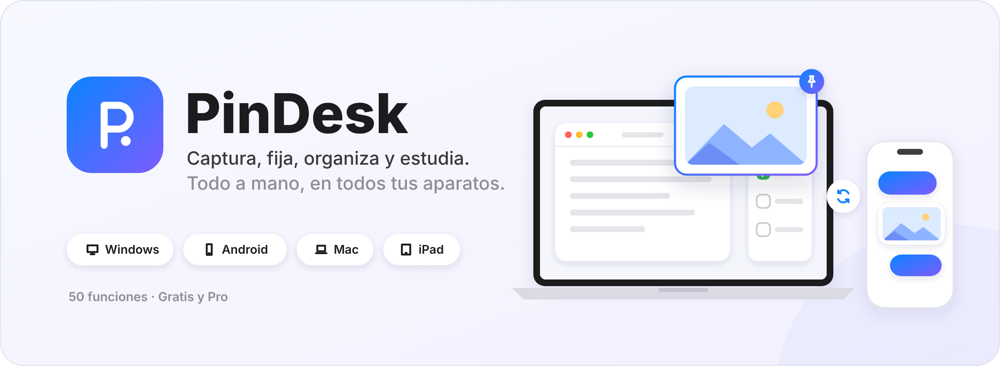
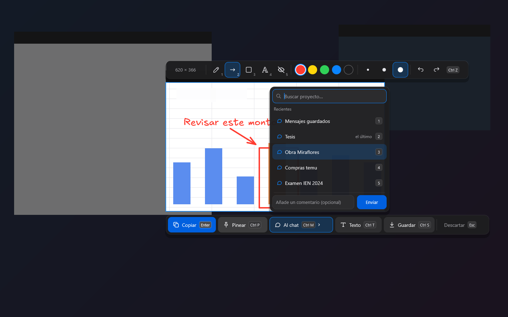
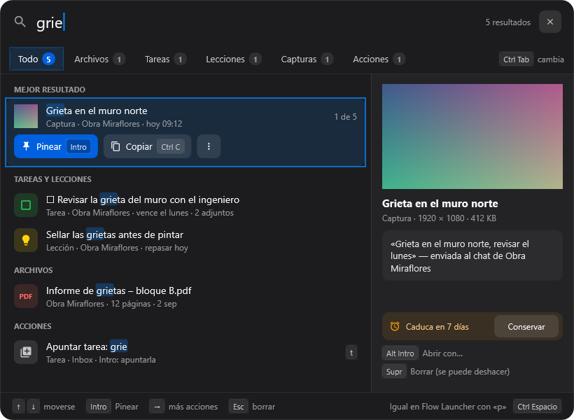
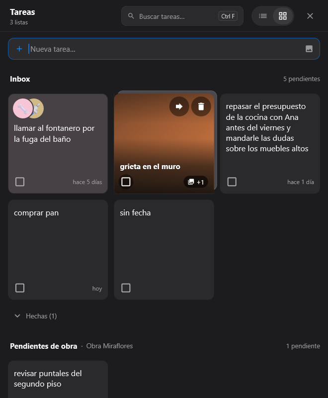
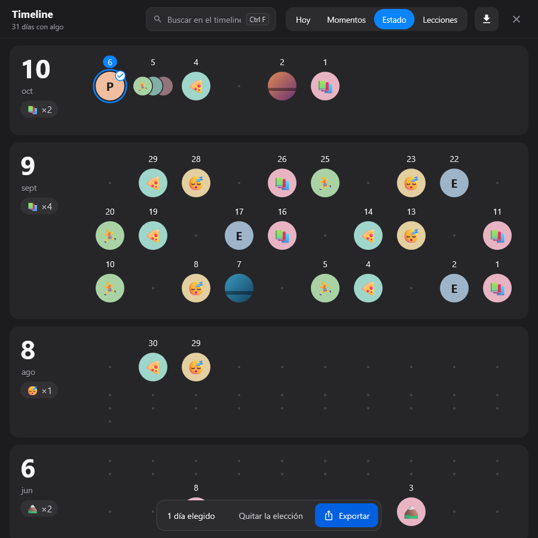
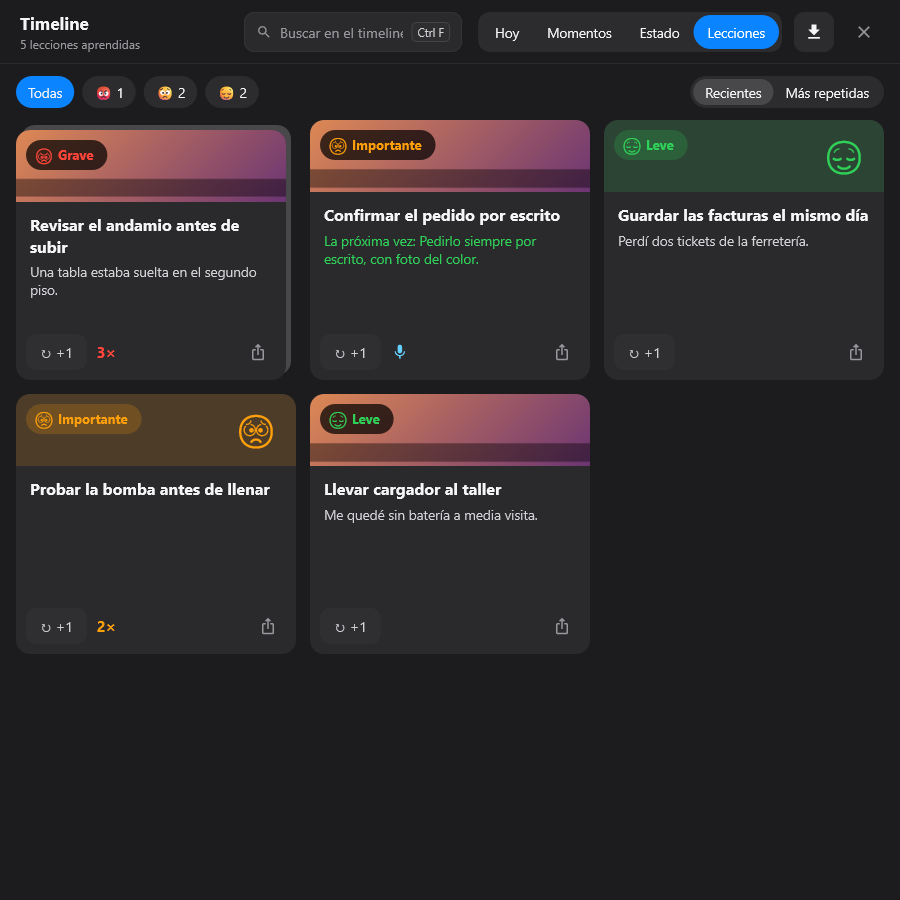
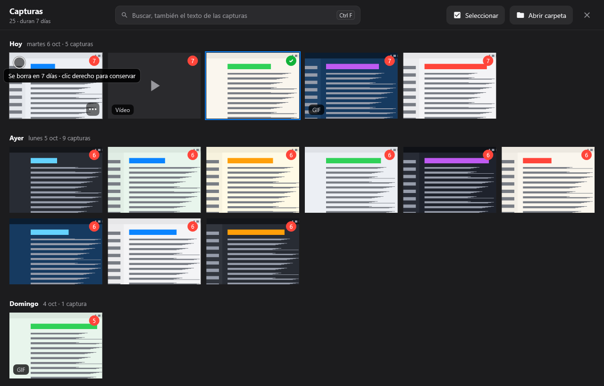
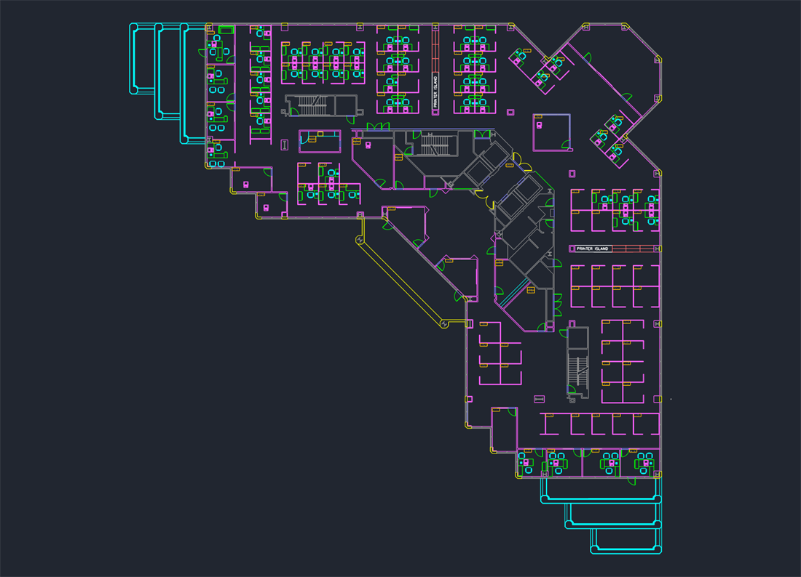
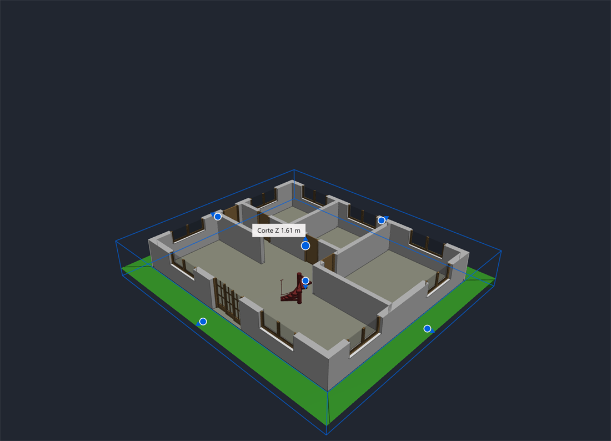

  

  
  
  
  

  <b>Captura</b> · <b>Pines flotantes</b> · <b>Chats por proyecto</b> · <b>Lienzo</b> · <b>Tareas y horario</b> · <b>Timeline y lecciones</b> · <b>Lector de PDF y Office</b> · <b>Plantillas</b>

  <a href="https://github.com/1xmanMAX/PINDESK-/releases/latest">Todas las versiones</a> ·
  <a href="docs/instalar.md">Cómo instalar</a> ·
  <a href="wiki/Inicio.md"><b>Wiki</b></a> ·
  <a href="docs/funciones.md">Guía de funciones</a> ·
  <a href="docs/planes.md">Gratis y Pro</a> ·
  <a href="docs/preguntas.md">Preguntas frecuentes</a> ·
  <a href="en/README.md">English</a>

---

**PinDesk** es una app para tener a mano todo lo que ves, apuntas y estudias. Captura la pantalla,
deja cualquier cosa flotando **siempre encima** de tus ventanas (una foto, un vídeo, un PDF, una
lista de tareas), dibuja encima y guárdalo todo ordenado en **proyectos con forma de chat**, como
los que ya usas en el móvil.

Está pensada para estudiantes, profesionales y cualquiera que trabaje con muchas cosas abiertas a
la vez. Arranca al instante y va fluida incluso en equipos modestos.

> [!TIP]
> **¿Primera vez?** Descarga el ZIP, haz clic derecho → **Extraer todo** y abre **`Instalar.cmd`**
> desde la carpeta extraída. Lo tienes paso a paso en [Instalar en Windows](docs/instalar.md).

## Descargar

| Plataforma | Estado | Enlace |
|---|---|---|
| 🪟 **Windows 10 (21H2 o posterior) y 11** | Disponible | [**Descargar PinDesk para Windows (ZIP)**](https://github.com/1xmanMAX/PINDESK-/releases/latest/download/PinDesk-Windows-x64.zip) |
| 🤖 **Android** | Próximamente | Se publicará en esta misma página |
| 💻 **Mac** | Próximamente | Se publicará en esta misma página |
| 📱 **iPad** | Próximamente | Se publicará en esta misma página |

Las notas de cada versión están en [Releases](https://github.com/1xmanMAX/PINDESK-/releases/latest)
y el resumen de cambios en el [CHANGELOG](CHANGELOG.md).

## ¿Qué puedo hacer con PinDesk?

Dicho fácil:

| | Quiero… | Con PinDesk… |
|:-:|---|---|
| 📸 | Guardar algo que veo en la pantalla | Pulso `Ctrl Alt X`, elijo la zona y listo: la copio, la dejo flotando o la mando a un proyecto. |
| 📌 | Tener algo siempre a la vista | Lo «pineo»: una foto, un vídeo, un PDF o una lista se queda encima de todas las ventanas. |
| 💬 | Ordenar mis cosas por temas | Cada proyecto es un chat: notas, fotos, audios y documentos, juntos y con su fecha. |
| ✏️ | Marcar o explicar algo | Dibujo encima con lápiz, flechas, recuadros y texto, o abro un lienzo en blanco. |
| ✅ | No olvidar lo pendiente | Escribo «llamar al banco urgente mañana 9» y queda una tarea con su urgencia y su aviso. |
| 🎓 | Llegar a tiempo a clase | Apunto mi horario y antes de cada clase PinDesk me avisa, con la nota de voz que me dejé. |
| 🕒 | Recordar qué pasó hoy | El timeline guarda mi día minuto a minuto, con voz, texto o foto. |
| 💡 | No repetir el mismo error | Lo convierto en una lección aprendida y PinDesk me la recuerda a su tiempo. |
| 📖 | Leer un PDF o un Word mientras trabajo | Se abre pequeño, como un pin, al lado de lo que hago, o a pantalla completa con `F11`. |
| 📊 | Abrir Word, Excel y PowerPoint al instante | Se ven al momento, sin esperar a que se abra Office. |
| 🗓️ | Hacerme un planificador o un diario | Con **PinDesk Plantillas** lo armo por bloques y lo saco a PDF o a imagen. |
| 📱 | Tenerlo también en el móvil | Se sincroniza por Wi‑Fi con mis otros aparatos (y por la nube con Pro). |
| 📐 | Ver un plano de AutoCAD o un modelo de Revit *(Pro)* | Lo abro sin tener AutoCAD ni Revit: mido, marco, anoto e imprimo. |
| 🎙️ | Grabar una clase o una reunión *(Pro)* | Graba el audio, la pantalla y las fotos que tomo, y lo pasa a texto. |
| 🤖 | Pedirle cosas a una IA *(Pro)* | El chat «Asistente» lee mis documentos, apunta tareas y dibuja en el lienzo. |

## Un vistazo

| Capturar y anotar sin abrir otra ventana | Buscar en todo PinDesk |
|---|---|
|  |  |
| **Tareas en tarjetas** | **Timeline: cada día con sus emoticonos** |
|  |  |
| **Lecciones aprendidas** | **Galería de capturas que caducan** |
|  |  |
| **Planos de AutoCAD, sin AutoCAD** *(Pro)* | **Modelos 3D, cortados por donde quieras** *(Pro)* |
|  |  |

## Gratis y Pro

Para usar PinDesk necesitas **iniciar sesión con tu cuenta de Google**. Con eso ya tienes el plan
gratuito, sin fecha de caducidad.

| | Gratis | Pro |
|---|:-:|:-:|
| Captura, pines flotantes, chats por proyecto y lienzo | ✅ | ✅ |
| Tareas, horario de clases, timeline y lecciones | ✅ | ✅ |
| Lector de PDF, Word, Excel y PowerPoint, con anotaciones | ✅ | ✅ |
| Notas de voz y paso a texto en tu propio equipo | ✅ | ✅ |
| Sincronizar por Wi‑Fi entre tus aparatos | ✅ | ✅ |
| PinDesk Plantillas (sin IA) | ✅ | ✅ |
| Sincronizar por la nube, desde donde estés | — | ✅ |
| Asistente con IA, urgencia de tareas con Jev, resúmenes de transcripciones y Plantillas con IA | — | ✅ |
| Planos CAD, comentarios avanzados con minichat, grabar clase o reunión y exportar a HTML interactivo | — | ✅ |

**PinDesk Pro** se ofrece como plan **mensual**, **anual** o **de por vida**, y cada uno vale para
**hasta 3 aparatos** con la misma cuenta. Se paga con tarjeta o PayPal desde cualquier país y, en
Perú, también con Yape o tarjetas locales. **Precios: próximamente.**

Todo el detalle está en [Planes: Gratis y Pro](docs/planes.md).

## Documentación

- 📥 [Instalar en Windows](docs/instalar.md): paso a paso, actualizar, desinstalar y problemas comunes.
- 📚 [**Wiki de PinDesk**](wiki/Inicio.md): las 50 funciones, numeradas y en siete partes, cada una con
  su ilustración, su paso a paso y sus fortalezas, y [lo de cada plataforma](wiki/Plataformas.md)
  (Windows, Android, Mac, iPad e iPhone).
  - [I · Capturar y fijar](wiki/Parte-1-Capturar-y-fijar.md) · [II · Organizar](wiki/Parte-2-Organizar.md) ·
    [III · Crear](wiki/Parte-3-Crear.md) · [IV · Leer, escuchar y estudiar](wiki/Parte-4-Leer-escuchar-y-estudiar.md) ·
    [V · Inteligencia artificial](wiki/Parte-5-Inteligencia-artificial.md) · [VI · Conectar](wiki/Parte-6-Conectar.md) ·
    [VII · Tu cuenta](wiki/Parte-7-Tu-cuenta.md)
- 📘 [Guía de funciones](docs/funciones.md): cada parte de PinDesk explicada con calma.
- 💳 [Planes: Gratis y Pro](docs/planes.md): qué incluye cada uno, cómo comprar y cómo gestionar tus aparatos.
- ❓ [Preguntas frecuentes](docs/preguntas.md).
- 🔒 [Política de privacidad](docs/privacidad.md) · [Privacy policy](en/privacy.md)
- 📄 [Términos de uso](docs/terminos.md) · [Terms of use](en/terms.md)

## Requisitos

- **Windows 10 versión 21H2 o posterior, o Windows 11**, de 64 bits.
- Una cuenta de Google para iniciar sesión.
- Conexión a internet para iniciar sesión, para las funciones Pro en la nube y para descargar los
  modelos de voz opcionales. Lo demás funciona sin conexión.
- No hace falta un equipo potente: PinDesk está pensada para ir bien en ordenadores modestos.

## ¿Algo no va o se te ocurre una mejora?

Cuéntalo en [Issues](https://github.com/1xmanMAX/PINDESK-/issues/new/choose): hay un formulario para
**informar de un fallo** y otro para **proponer una función**. Para asuntos privados (tu cuenta, un
pago o tus datos), escribe a **max.antony.8.5.1@gmail.com**.

---

  PinDesk es una app de Max Anthony Mamani Maquera. Su uso se rige por los <a href="docs/terminos.md">Términos de uso</a>. 
  Hasta noviembre de 2026 se llamaba PixPin Max. No está afiliada a PixPin ni a DepthPixel.

