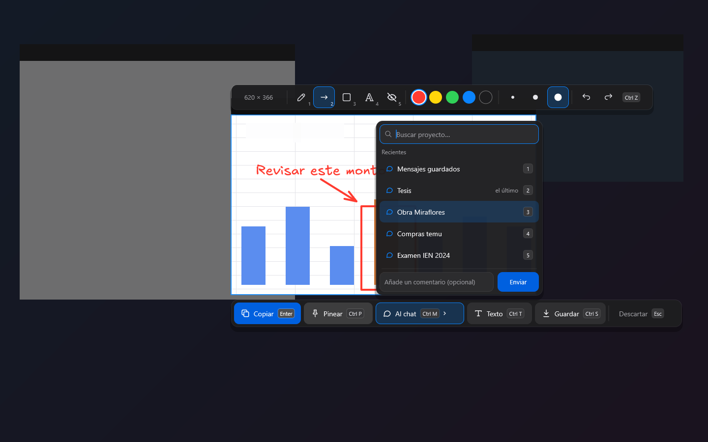
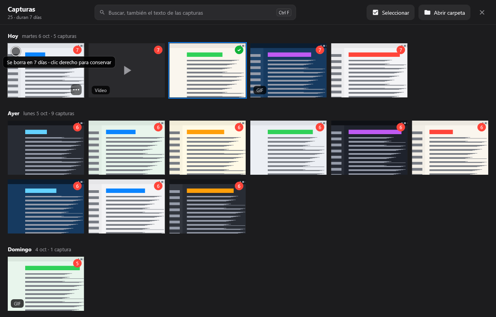
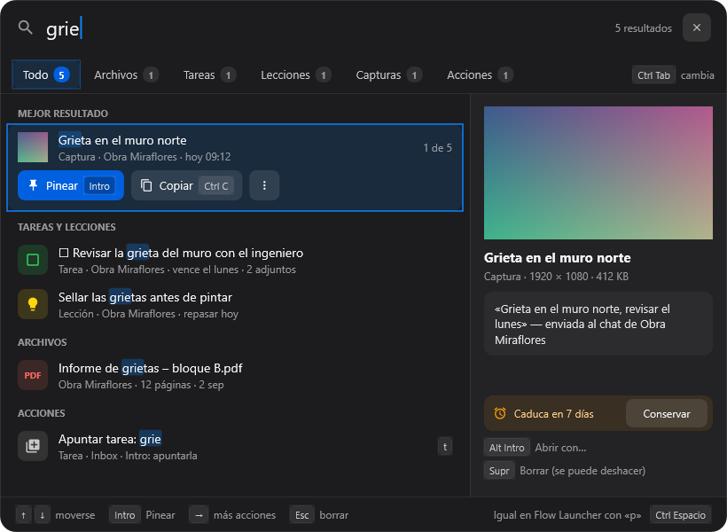
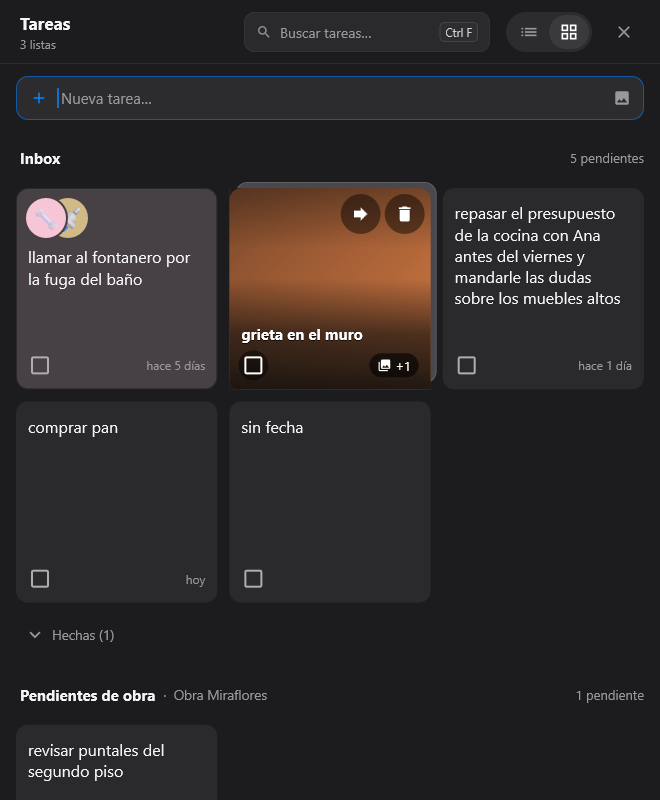
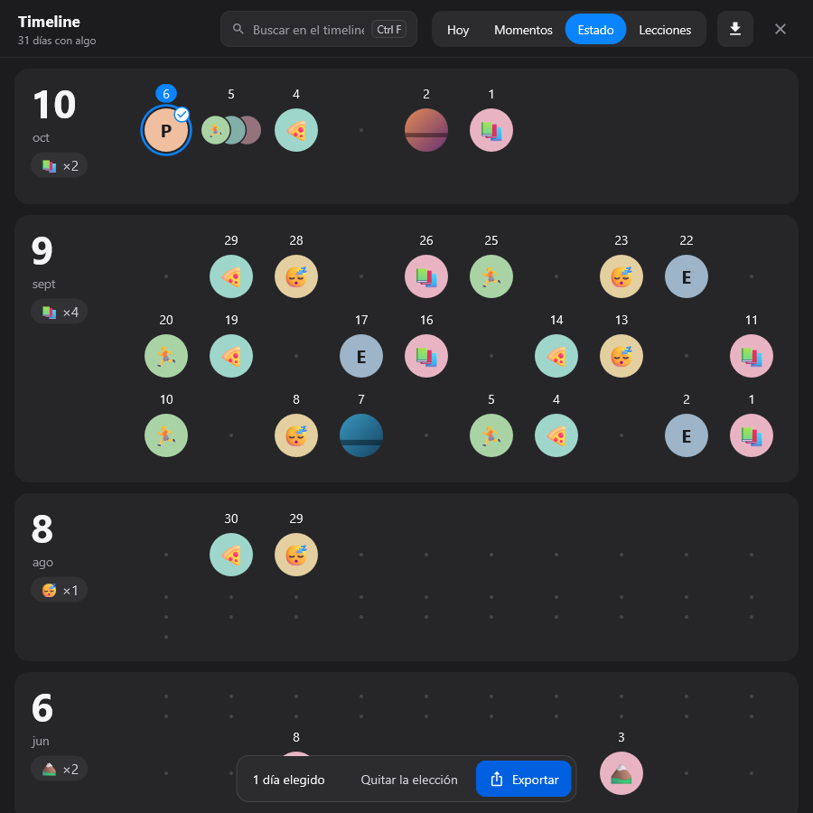
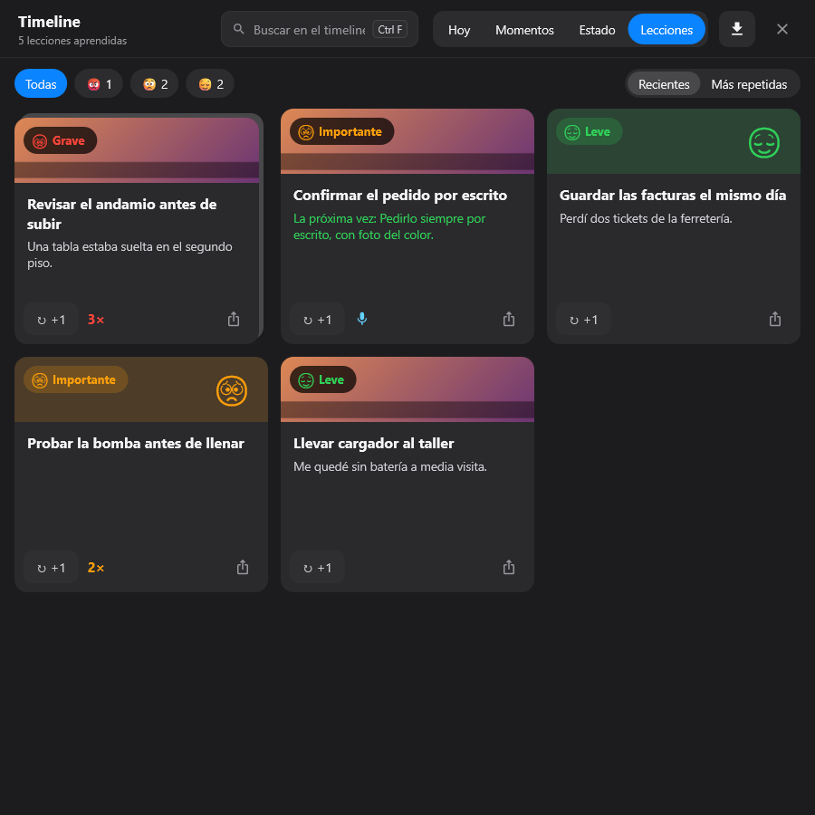
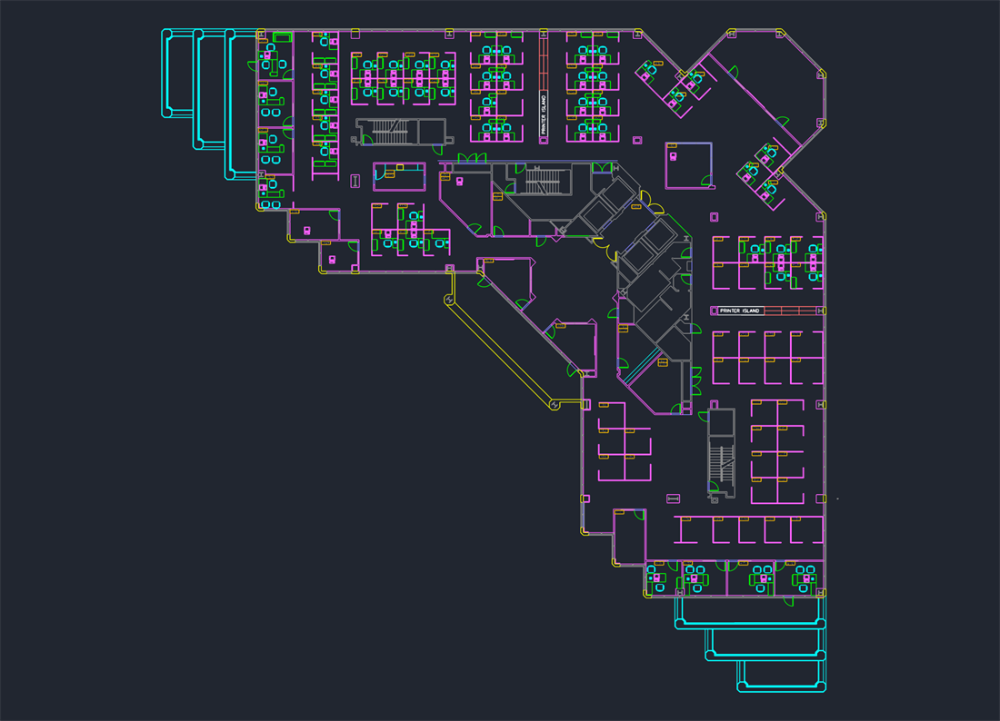
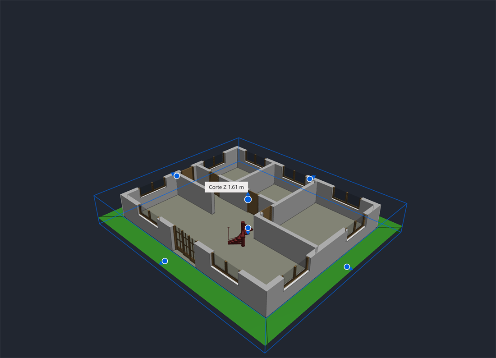
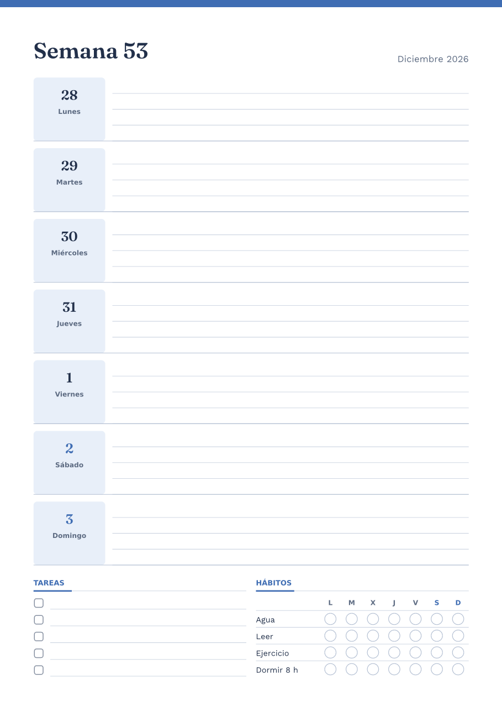
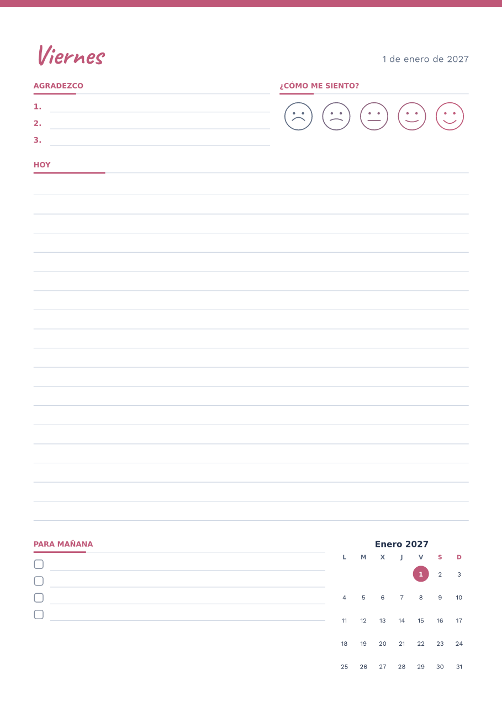

# Guía de funciones de PinDesk

[← Volver al inicio](../README.md)

Esta guía explica, parte por parte, qué hace PinDesk y cómo se usa. No hace falta leerla entera:
salta a lo que te interese. Lo que es de **PinDesk Pro** lleva la marca **⭐ Pro**; todo lo demás
está en el plan gratuito (ver [Planes](planes.md)).

Las capturas son de PinDesk para Windows. En Android, Mac e iPad las funciones son las mismas y
cambia solo lo propio de cada aparato (por ejemplo, el dedo o el lápiz en lugar del ratón).

## Contenido

1. [Captura](#1-captura)
2. [Pines flotantes](#2-pines-flotantes)
3. [Chats y proyectos](#3-chats-y-proyectos)
4. [El lienzo](#4-el-lienzo)
5. [Tareas y asignaturas](#5-tareas-y-asignaturas)
6. [Horario de clases](#6-horario-de-clases)
7. [Timeline y lecciones](#7-timeline-y-lecciones)
8. [Lector de PDF y Office](#8-lector-de-pdf-y-office)
9. [Planos y modelos 3D](#9-planos-y-modelos-3d) ⭐ Pro
10. [Comentarios](#10-comentarios)
11. [Grabar clase o reunión](#11-grabar-clase-o-reunión) ⭐ Pro
12. [Sincronizar](#12-sincronizar)
13. [PinDesk Plantillas](#13-pindesk-plantillas)
14. [Asistente con IA](#14-asistente-con-ia) ⭐ Pro
15. [Flow Launcher](#15-flow-launcher)
16. [Accesos y atajos](#16-accesos-y-atajos)

---

## 1. Captura

Pulsa **`Ctrl Alt X`** (o el botón **Capturar** de la bandeja) y elige qué quieres capturar. Abajo
aparece una barra con cada modo y su letra, así que no hace falta memorizar nada.



**Modos**

| Letra | Modo | Para qué |
|:-:|---|---|
| `Z` | Zona | Arrastra un rectángulo con el ratón. |
| `V` | Ventana | Resalta la ventana bajo el ratón, con su nombre. |
| `P` | Pantalla | La pantalla entera. |
| `S` | Con scroll | Una página larga, bajando sola. |
| `G` | Grabar GIF | Un vídeo corto de una zona. |
| `L` | Pin en vivo | Una ventanita que copia esa zona en tiempo real. |
| `T` | Texto | Lee el texto de la zona y lo copia. |

**Ayudas al elegir**: puedes teclear medidas exactas (ancho × alto), usar proporciones **16:9,
4:3 o 1:1** y repetir la última zona con `R`. La **lupa** enseña el color bajo el ratón en HEX y
RGB; `C` lo copia.

**Después de elegir**

- **Copiar** (`Enter`): al portapapeles.
- **Pinear** (`Ctrl P`): se queda flotando encima de todo.
- **Al chat** (`Ctrl M`): elige el proyecto en un paso, con buscador y las teclas 1–6.
- **Texto** (`Ctrl T`): el texto de la imagen, listo para pegar.
- **Guardar** (`Ctrl S`): a la galería de capturas.

Antes de decidir, puedes **anotar encima** sin abrir otra ventana: lápiz, flecha, rectángulo, texto
y mosaico para tapar datos (teclas `1`–`5`), con colores, grosores y deshacer.

**Gestos con Alt**, en cualquier sitio de Windows: `Alt` + arrastrar con el botón izquierdo copia
una zona, con el derecho la pinea y con el central saca un pin en vivo. `Alt` + doble clic central
abre el anotador de pantalla.

**Galería de capturas**. Las capturas guardadas **se borran solas a los 7 días** (pasan a la
papelera, de donde se recuperan), salvo las que decides **conservar**. Cada una dice en rojo cuántos
días le quedan, y el buscador encuentra también **el texto que hay dentro** de cada captura.



## 2. Pines flotantes

Un **pin** es una ventanita que se queda **siempre encima** de las demás. Se puede pinear casi
cualquier cosa: una captura, una foto, un vídeo, un PDF, una nota, una lista de tareas, una
herramienta (contador, ruleta, cronómetro, gastos…) o un **pin en vivo**, que copia una zona de la
pantalla en tiempo real.

- **La misma barra en todos**: al pasar el ratón aparece arriba. Primero el control propio del pin
  (zoom, página del PDF, reproducir el vídeo…), después **Copiar**, **Anotar** y **Más**; cerrar va
  aparte.
- **Moverlo y cambiarlo de tamaño**: arrástralo; la rueda lo agranda o lo achica, y `Ctrl 0` lo
  devuelve a su tamaño original.
- **Transparencia**: `Mayús` + rueda, del 20 al 100 %.
- **Dejar pasar el clic** (`Ctrl T`): el pin se ve pero no estorba; los clics van a la ventana de
  debajo.
- **Alinear**: al moverlo salen guías azules y un imán suave para dejarlo junto a otros.
- **Pin en vivo**: marca su zona con un recuadro azul (que no sale en las capturas). Se pausa con
  doble clic y, con el botón del ratón de su barra, puedes hacer clic en la zona original desde el
  propio pin.
- **Pines abiertos**: una lista de todos tus pines, agrupados por color, para encontrar los
  ocultos. `Ctrl 2` los oculta o los muestra todos de golpe.
- **Llevarlo a otra app**: `Ctrl` + arrastrar el pin a WhatsApp, al correo o a una carpeta.

## 3. Chats y proyectos

Cada **proyecto es un chat**, como los del móvil. Mandas lo que sea y queda guardado con su fecha,
sin tener que decidir antes en qué carpeta va.

- **Qué puedes mandar**: notas, fotos (varias a la vez, cada una con su descripción), vídeos,
  notas de voz, documentos, PDF, tablas, listas de tareas y lienzos. El botón de **adjuntar** abre
  una cuadrícula con buscador y las teclas `1`–`8`.
- **Chats fijos**: «Mensajes guardados» para lo tuyo, «Asistente» para la IA y «Asignaturas» para
  todo lo de tus clases.
- **Menú de cada mensaje**: copiar, responder (`R`), escuchar en voz alta, pinear (`P`), cambiar el
  nombre (`F2`), anotar (`A`), reenviar (`F`), compartir o convertirlo en lección (`L`). Encima, las
  etiquetas rápidas ⭐ ✅ ⏳ 💡 💰 📍.
- **Buscar en todos los chats**: lo que escribes en el buscador de la lista encuentra chats por su
  nombre y, debajo, **mensajes de cualquier chat**, con pestañas para quedarte solo con fotos,
  vídeos, archivos, enlaces, voz o dibujos. Da igual si escribes con o sin tildes.
- **Funciones**: el interruptor **Chat · Funciones** de arriba cambia la lista de chats por una
  rejilla con lo más usado: Grabar reunión, Nuevo lienzo, Tareas, Timeline, Horario, Capturas y
  Figuras.
- **Chats compartidos**: con el «+» de la lista eliges **Chat normal** (solo tú y tus aparatos) o
  **Chat compartido** (con otras personas). En uno compartido tus mensajes van a la derecha y los de
  los demás a la izquierda, como en cualquier mensajería, y puedes invitar a varias personas con un
  código o un QR.
- **Buscar en todo PinDesk**: una ventana que encuentra archivos, tareas, lecciones, capturas y
  acciones a la vez, con vista previa. Todo se maneja con el teclado.



- **Abrir archivos con PinDesk**: si la eliges como app predeterminada, las fotos, vídeos, audios y
  documentos se abren en una ventanita flotante en un instante. En el Explorador, elige archivos y
  pulsa **Espacio** para verlos en PinDesk; otro Espacio los cierra.
- **Compartir y arrastrar**: al exportar algo sale una ventanita encima de todo con cada archivo
  como una tarjeta, para **arrastrarlo** a cualquier app, copiarlo o abrirlo. Una foto con
  anotaciones sale siempre con el dibujo incluido.

## 4. El lienzo

Un lienzo es una hoja infinita para dibujar, explicar o calcular. Se crea desde el «+» del chat o
desde **Funciones → Nuevo lienzo**, y vive dentro de su proyecto.

- **Barra agrupada**: cada grupo enseña su última herramienta y despliega las demás.
- **Tinta**: lápiz, grafito, resaltador, goma y bote de relleno.
- **Figuras y texto**: rectángulos, flechas, líneas y texto sin caja, con ocho tipos de letra
  incluidos (también letra «a mano»).
- **Construir y medir**: recortar y extender líneas, soldar vértices, puntos con letra, cotas,
  escala gráfica y ángulos con su letra griega (`W`).
- **Señalar y tapar**: pasos numerados, foco, lupa, pixelar o desenfocar, puntero láser y
  marcadores.
- **Gráficas y tablas**, también pegadas desde Excel o Google Sheets.
- **Zona al chat**: manda un trozo del lienzo al chat, con un enlace para volver a él.
- **Biblioteca de figuras**: guarda tus figuras para reutilizarlas (ahí aparecen también tus
  plantillas, ver [Plantillas](#13-pindesk-plantillas)).
- **Imprimir y exportar** a PNG, JPG, SVG o PDF. ⭐ Pro: **exportar a una página web interactiva**,
  un solo archivo que se abre en cualquier navegador y en el que quien la recibe puede volver a
  anotar.

## 5. Tareas y asignaturas

**Tareas** reúne en una sola ventana las listas de todos tus proyectos. Se ven en **tarjetas**
(`Ctrl T`), en **Kanban** (`Ctrl K`) o en el **horario** de la semana (`Ctrl H`).



- **Inbox**: lo que apuntas rápido entra aquí, y **Mover a…** lo lleva a la lista que toque.
- **Se entiende lo que escribes**: «#casa llamar al banco urgente 18/10 17:00» queda con el título
  limpio, la etiqueta `#casa`, la urgencia y el aviso a esa hora.
  - **Urgencia**: normal, **urgente** o **muy urgente**. Las palabras que la marcan («urgente»,
    «importante», «!», «!!»…) se cambian en **Ajustes → Tareas**. ⭐ Pro: **Jev** propone la
    urgencia de cada tarea leyendo lo que dice, sin que tengas que escribir esas palabras.
  - **Aviso**: «18/10 17:00», «18 oct 5pm», «el 20 a las 9», «mañana 7», «viernes 15:30»… o con el
    reloj de la caja de apuntar.
- **Fotos en las tareas**: pega una imagen con `Ctrl V`; en las tarjetas la foto es el fondo.
- **Pin de una tarea**: una tarea con hora puede quedarse flotando como un pin pequeño, con un botón
  «¿Por qué no ahora?» para apuntar el motivo.
- **Kanban**: una columna por lista; arrastra una tarjeta a otra columna para cambiarla de lista.

**Asignaturas.** Cada asignatura de tu [horario](#6-horario-de-clases) es también **una lista de
tareas**: aparece entre las listas de Tareas y puedes apuntarle deberes directamente. Además, todo
lo de tus clases (apuntes, fotos de la pizarra, grabaciones) se reúne en el chat **Asignaturas**,
agrupado por asignatura. Si quitas una asignatura del horario, sus tareas **no se borran**.

## 6. Horario de clases

El horario es la tercera vista de Tareas (`Ctrl H`, o **Funciones → Horario**): un **calendario
semanal** con tus clases.

1. A la izquierda apunta tus asignaturas, por ejemplo «Geometría @A-12» (la @ es el aula).
2. **Arrástralas** a la rejilla de la semana. Cada clase se mueve y se alarga con el ratón, en
   saltos de 15 minutos.
3. Antes de cada clase sale una **llamada** en pantalla. **Contestar** reproduce la nota de voz que
   te dejaste para esa clase («trae la calculadora»).
4. Las **evaluaciones** avisan 3 días y 1 día antes.

Las tareas con hora de la semana salen como chapitas en su día. Si conectas tu **Google Calendar**
(solo lectura), tus eventos también aparecen en el horario.

## 7. Timeline y lecciones

**Timeline**: apunta lo que pasa **en el momento**, con la voz, escribiendo o con una foto. Es tan
rápido como un chat, pero se ve como una línea de tiempo.

- **Hoy** (las últimas 24 horas), **Momentos** (el archivo, día a día) y **Estado** (cada mes con
  los emoticonos que usaste) son tres formas de ver lo mismo.
- Al pulsar un momento se abre como una **historia**, con su foto de fondo y su nota de voz.
- **Compartir como imagen**: cada momento sale como una tarjeta lista para mandar.
- **Exportar** a PDF lo que estás viendo o los días que elijas. ⭐ Pro: exportar a una **página web
  interactiva** con las fotos y los audios dentro.



**Lecciones aprendidas**: viven como una pestaña más del timeline. La bombilla 💡 de cualquier
momento (o «Hacer lección» en el menú de un mensaje) lo convierte en lección.



- **Gravedad** con emoticono y color: 😌 leve, 😟 importante, 😡 grave.
- **«Me volvió a pasar»** suma una vez más; puedes ver primero las más repetidas.
- **Repaso espaciado**: PinDesk te las recuerda a su tiempo. En el repaso, `1` lo recordaba, `2` a
  medias y `3` lo olvidé; así sabe cuándo volver a enseñártela.

## 8. Lector de PDF y Office

Los **PDF, Word, EPUB, Markdown y páginas web** se abren **pequeños, como un pin**, para leer al lado
de lo que haces, o a pantalla completa con `F11` (`Esc` vuelve).

- **Barra de arriba**: nombre y página, índice de capítulos, **escuchar en voz alta**, más opciones,
  pantalla completa y «siempre encima».
- **Riel de la derecha**, igual en todos los visores: 🔖 marcadores con su zoom (`Ctrl M`), ✏️
  anotar a mano (`A`) y ⛶ marcos numerados para imprimir solo esas partes (`I`; `Ctrl P` los
  imprime).
- **Word, Excel y PowerPoint al instante**: PinDesk los dibuja sin abrir Office, con sus páginas,
  tablas, imágenes y colores. Excel muestra pestañas, formatos, gráficos y hojas enormes sin esperar;
  PowerPoint se presenta a pantalla completa con `F5`.
- **Archivos antiguos** (`.doc`, `.ppt`, RTF, OpenDocument): se ven al momento con la vista previa
  de Office y, si tienes Office instalado, PinDesk los convierte una vez para que puedas anotarlos
  como los demás.
- **Lo anotado viaja**: la tinta, los marcadores y los marcos se sincronizan con tus otros aparatos.
- **PDF en el chat**: un PDF entra como un solo mensaje y sus páginas se anotan como lienzos, con
  búsqueda, marcadores y lectura seguida.

## 9. Planos y modelos 3D

⭐ **Pro**

**Planos de AutoCAD (DWG y DXF)**, sin tener AutoCAD. Se abren al momento, como un pin.



- **Moverse**: la rueda acerca hacia donde apunta el ratón, arrastrar mueve el plano y doble clic (o
  `F`) lo enseña entero.
- **Medir** (`M`): la regla se engancha sola a esquinas, centros, cualquier punto de una línea y la
  perpendicular.
- **Marcos** (`I`) para imprimir solo las partes que eliges, cada una en su hoja (`Ctrl P`).
- **Anotar** (`A`) encima del plano; lo anotado se guarda y sale al imprimir.
- Los textos con letras de AutoCAD se ven bien aunque no lo tengas instalado, con ñ, tildes, ° y Ø.

**Modelos 3D de Revit e IFC**, sin tener Revit.



- **Girar** arrastrando con el botón izquierdo, **mover** con el derecho, **acercar** con la rueda.
- **¿Qué es esto?**: un clic en una pieza dice qué es, en qué planta está, su **volumen** y su
  **área**. Otro clic la **aísla**; `Esc` vuelve a todo.
- **Caja de sección** (`C`): una caja con un tirador en cada cara para cortar el modelo por donde
  quieras.
- **Niveles y categorías** (`L`): oculta o muestra plantas, muros, losas, vigas…
- Abre proyectos de **Revit 2023 a 2025**.

**Terrenos y carreteras de Civil 3D**: archivos LandXML y de puntos se ven en 3D con colores por
altura y curvas de nivel, con sus ejes, perfiles, tuberías y parcelas.

## 10. Comentarios

En las notas puedes dejar **comentarios** sobre el texto, como en un documento compartido.

⭐ **Pro: comentarios avanzados con minichat.** Pega una **pegatina** en cualquier punto de un
documento, un plano, una imagen o un lienzo. Hay cuatro tipos: 🔴 urgente, 🟠 alta, 🟡 media y 💬
nota.

- Cada pegatina tiene su **minichat**: escribe, adjunta una foto o un archivo, o enlaza un mensaje
  del chat o una figura de un lienzo.
- Una imagen del minichat se abre en el lienzo para **anotar encima**.
- Cuando está resuelta, márcala como **resuelta** (y reábrela si hace falta). De una urgencia puedes
  **crear una tarea** con un clic.
- Las pegatinas y sus conversaciones viajan con el documento a tus otros aparatos.

## 11. Grabar clase o reunión

⭐ **Pro**

Desde **Funciones → Grabar reunión**. Una sola grabadora que sirve para una clase en persona, una
clase por pantalla o una reunión.

1. **Preparar**: elige si empiezas grabando la pantalla, el micrófono y el sonido del equipo, el
   chat donde se guardará y, si quieres, los **temas** que vas a tratar.
2. **La barra de grabación**: el reloj **● 12:34** pausa o sigue con un clic, y **mantenerlo
   pulsado termina** y guarda. Al lado: **Foto** con la cámara, **Captura** de la pantalla,
   **Pantalla** para encender o apagar el vídeo (el audio sigue siempre) y **Clip** de cámara.
3. **Pantalla completa** (⛶): arriba los controles en grande, en medio tu lista de temas y abajo
   **la transcripción en vivo**, frase a frase.

Al terminar, el audio, el vídeo, las capturas y el texto quedan juntos en el chat elegido. El paso a
texto se hace **en tu propio equipo**. Con Pro, además, puedes pedir un **resumen** de la
transcripción y que se marquen solos los temas que ya se trataron.

> Graba solo cuando tengas permiso de las personas presentes y respeta las normas de tu centro o tu
> empresa.

## 12. Sincronizar

Tus aparatos pueden tener **lo mismo** en todos: chats, fotos, tareas, lecciones, lienzos y lo que
anotes en PDF, Word o planos.

**Por Wi‑Fi (gratis)**

1. En un aparato, abre **Sincronizar** y crea tu grupo: sale un **código** y un **QR**.
2. En el otro, **Únete con el código** o lee el QR con la cámara.
3. Listo. Los aparatos se encuentran solos en la misma red y juntan los cambios de los dos lados:
   si escribes en el móvil y en el PC, se quedan las dos cosas, y nada se duplica.

Todo viaja **cifrado** directamente entre tus aparatos, sin pasar por internet. Antes de recibir
cambios se hace una copia de seguridad, y antes de borrar algo se pregunta. El botón de sincronizar
gira mientras trabaja y se marca en rojo si la última vez falló.

También puedes **mandar archivos sueltos** a un aparato del grupo: entran en el chat que tenga
abierto.

**Por la nube** ⭐ **Pro**

Con Pro tus aparatos se mantienen al día **aunque no estéis en la misma Wi‑Fi**, y los **chats
compartidos** pueden ir por la nube para que cada persona los reciba desde donde esté. Se sube
**solo lo que cambia**: si dibujas una raya en un plano, viaja esa raya, no el plano entero.

## 13. PinDesk Plantillas

Una app aparte, incluida con PinDesk (búscala en el menú Inicio como **PinDesk Plantillas**), para
**diseñar plantillas por bloques**: diarios, planificadores, calendarios, listas de hábitos, notas
Cornell o actas de reunión.

| Planificador semanal | Diario |
|---|---|
|  |  |

- **Por bloques**: arrastra desde la paleta encabezados, textos, renglones, cuadrícula, listas,
  casillas, tablas, calendarios del mes o de la semana, horarios, hábitos, prioridades, ánimo,
  Cornell o reunión. Una guía azul te enseña dónde va a caer.
- **Fechas que se llenan solas**: pon la fecha, el día o la semana y PinDesk Plantillas los escribe
  por ti, en el idioma que elijas.
- **Repetir**: una página por día, por semana o por mes, para convertir una plantilla en un diario o
  una agenda del año entero.
- **Galería** con modelos para empezar, y temas de colores.
- **Exportar** a PDF, PNG o SVG, o mandarla al lienzo.
- **Enviar a PinDesk**: tu plantilla aparece en la biblioteca de figuras, lista para usarla en
  cualquier chat.
- ⭐ **Pro: con IA.** **Descríbelo** («planner semanal con horario de 7 a 22, tareas y hábitos») y se
  arma la plantilla entera; **ajusta** el bloque elegido («más filas», «en dos columnas») o pide
  **ideas de relleno**. Siempre ves una vista previa y decides si la aplicas.

## 14. Asistente con IA

⭐ **Pro**

Un chat más, **Asistente**, con una inteligencia artificial que hace cosas dentro de PinDesk. Eliges
el proveedor de IA en **Ajustes → Asistente** y lo cambias desde la pastilla de arriba del chat.

- **Lee y entiende lo tuyo**: los PDF, Word, Excel y fotos del chat, y busca en todos tus proyectos
  con la fecha de cada cosa.
- **Hace**: apunta tareas y recordatorios, crea notas, abre ventanas, pinea y resume lo que hiciste.
- **Dibuja en el lienzo**: gráficas, figuras exactas y diagramas.
- **«Calca esto»**: una lámina, un apunte o una captura pasan al lienzo **editables**, con el texto,
  las tablas, las figuras y las fórmulas en su sitio.
- **Google Drive y Google Calendar**, si los conectas: busca y trae archivos de tu Drive (y sube los
  del chat si se lo pides), y contesta «¿qué tengo hoy?».
- **Conversación nueva** empieza de cero sin borrar lo anterior.

Las respuestas de una IA pueden contener errores: revisa lo importante. Si una respuesta es
inadecuada, usa **Reportar respuesta…** en el menú del mensaje. Lo que se envía y a quién lo
explica la [Política de privacidad](privacidad.md#4-datos-que-salen-de-tu-aparato).

## 15. Flow Launcher

Si usas [Flow Launcher](https://www.flowlauncher.com/) en Windows, puedes usar PinDesk sin abrirla:
escribe **`p`** y lo que quieras hacer.

```
p t comprar sellador            → tarea nueva al Inbox (pega una imagen con Ctrl V)
p t llamar urgente 18/10 17:00  → tarea urgente con su aviso
p n idea para la tesis          → nota nueva
p g muro                        → buscar en la galería, también el texto de dentro
p a revisar la escala           → lección nueva
p lecciones grietas             → buscar en tus lecciones
p s                             → sincronizar con un aparato o con todos
p c                             → capturar una zona
```

Las mismas letras sirven en **Buscar en todo PinDesk**: `t` tarea, `n` nota, `l` lienzo,
`g` galería, `c` capturar, `u` última captura, `a` nueva lección.

La instalación del plugin de Flow Launcher desde el ZIP llega **próximamente**.

## 16. Accesos y atajos

**La bandeja**. Un clic en el icono de PinDesk (junto al reloj) abre un centro de control: buscador
de acciones, **Capturar** con sus modos, tus favoritos, interruptores para ocultar los pines o
silenciar los atajos, las últimas capturas y acceso a Tareas, Lecciones y la galería. El clic
derecho abre el menú clásico.

**Ajustes**. Todo tiene su control, con buscador, una explicación en cada opción y un **punto azul**
en lo que has cambiado. Cada sección se puede restablecer. En **General** están «Arrancar con
Windows» y «Privacidad y datos».

**Atajos de teclado**. Solo hay **un atajo general** (capturar, `Ctrl Alt X`, que puedes cambiar en
Ajustes) y los gestos con Alt. El resto son letras que **solo valen dentro de la ventana abierta**, y
cada botón enseña la suya.

| Dónde | Teclas |
|---|---|
| En todo Windows | `Ctrl Alt X` capturar · `Alt` + arrastrar: izquierdo copia, derecho pinea, central pin en vivo · `Alt` + doble clic central: anotar la pantalla · `Ctrl 2` ocultar o mostrar los pines |
| Al capturar | `Z` `V` `P` `S` `G` `L` `T` modos · `R` repetir la zona · `C` copiar el color · `1`–`5` herramientas · `Enter` copiar · `Ctrl P` pinear · `Ctrl M` al chat · `Ctrl T` texto · `Ctrl S` guardar · `Esc` salir |
| En un pin | `A` anotar · `Ctrl C` copiar · `Ctrl 0` tamaño original · `Ctrl T` dejar pasar el clic · `Mayús` + rueda transparencia · `Espacio` pausa (vídeo) · `M` silencio |
| En el chat | `R` `P` `A` `E` `F` `L` en el menú de un mensaje · `F2` cambiar el nombre · `1`–`8` en adjuntar |
| Galería | flechas · `Espacio` elegir · `Enter` pinear · `Ctrl S` conservar · `Supr` borrar · `Ctrl Z` deshacer |
| Lecciones | `Ctrl F` buscar · `R` repasar · `1` `2` `3` en el repaso · `S` saltar |
| Lector de PDF y Office | `F11` pantalla completa · `Esc` vuelve a pin · `Ctrl F` buscar · `Ctrl M` marcador · `A` anotar · `I` marcos |
| Lienzo | `W` ángulo con letra griega (otra vez: 90°) · `↑` `↓` cambiar la letra |
| Tareas | `Ctrl T` tarjetas · `Ctrl K` Kanban · `Ctrl H` horario |
| Plano ⭐ | `M` medir · `I` marcos · `Ctrl P` imprimir · `A` anotar · `3` ver en 3D · `F` todo · `B` tema · `T` encima · `Esc` cerrar |
| Modelo 3D ⭐ | `C` caja de sección · `L` niveles · `F` todo · `P` planta · `A` aristas · `B` fondo · `T` encima · `Esc` soltar o cerrar |
| PinDesk Plantillas | `Supr` borrar · `Ctrl D` duplicar · `Ctrl Z` / `Ctrl Y` deshacer y rehacer · `Ctrl S` guardar · `Ctrl E` exportar a PDF · `Alt ↑` `Alt ↓` subir y bajar el bloque |

---

¿Echas algo en falta? [Propón una función](https://github.com/1xmanMAX/PINDESK-/issues/new/choose).
