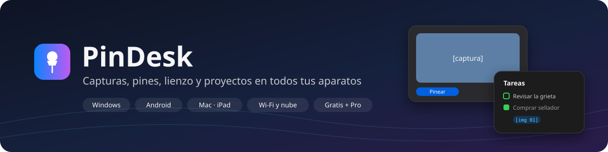

  

  
  
  
  

  <a href="../README.md">Español</a> ·
  <a href="https://github.com/1xmanMAX/PINDESK-/releases/latest">All releases</a> ·
  <a href="privacy.md">Privacy</a> ·
  <a href="terms.md">Terms</a>

---

**PinDesk** keeps everything you see, note and study at hand. Capture the screen, keep anything
floating **always on top** of your windows (a photo, a video, a PDF, a task list), draw on it and
keep it all organised in **chat-style projects**, like the ones you already use on your phone.

The full guides are in Spanish, the app's main language: [installation](../docs/instalar.md),
[features](../docs/funciones.md), [plans](../docs/planes.md) and [FAQ](../docs/preguntas.md).
The [wiki](../wiki/Inicio.md) covers every feature on every platform, with an
[English summary](../wiki/en/Home.md).

## Download

| Platform | Status |
|---|---|
| 🪟 **Windows 10 (21H2 or later) and 11**, 64-bit | [**Download PinDesk for Windows (ZIP)**](https://github.com/1xmanMAX/PINDESK-/releases/latest/download/PinDesk-Windows-x64.zip) |
| 🤖 **Android** | Coming soon |
| 💻 **Mac** | Coming soon |
| 📱 **iPad** | Coming soon |

**Install in three steps**: download the ZIP, right-click it → **Extract All**, and open
**`Instalar.cmd`** from the extracted folder. If Windows shows "Windows protected your PC", click
**More info → Run anyway**. If you see "Windows cannot find pindesk.exe", it was opened from inside
the ZIP: extract it first.

## What it does

| | I want to… | With PinDesk… |
|:-:|---|---|
| 📸 | Keep something I see on screen | Press `Ctrl Alt X`, pick the area, then copy it, pin it or send it to a project. |
| 📌 | Keep something always in view | Pin it: a photo, video, PDF or list stays above every window. |
| 💬 | Organise things by topic | Each project is a chat: notes, photos, audio and documents together, with their dates. |
| ✏️ | Mark up or explain something | Draw on top with pen, arrows, boxes and text, or open a blank canvas. |
| ✅ | Not forget what's pending | Type "call the bank urgent tomorrow 9" and get a task with its urgency and reminder. |
| 🎓 | Get to class on time | Enter my timetable and PinDesk calls me before each class. |
| 💡 | Not repeat the same mistake | Turn it into a lesson learned, with spaced review. |
| 📖 | Read a PDF or Word file while I work | It opens small, like a pin, next to what I'm doing. |
| 🗓️ | Make a planner or a journal | Build it from blocks with **PinDesk Templates** and export it to PDF or image. |
| 📱 | Have it on my phone too | Sync over Wi‑Fi between my devices (and through the cloud with Pro). |

## Free and Pro

Signing in with a **Google account** is required. The **free plan** includes everything except Pro,
including local Wi‑Fi sync between devices and PinDesk Templates without AI.

**PinDesk Pro** adds cloud sync, the AI features (Assistant, Jev task urgency, transcript summaries,
Templates with AI) and the pro tools (CAD drawings, advanced comments with mini chat, class and
meeting recording, interactive HTML export). Plans: **monthly**, **yearly** and **lifetime**, each
for **up to 3 devices** per account. Pay by card or PayPal worldwide and, in Peru, also with Yape or
local cards. **Prices: coming soon.**

If Pro lapses, **your data is never deleted**: Pro features stop until you renew.

## Requirements

- Windows 10 version 21H2 or later, or Windows 11, 64-bit.
- A Google account.
- Internet to sign in, for Pro cloud features and to download the optional speech models; the rest
  works offline.

## Feedback

Report a bug or suggest a feature in [Issues](https://github.com/1xmanMAX/PINDESK-/issues/new/choose)
(the forms are in Spanish, but English is welcome). For account, payment or data matters, email
**max.antony.8.5.1@gmail.com**.

---

  PinDesk is an app by Max Anthony Mamani Maquera. Its use is governed by the <a href="terms.md">Terms of Use</a>. 
  Formerly called PixPin Max. Not affiliated with PixPin or DepthPixel.

