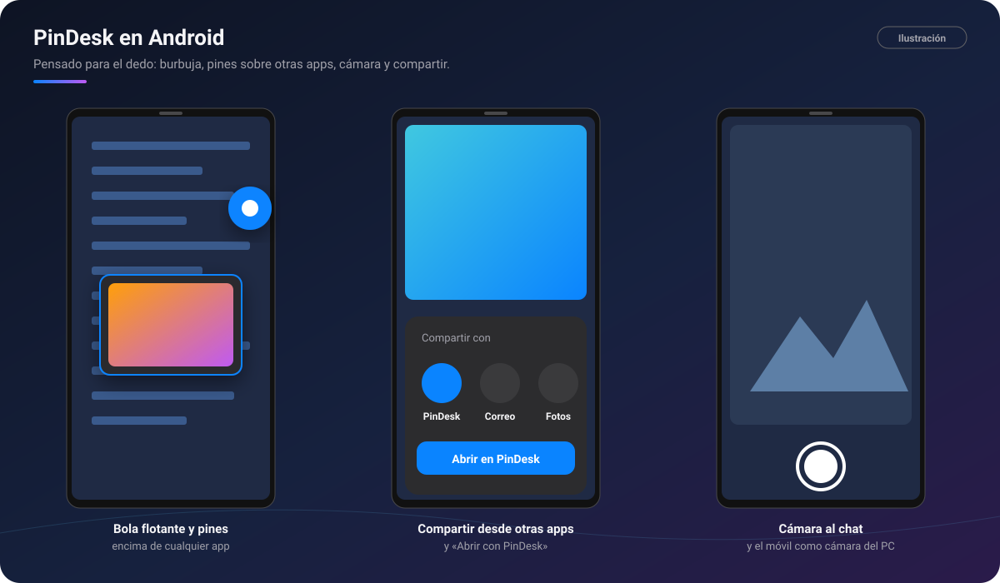
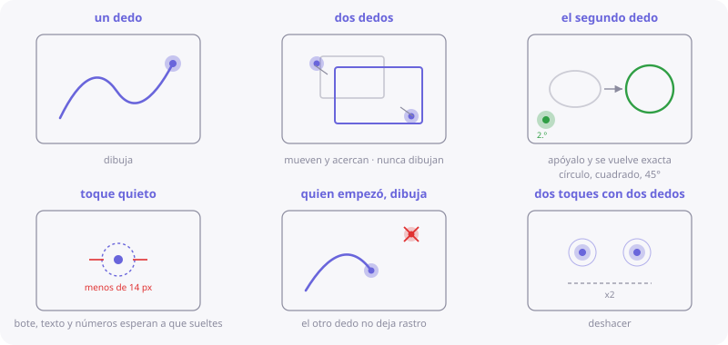
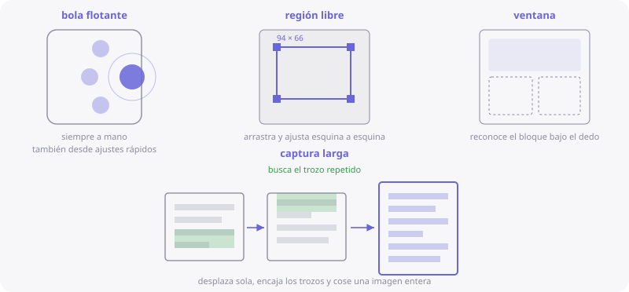

# PinDesk para Android

[🏠 Inicio](Inicio.md) · Plataformas: [Windows](Windows.md) · **Android** · [macOS](macOS.md) ·
[iPad](iPad.md) · [iPhone](iPhone.md)

**Estado: ⏳ próximamente.** La app de Android ya hace casi todo lo que describe esta wiki y se está
preparando para su publicación. Cuando salga, la descarga estará en este repositorio.

*Ilustración: la bola flotante con un pin encima de otra app, compartir hacia PinDesk y la cámara
del chat.*

## Requisitos

- **Android 10 o posterior.**
- Una **cuenta de Google** para iniciar sesión.
- Para la voz a texto, los modelos se bajan una vez; después funcionan sin red.

## Instalar (cuando se publique)

1. Descarga la app desde este repositorio.
2. Si Android lo pide, permite **instalar apps de este origen**.
3. En la primera pantalla, concede los permisos y pulsa **Comenzar**.

**Para qué es cada permiso**

| Permiso | Para qué |
|---|---|
| Mostrar sobre otras apps | Los pines y la bola flotante (imprescindible). |
| Capturar la pantalla | Hacer capturas (imprescindible). |
| Micrófono | Notas de voz, dictado y grabar clases. |
| Red local | Sincronizar por Wi‑Fi con tus otros aparatos. |
| Cámara | Fotos al chat y a los comentarios, y el croquis 3D «en el sitio». |
| Notificaciones y batería | Avisos, recordatorios y que el sistema no cierre los pines. |

## Lo que tiene de especial el móvil

| | Qué es | Por qué mola |
|:-:|---|---|
| 🔵 | **Bola flotante** | Siempre a mano encima de cualquier app: un toque abre el menú, doble toque captura y mantenerla oculta o muestra todos los pines. Se imanta al borde. |
| 📌 | **Pines sobre otras apps** | Fotos, notas, tablas, PDF y mini-apps flotan encima de lo que uses, también fuera de PinDesk. |
| ✨ | **La palabra es el comando** | Copia «timer», «todo», «gastos» o «pizarra» y pinéala: sale la herramienta lista. |
| 📷 | **Cámara en el chat** | La foto entra sola en el cuadro de enviar, con su descripción. |
| 📤 | **Compartir y «Abrir con»** | Desde cualquier app, manda fotos, PDF o Word a PinDesk, o ábrelos directamente en su visor sin guardarlos. |
| 🎙️ | **Micrófono flotante** | Graba una nota de voz encima de cualquier app, sin abrir PinDesk. Se pasa a texto en el teléfono. |
| 📞 | **Llamada secreta** | Una nota de voz con hora suena como una llamada: contestas y oyes tu propio recado por el auricular. |
| 🃏 | **Varios lienzos a la vez** | Hasta tres lienzos abiertos, uno al lado del otro, y una «baraja» para cambiar de uno a otro. |
| 🧊 | **Croquis 3D «en el sitio»** | Dibuja en el espacio y míralo encima de la cámara, a tamaño real. |
| 🎥 | **El móvil como cámara del PC** | Mientras el PC graba una clase, tus fotos y clips del móvil entran en su minuto. |
| 🔊 | **Leer en voz alta, también con la pantalla apagada** | Word y libros siguen sonando, con mandos en la notificación y en los auriculares. |
| 🌐 | **[Comunidad](Comunidad.md)** | La galería compartida de miniapps, figuras y plantillas llega primero a Android. |
| 🤖 | **Asistente que crea archivos** ⭐ | Mini-apps, PDF y planos DXF hechos por la IA. Ver [Asistente IA](Asistente-IA.md). |

*Ilustración de PinDesk para Android: un dedo dibuja, dos mueven y acercan, y el segundo dedo
convierte el trazo en una figura perfecta.*

## Gestos

**En el lienzo**

| Gesto | Qué hace |
|---|---|
| Un dedo | Dibuja. |
| Dos dedos | Mueven y acercan; nunca dibujan. |
| Apoyar el segundo dedo al dibujar | El trazo se vuelve exacto: círculo, cuadrado, 45°. |
| Dos toques con dos dedos | Deshacer. |
| Tres dedos de lado | Pasar al lienzo vecino. |
| Cuatro dedos hacia arriba | La baraja con todos los lienzos abiertos. |

**En un pin**

| Gesto | Qué hace |
|---|---|
| Arrastrar | Moverlo (sobre la bola, se aparca). |
| Pellizcar · dos dedos arriba y abajo | Cambiar el tamaño · la transparencia. |
| Toque · doble toque | Copiar o abrir · minimizar. |
| Mantener pulsado | La barra: dejar pasar el toque, dibujar, editar, guardar, cerrar. |

*Ilustración de PinDesk para Android: bola flotante, región libre, ventana y captura larga.*

## Límites (cosas que Android no deja)

- **No hay atajos de teclado globales** ni [Flow Launcher](Flow-Launcher-y-atajos.md).
- **No hay pin en vivo**: Android no deja copiar en tiempo real la ventana de otra app.
- **El contenido protegido** (apps de banco, vídeo con protección) sale en negro en las capturas.
- Algunos fabricantes **cierran las apps en segundo plano** para ahorrar batería: si los pines
  desaparecen, quita a PinDesk de la optimización de batería.
- La **captura larga** cose varias imágenes: con cabeceras fijas puede fallar.
- [Comentarios avanzados](Comentarios-avanzados.md): por ahora, en los planos.
- [PinDesk Plantillas](PinDesk-Plantillas.md) como app aparte llega más adelante.

## Preguntas frecuentes

**¿Se sincroniza con mi PC?** Sí, por la Wi‑Fi de casa, con el mismo código o QR. Ver
[Sincronización](Sincronizacion.md).

**¿La voz sale de mi teléfono?** No: la voz a texto se hace en el teléfono.

---

[← Windows](Windows.md) · [Inicio](Inicio.md) · Siguiente: [macOS →](macOS.md)
