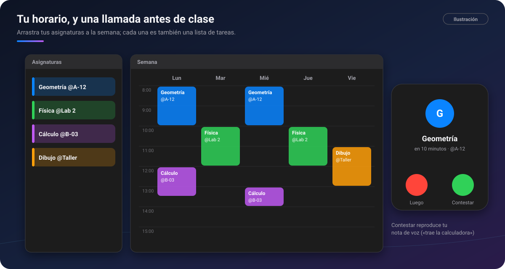

# 🎓 Asignaturas y horario

[🏠 Inicio](Inicio.md) · **Plan: 🟢 Gratis**

| Windows | Android | macOS | iPad | iPhone |
|:-:|:-:|:-:|:-:|:-:|
| ✅ | ✅ | ✅ | ✅ | ⏳ |

Apunta tus clases en un **calendario semanal** y PinDesk te **llama** antes de cada una. Cada
asignatura es además **una lista de tareas** y tiene su sitio en el chat **Asignaturas**.

*Ilustración: las asignaturas a la izquierda, la semana en el medio y la llamada antes de clase.*

## Qué hace

- **Horario semanal**: la tercera vista de [Tareas](Tareas.md) (`Ctrl H`, o **Funciones → Horario**).
- **Asignaturas con aula**: «Geometría @A-12» (la @ es el aula).
- **Llamada antes de cada clase**: sale en pantalla como una llamada; **Contestar** reproduce la nota
  de voz que te dejaste («trae la calculadora»). Se puede volver a llamar en 5, 15 o 30 minutos.
- **Evaluaciones** que avisan 3 días y 1 día antes.
- **Cada asignatura es una lista de tareas**: aparece entre tus listas y le apuntas deberes
  directamente.
- **El chat Asignaturas** reúne apuntes, fotos de la pizarra y grabaciones, **agrupados por
  asignatura**.
- **Google Calendar** (solo lectura), si lo conectas: tus eventos también salen en el horario.

## Cómo se usa, paso a paso

1. Abre **Funciones → Horario**.
2. A la izquierda, escribe tus asignaturas, por ejemplo «Física @Lab 2».
3. **Arrástralas** a la rejilla de la semana. Cada clase se mueve y se alarga en saltos de
   15 minutos.
4. Déjate una **nota de voz** para la próxima clase, si quieres.
5. Antes de la clase, contesta la llamada y escucha tu recado.

## Fortalezas

- **Una llamada es imposible de ignorar**: mucho más difícil de pasar por alto que una notificación.
- **Tu propia voz como recordatorio**: lo que te dijiste ayer, justo a tiempo.
- **Las tareas de clase no se pierden**: cada asignatura tiene su lista, y si quitas la asignatura
  del horario, **sus tareas no se borran**.
- **Todo lo de una clase junto**: el chat Asignaturas agrupa apuntes, fotos y grabaciones por
  materia.
- **Las tareas con hora** de la semana salen como chapitas en su día.

## Consejos

- Graba la clase con [Grabar clases y reuniones](Grabar-clases-y-reuniones.md) ⭐ y quedará en su
  asignatura.
- Cambia el nombre de una asignatura y su lista cambia con ella.

## Preguntas frecuentes

**¿El horario viaja a mi móvil?** Las tareas de las asignaturas viajan con la sincronización.

**¿Puedo ver mi Google Calendar?** Sí, en solo lectura, si lo conectas en Ajustes.

---

[← Tareas](Tareas.md) · [Inicio](Inicio.md) · Siguiente: [Lecciones y estudio →](Lecciones-y-estudio.md)
