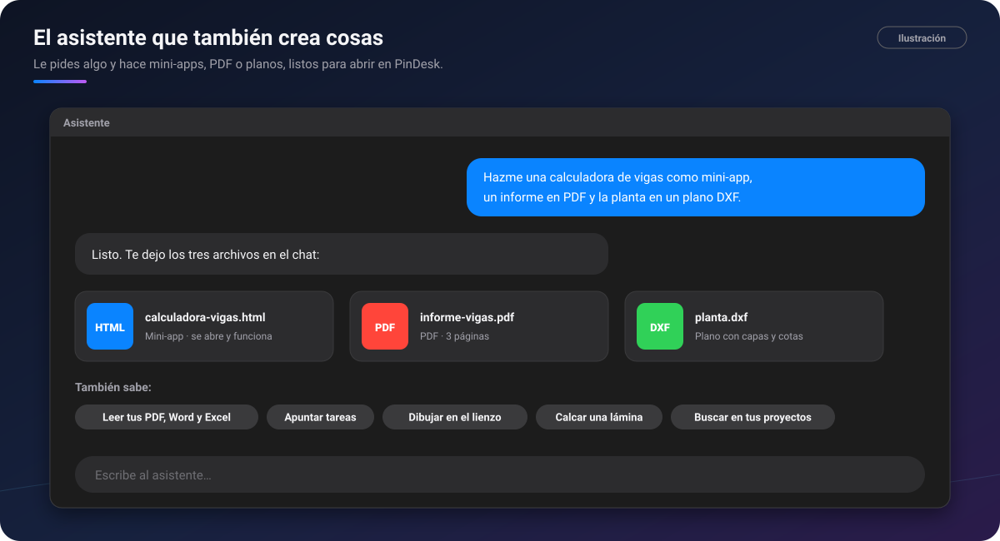

# 🤖 Asistente con IA

[🏠 Inicio](Inicio.md) · **Plan: ⭐ Pro**

| | Windows | Android | macOS | iPad | iPhone |
|---|:-:|:-:|:-:|:-:|:-:|
| Asistente en el chat | ✅ | ✅ | ✅ | ✅ | ⏳ |
| Crear mini-apps, PDF y planos | ⏳ | ✅ | ⏳ | ⏳ | ⏳ |

Un chat más, **Asistente**, con una inteligencia artificial que **hace cosas dentro de PinDesk**: lee
tus documentos, apunta tareas, dibuja en el lienzo y, en Android, **crea archivos** como un agente de
código.

*Ilustración: le pides tres cosas y te deja los tres archivos en el chat.*

## Qué hace

- **Lee y entiende lo tuyo**: los PDF, Word, Excel y fotos del chat, y busca en todos tus proyectos
  con la fecha de cada cosa.
- **Hace**: apunta tareas y recordatorios, crea notas, abre ventanas, pinea y resume lo que hiciste.
- **Dibuja en el lienzo**: gráficas, figuras exactas y diagramas; crea lienzos nuevos y abre los que
  ya tienes por su nombre.
- **«Calca esto»**: una lámina, un apunte o una captura pasan al lienzo **editables**, con el texto,
  las tablas, las figuras y las fórmulas en su sitio. Primero ves lo principal en un par de
  segundos, y el resto va llegando.
- **Tablas desde una foto**.
- **Google Drive y Google Calendar**, si los conectas: busca y trae archivos de tu Drive (y sube los
  del chat si se lo pides) y contesta «¿qué tengo hoy?».
- **Busca y lee páginas web** cuando le hace falta.
- **Conversación nueva** empieza de cero sin borrar lo anterior.

### El agente de código: mini-apps, PDF y planos

En **Android**, el asistente también **crea archivos** y los deja en el chat, listos para abrir en
sus visores:

- **Mini-apps** en una página web: una calculadora, un conversor, un juego para estudiar…
- **PDF** a partir de lo que le pidas (un informe, una ficha).
- **Planos DXF** con capas, arcos y cotas.
- También **SVG, Markdown o CSV**, y **editar** un archivo que ya creó, cambiando solo el trozo
  que pides.

Cada archivo se revisa solo antes de entregarlo, para que no llegue cortado. Lo que crea puedes
compartirlo en la [Comunidad](Comunidad.md). Llegará también a Windows, Mac e iPad.

## Cómo se usa, paso a paso

1. Abre el chat **Asistente** (o **Funciones → Asistente** en Android).
2. Escribe lo que quieres, como se lo dirías a una persona: «apúntame comprar cemento para el
   viernes», «resume este PDF», «calca esta lámina».
3. Adjunta una foto o un documento si hace falta.
4. Revisa la respuesta. Si algo no está bien, díselo y lo corrige.

## Fortalezas

- **No solo contesta: actúa** dentro de PinDesk, con tus tareas, tus lienzos y tus documentos.
- **«Calca esto» de verdad editable**: no es una foto pegada, son textos, tablas y figuras que
  puedes mover.
- **Conoce tus cosas por su fecha**: «¿qué apunté en la obra el martes?» tiene respuesta.
- **Crea herramientas a tu medida** (Android): una mini-app que hace justo el cálculo que
  necesitas, sin programar.
- **Las órdenes simples no necesitan IA**: apuntar o abrir algo directo sigue siendo gratis.
- **Elige el modelo** desde la pastilla de arriba del chat.

## Consejos

- Pide las cosas una a una si son largas; puedes escribirle mientras trabaja.
- Usa **Reportar respuesta…** en el menú del mensaje si algo es inadecuado.

## Preguntas frecuentes

**¿Puede equivocarse?** Sí. Las respuestas de una IA pueden contener errores: revisa lo importante.

**¿Qué se envía a la IA?** Lo que le pides y lo que adjuntas para esa petición. Lo explica la
[Política de privacidad](../docs/privacidad.md#4-datos-que-salen-de-tu-aparato) y la página de
[Privacidad](Privacidad.md).

**¿Hay un límite de uso?** Puede haber un cupo de uso por día, para que el servicio vaya bien para
todos. En Android lo ves en la pantalla **Cuenta**.

---

[← Grabar clases y reuniones](Grabar-clases-y-reuniones.md) · [Inicio](Inicio.md) · Siguiente: [Jev →](Jev.md)
