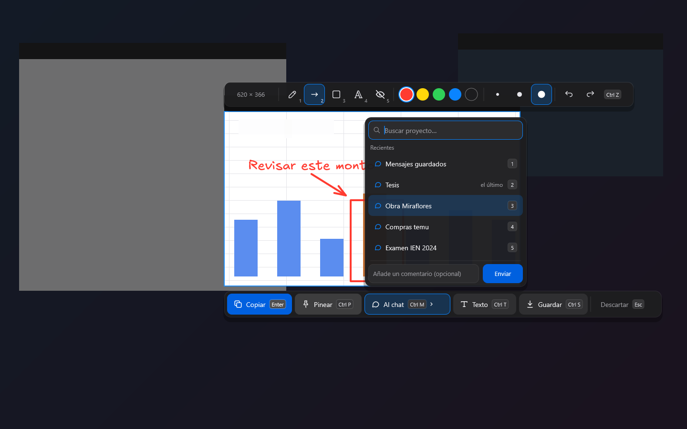
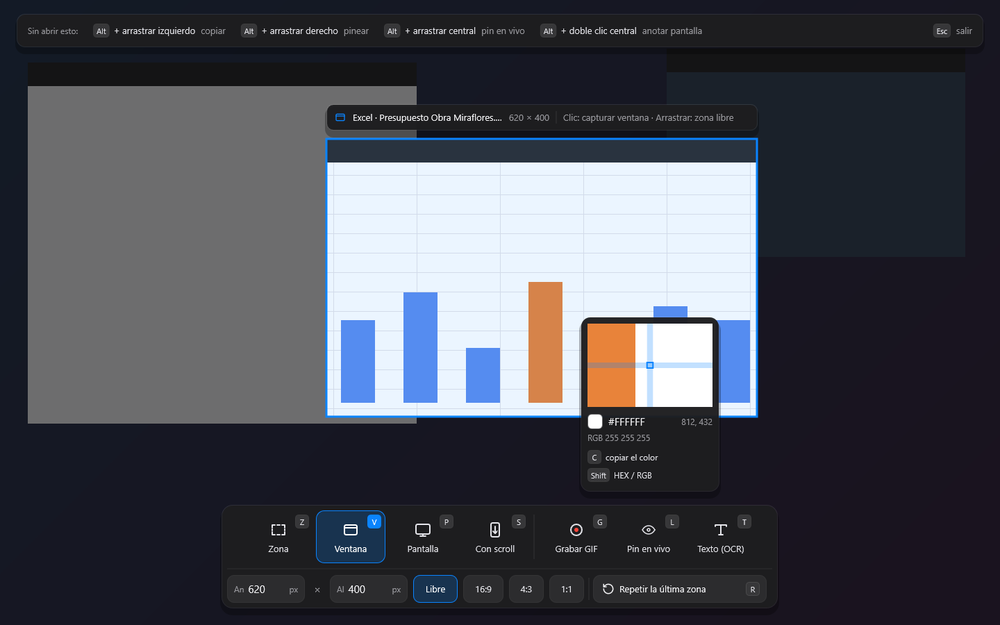
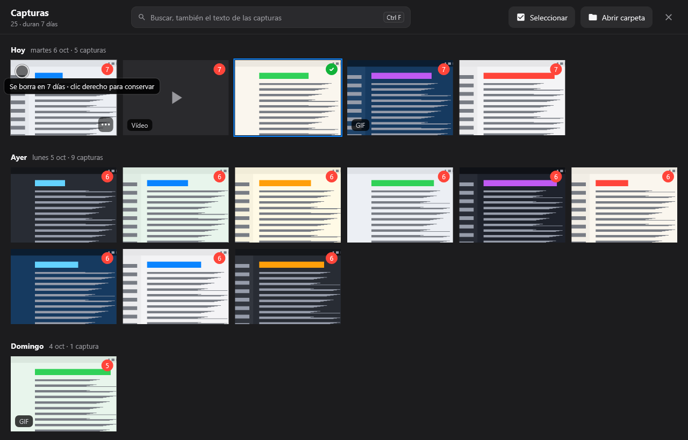
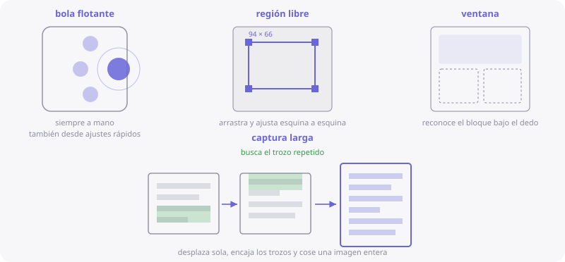

# 📸 Captura

[🏠 Inicio](Inicio.md) · **Plan: 🟢 Gratis**

| Windows | Android | macOS | iPad | iPhone |
|:-:|:-:|:-:|:-:|:-:|
| ✅ | ✅ | ✅ | ✅ (de PinDesk y de tus fotos) | ⏳ |

Captura lo que ves en la pantalla y decide al momento qué hacer con ello: copiarlo, dejarlo
flotando, mandarlo a un chat, sacar su texto o guardarlo.

*Captura de PinDesk para Windows: después de elegir la zona, la barra para anotar y decidir.*

## Qué hace

| Letra | Modo | Para qué |
|:-:|---|---|
| `Z` | Zona | Arrastra un rectángulo. |
| `V` | Ventana | Resalta la ventana que tienes debajo, con su nombre. |
| `P` | Pantalla | La pantalla entera. |
| `S` | Con scroll | Una página larga, que baja sola y se cose en una imagen. |
| `G` | Grabar GIF | Un vídeo corto de una zona. |
| `L` | Pin en vivo | Una ventanita que copia esa zona en tiempo real (Windows y Mac). |
| `T` | Texto | Lee el texto de la zona y lo copia (OCR). |

## Cómo se usa, paso a paso

1. **Abre la captura**: `Ctrl Alt X` en Windows, `⌃⌥X` en el Mac, la bola flotante en Android o la
   bandeja o la barra de menús.
2. **Elige el modo** con su letra o con la barra de abajo, y marca la zona.
   - Teclea medidas exactas (ancho × alto), usa **16:9, 4:3 o 1:1**, o repite la última zona con `R`.
   - La **lupa** te dice el color bajo el ratón en HEX y RGB; `C` lo copia.
3. **Anota encima si quieres**, sin abrir otra ventana: lápiz, flecha, rectángulo, texto y mosaico
   para tapar datos (teclas `1`–`5`), con colores, grosores y deshacer.
4. **Decide**:
   - **Copiar** (`Enter`) al portapapeles;
   - **Pinear** (`Ctrl P`): se queda [flotando encima](Pines-flotantes.md);
   - **Al chat** (`Ctrl M`): eliges el proyecto en un paso, con buscador y las teclas 1–6;
   - **Texto** (`Ctrl T`): el texto de la imagen, listo para pegar;
   - **Guardar** (`Ctrl S`) en la galería de capturas.

*Captura de PinDesk para Windows: la lupa con el color y la barra de modos con sus letras.*

### La galería de capturas

Las capturas guardadas **se borran solas a los 7 días** (pasan a la papelera, de donde se
recuperan), salvo las que decides **conservar**. Cada una dice en rojo cuántos días le quedan, y el
buscador encuentra **también el texto que hay dentro** de cada captura.

*Captura de PinDesk para Windows: la galería, con los días que le quedan a cada captura.*

## En cada aparato

- **Windows**: los **gestos con Alt** funcionan en cualquier sitio: `Alt` + arrastrar con el
  izquierdo copia, con el derecho pinea, con el central saca un pin en vivo; `Alt` + doble clic
  central abre el anotador de pantalla.
- **Mac**: los mismos modos, con gestos con `⌥` que se encienden en Ajustes.
- **Android**: la **bola flotante** (doble toque captura), región libre, ventana detectada y captura
  larga que cose la página.
- **iPad**: iPadOS no deja capturar otras apps. Haz la captura del sistema, mándala a PinDesk con
  **Compartir** y ahí recórtala, anótala o saca su texto.

*Ilustración de PinDesk para Android: bola flotante, región libre, ventana y captura larga.*

## Fortalezas

- **Una sola tecla para todo**: no hay que recordar siete atajos; cada modo enseña su letra en
  pantalla mientras capturas.
- **Anotas sin abrir otro programa**: marcas, tapas un dato con el mosaico y sigues, todo en el
  mismo paso.
- **Del ojo al proyecto en un gesto**: «Al chat» lleva la captura directamente a su proyecto, con
  su fecha, sin carpetas ni nombres de archivo.
- **La galería se limpia sola**: lo que no conservas desaparece en 7 días, y aun así puedes
  recuperarlo de la papelera.
- **Encuentras capturas por lo que dicen**: el texto de dentro también se busca.
- **Medidas exactas**: ancho × alto tecleado, proporciones fijas y repetir la última zona, ideal
  para tutoriales o documentación.

## Consejos

- ¿Haces capturas para un manual? Usa **16:9** y `R` para que todas tengan el mismo tamaño.
- Para mandar una captura a WhatsApp, **pinéala** y arrástrala con `Ctrl` a la conversación.
- El modo **Texto** (`T`) es la forma más rápida de copiar algo de una imagen o de un vídeo.

## Preguntas frecuentes

**¿Por qué una captura salió en negro?** Algunas apps (bancos, vídeo con protección) no se dejan
capturar.

**¿Puedo cambiar el atajo?** Sí, en **Ajustes → Atajos**.

**¿Dónde está la papelera?** En la propia galería: lo borrado se recupera con **Deshacer**
(`Ctrl Z`) o desde la papelera.

---

[← iPhone](iPhone.md) · [Inicio](Inicio.md) · Siguiente: [Pines flotantes →](Pines-flotantes.md)
