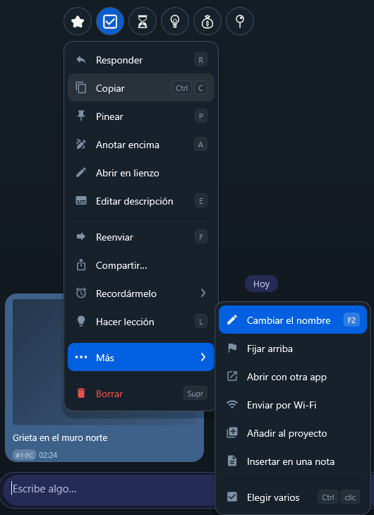
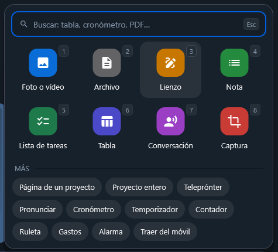
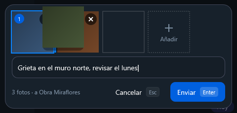
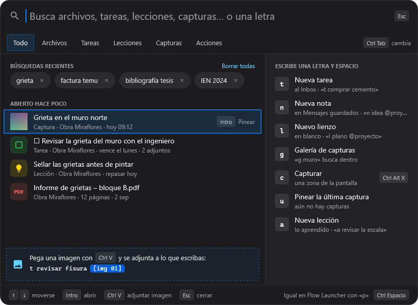
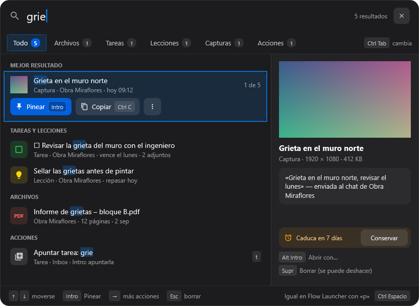

# 💬 Chats y proyectos

[🏠 Inicio](Inicio.md) · **Plan: 🟢 Gratis**

| Windows | Android | macOS | iPad | iPhone |
|:-:|:-:|:-:|:-:|:-:|
| ✅ | ✅ | ✅ | ✅ | ⏳ |

En PinDesk cada **proyecto es un chat**, como los del móvil. Mandas lo que sea y queda guardado con
su fecha, **sin tener que decidir antes en qué carpeta va**.

*Captura de PinDesk para Windows: el menú de un mensaje.*

## Qué hace

- **Qué puedes mandar**: notas, fotos (varias a la vez, cada una con su descripción), vídeos, notas
  de voz, documentos, PDF, tablas, listas de tareas, lienzos, música y carpetas de páginas.
- **Chats fijos**: «Mensajes guardados» para lo tuyo, «Asistente» para la [IA](Asistente-IA.md) ⭐ y
  «Asignaturas» para todo lo de tus [clases](Asignaturas-y-horario.md).
- **Etiquetas rápidas** en cada mensaje: ⭐ ✅ ⏳ 💡 💰 📍.
- **Chat · Funciones**: el interruptor de arriba cambia la lista de chats por una rejilla con lo más
  usado: Grabar reunión, Nuevo lienzo, Tareas, Timeline, Horario, Capturas y Figuras.
- **Foto del chat**: pon una imagen, un emoji o un color a cada chat, como en una app de mensajería.
- **Chats compartidos**: con otras personas, con tus mensajes a la derecha y los suyos a la
  izquierda. Se invita con un código o un QR.

## Cómo se usa, paso a paso

1. **Crea un chat** con el «+» de la lista: **Chat** (solo tú y tus aparatos) o **Chat compartido**.
2. **Manda cosas**: escribe, pega una imagen (`Ctrl V`), arrastra archivos o usa **Adjuntar**, una
   cuadrícula con buscador y las teclas `1`–`8`.
3. **Haz algo con un mensaje**: clic derecho (o mantener pulsado) para copiar, responder (`R`),
   escuchar en voz alta, pinear (`P`), cambiar el nombre (`F2`), anotar (`A`), reenviar (`F`),
   compartir o convertirlo en [lección](Lecciones-y-estudio.md) (`L`). El menú enseña solo lo que
   tiene sentido para ese tipo de mensaje.
4. **Busca**: lo que escribes en el buscador encuentra chats por su nombre y, debajo, **mensajes de
   cualquier chat**, con pestañas para fotos, vídeos, archivos, enlaces, voz o dibujos. Da igual si
   escribes con tildes o sin ellas.

| Adjuntar | Varias fotos con descripción |
|---|---|
|  |  |

*Capturas de PinDesk para Windows.*

### Buscar en todo PinDesk

Una ventana que encuentra a la vez archivos, tareas, lecciones, capturas y acciones, con vista
previa. Todo se maneja con el teclado, y las letras rápidas (`t` tarea, `n` nota, `l` lienzo, `g`
galería…) son las mismas que en [Flow Launcher](Flow-Launcher-y-atajos.md).

| Antes de escribir | Con resultados |
|---|---|
|  |  |

*Capturas de PinDesk para Windows: buscar en todo PinDesk.*

### Las notas de voz

Graba una nota de voz y se **pasa a texto en tu propio aparato**, con el minuto de cada párrafo: un
toque en el texto salta a ese punto del audio. También hay **teleprónter** (lees un texto que baja
solo mientras te grabas), **pronunciar** (hablas, sueltas y te oyes) y **conversación por turnos**.

## Fortalezas

- **Guardar no pregunta nada**: como en un chat, mandas y listo. Ordenar por *cuándo* fue es como
  de verdad recordamos las cosas.
- **Todo junto**: la foto de la pizarra, el PDF de clase y el audio de la explicación, en el mismo
  sitio y en orden.
- **Un buscador que mira dentro de todos los chats**, también en las transcripciones de las notas
  de voz.
- **Un menú que no te hace pensar**: en un PDF no salen opciones absurdas como «llamada»; cada tipo
  enseña lo suyo.
- **La voz a texto no sale de tu aparato**.
- **Compartido sin servidores**: un chat con otras personas puede ir por la red local, gratis, o
  por la nube con Pro.

## Consejos

- Usa las etiquetas rápidas (💰 para gastos, 📍 para lugares) y luego búscalas.
- Agrupa páginas en una **carpeta** («Día 1», «Día 2»…) y expórtala como un solo PDF con índice.
- En Windows, PinDesk puede ser la app que abre tus fotos y documentos: se abren al instante en una
  ventanita flotante.

## Preguntas frecuentes

**¿Puedo tener chats solo en un aparato?** Todos tus chats se sincronizan con tus aparatos del
grupo; los compartidos, también con las personas invitadas.

**¿Se pierde algo si borro un mensaje por error?** Antes de borrar se pregunta, y las copias de
seguridad guardan cómo estaba.

---

[← Pines flotantes](Pines-flotantes.md) · [Inicio](Inicio.md) · Siguiente: [Lienzo →](Lienzo.md)
