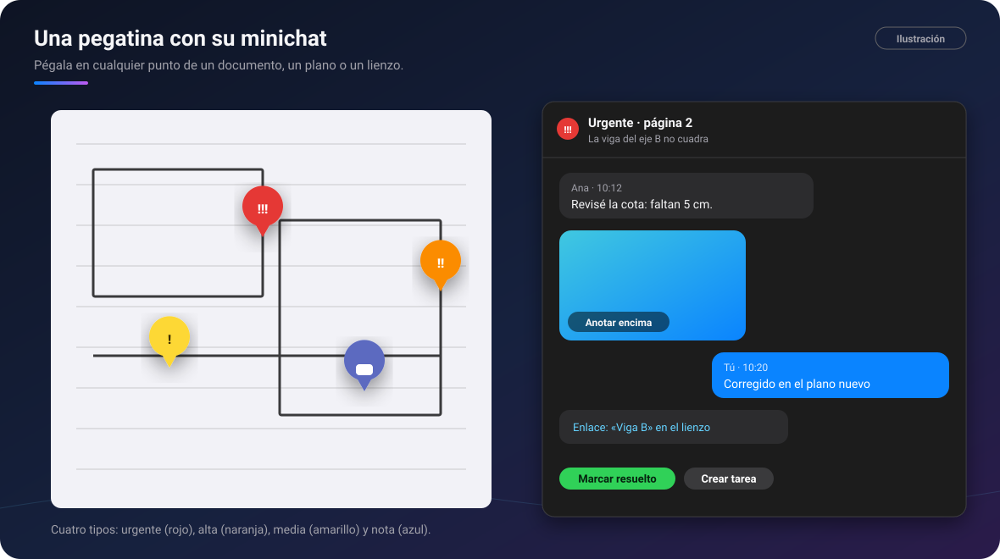

# 🔴 Comentarios avanzados

[🏠 Inicio](Inicio.md) · **Plan: 🟢 Gratis** (comentarios en las notas) · **⭐ Pro** (pegatinas con
minichat)

| Windows | Android | macOS | iPad | iPhone |
|:-:|:-:|:-:|:-:|:-:|
| ✅ | ✅ (en planos, por ahora) | ⏳ | ⏳ | ⏳ |

Pega una **pegatina** en cualquier punto de un documento, un plano, una imagen o un lienzo. Cada
pegatina tiene su **minichat** para hablar de ese punto concreto.

*Ilustración: pegatinas de cuatro colores sobre un plano y el minichat de una de ellas.*

## Qué hace

- 🟢 **Comentarios en las notas**: deja un comentario al margen sobre un trozo de texto, como en un
  documento compartido.
- ⭐ **Pegatinas de cuatro tipos**: 🔴 urgente, 🟠 alta, 🟡 media y 💬 nota.
- ⭐ **Minichat** en cada pegatina: escribe, adjunta una **foto** o un **archivo**, o enlaza un
  **mensaje del chat** o una **figura** de un lienzo.
- ⭐ Una imagen del minichat se abre en el lienzo para **anotar encima**.
- ⭐ **Resuelve** la pegatina cuando esté hecha (y reábrela si hace falta). De una urgencia puedes
  **crear una tarea** con un clic: entra en el Inbox de [Tareas](Tareas.md), unida a la pegatina.
- ⭐ La lista **«Comentarios (n)»** te enseña todas las pegatinas de un documento.

**Dónde se pueden pegar**: lienzos, PDF y Office, el lector de Word y libros, hojas de cálculo y
[planos CAD](Planos-CAD-BIM.md) (en Windows). En Android, por ahora, en los planos.

## Cómo se usa, paso a paso

1. Abre un documento o un plano y pulsa el botón de **comentario** (el emoji del bocadillo).
2. Elige el tipo (urgente, alta, media o nota) y **toca el punto** donde va la pegatina.
3. Escribe en su minichat y adjunta lo que haga falta.
4. Para moverla, **mantenla pulsada y arrástrala**.
5. Cuando esté resuelta, **Marcar resuelto**; si era urgente y hay que actuar, **Crear tarea**.

## Fortalezas

- **El comentario va en su sitio exacto**, no en un mensaje suelto que hay que explicar («la viga
  del eje B…»).
- **Una conversación por punto**: cada problema tiene su hilo, con fotos y archivos.
- **De la duda a la tarea en un clic**: lo urgente no se queda en un comentario olvidado.
- **Los colores dicen la prioridad** de un vistazo: ves qué está rojo en todo el plano.
- **Viajan con el documento**: las pegatinas y sus conversaciones llegan a tus otros aparatos y, en
  un chat compartido, a tu equipo.

## Consejos

- Usa 💬 nota para dudas sin urgencia y 🔴 urgente solo para lo que bloquea el trabajo.
- Enlaza una figura del lienzo en el minichat para ir directo a ella.

## Preguntas frecuentes

**Si se me acaba Pro, ¿pierdo mis pegatinas?** No: las que ya hay se siguen viendo y su minichat se
abre. Lo de Pro es **pegar pegatinas nuevas**.

**¿Quién ve mis pegatinas?** Tus aparatos y, en un chat compartido, las personas de ese chat.

---

[← Planos CAD y BIM](Planos-CAD-BIM.md) · [Inicio](Inicio.md) · Siguiente: [Grabar clases y reuniones →](Grabar-clases-y-reuniones.md)
