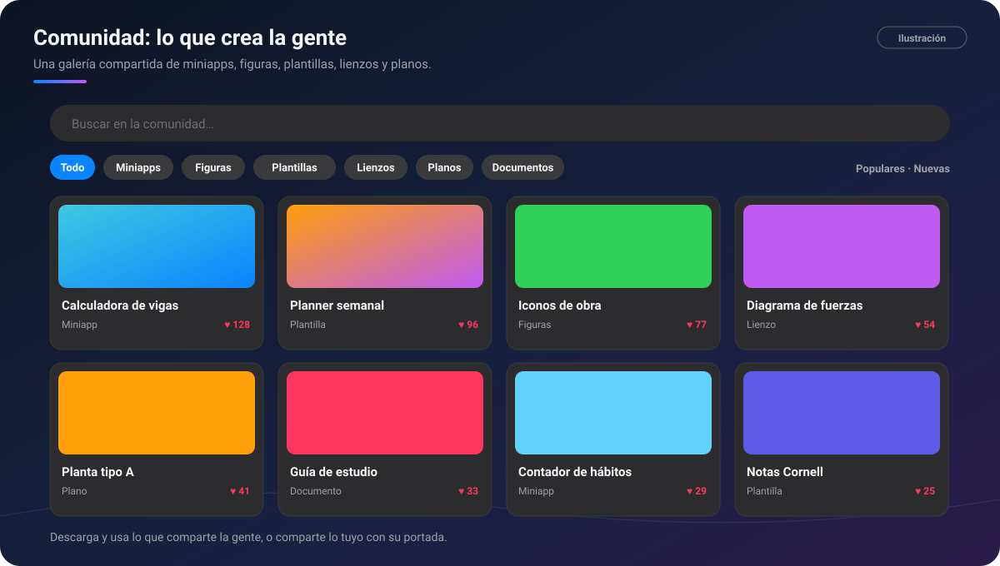

# 🌐 Comunidad

[🏠 Inicio](Inicio.md) · **Plan: 🟢 Gratis**

| Windows | Android | macOS | iPad | iPhone |
|:-:|:-:|:-:|:-:|:-:|
| ⏳ | ✅ (se abre poco a poco) | ⏳ | ⏳ | ⏳ |

La **Comunidad** es una **galería compartida** donde la gente sube lo que crea con PinDesk:
miniapps, figuras, plantillas, lienzos, planos y documentos. Lo descargas y lo usas en tus chats.

*Ilustración: la galería con sus tipos, el buscador y los «me gusta».*

> [!NOTE]
> La Comunidad llega primero a **Android** y se abre poco a poco: si ves «disponible pronto», es que
> aún no está abierta para tu cuenta.

## Qué hace

- **Explorar por tipo**: miniapps, figuras, plantillas, lienzos, planos y documentos.
- **Buscar** y ordenar por **populares** o **nuevas**.
- **Me gusta** para lo que te sirve.
- **Descargar y usar**: las figuras entran en la biblioteca de tu lienzo; lo demás, en tu chat.
- **Contribuir**: comparte un archivo del chat (por ejemplo, una mini-app que hizo el
  [asistente](Asistente-IA.md)), una figura tuya o un archivo del teléfono, **con su portada**.
- **Mis aportes**: ves el estado de lo que subiste y publicas versiones nuevas.
- **Denunciar** lo que no debería estar.

## Cómo se usa, paso a paso

1. Abre **Funciones → Comunidad**.
2. Elige un tipo o busca lo que necesitas («horario», «vigas», «hábitos»).
3. Abre una tarjeta y pulsa **Descargar** o **Usar**.
4. Para compartir algo tuyo, pulsa **Contribuir**, elige el archivo y su portada, y envíalo.

## Fortalezas

- **No empiezas de cero**: alguien ya hizo la plantilla, la figura o la calculadora que buscas.
- **Todo listo para PinDesk**: lo descargado se abre en sus visores o entra directo en tu
  biblioteca de figuras.
- **Las mini-apps del asistente cobran vida**: lo que creas con la IA puede ayudar a otros.
- **Cuidada**: lo que se sube se revisa antes de publicarse, y lo denunciado por varias personas se
  esconde.

## Consejos

- Pon una portada clara: es lo primero que ve la gente.
- Sube versiones nuevas desde **Mis aportes** en lugar de duplicar.

## Preguntas frecuentes

**¿Lo que subo es público?** Sí: cualquiera con PinDesk puede verlo y descargarlo. No subas nada con
datos personales.

**¿Cuándo llega a Windows, Mac e iPad?** Más adelante; se anunciará en el [CHANGELOG](../CHANGELOG.md).

---

[← PinDesk Plantillas](PinDesk-Plantillas.md) · [Inicio](Inicio.md) · Siguiente: [Exportar y compartir →](Exportar-y-compartir.md)
