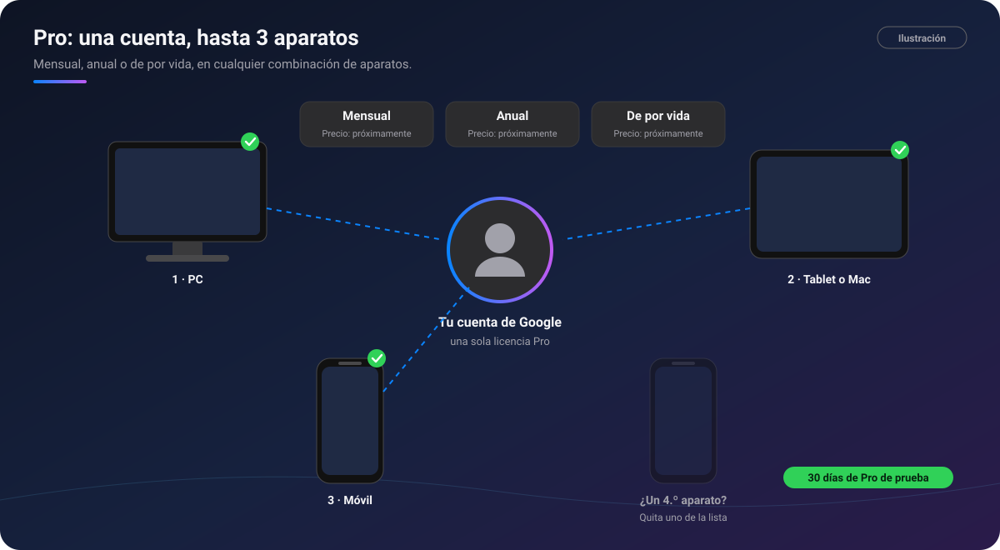

# 💳 Cuenta y planes

[🏠 Inicio](Inicio.md)

| | Windows | Android | macOS | iPad | iPhone |
|---|:-:|:-:|:-:|:-:|:-:|
| Cuenta de Google y planes | ✅ | ✅ | ⏳ | ⏳ | ⏳ |

Para usar PinDesk hay que **iniciar sesión con una cuenta de Google**. Con eso ya tienes el **plan
gratuito**, sin fecha de caducidad. **PinDesk Pro** añade la nube, la inteligencia artificial y las
herramientas profesionales.

*Ilustración: una cuenta de Google con Pro activo en tres aparatos.*

## Qué incluye cada plan

| Función | 🟢 Gratis | ⭐ Pro |
|---|:-:|:-:|
| [Captura](Captura.md), [pines flotantes](Pines-flotantes.md), [chats](Chats-y-proyectos.md) y [lienzo](Lienzo.md) | ✅ | ✅ |
| [Tareas](Tareas.md), [asignaturas y horario](Asignaturas-y-horario.md), timeline y [lecciones](Lecciones-y-estudio.md) | ✅ | ✅ |
| [Lector](Lector-de-documentos.md) de PDF, Word, Excel, PowerPoint y EPUB, con marcas y anotaciones | ✅ | ✅ |
| Notas de voz y paso a texto en tu aparato | ✅ | ✅ |
| Comentarios en las notas | ✅ | ✅ |
| [Sincronizar por Wi‑Fi](Sincronizacion.md) | ✅ | ✅ |
| [PinDesk Plantillas](PinDesk-Plantillas.md) sin IA | ✅ | ✅ |
| [Comunidad](Comunidad.md), [música](Musica-y-karaoke.md), [Flow Launcher](Flow-Launcher-y-atajos.md) y [14 idiomas](Idiomas.md) | ✅ | ✅ |
| [Sincronizar por la nube](Sincronizacion.md#por-la-nube) | — | ✅ |
| [Asistente con IA](Asistente-IA.md) | — | ✅ |
| [Jev](Jev.md): urgencia de las tareas | — | ✅ |
| Resúmenes de las transcripciones | — | ✅ |
| PinDesk Plantillas con IA | — | ✅ |
| [Planos CAD y BIM](Planos-CAD-BIM.md) | — | ✅ |
| [Comentarios avanzados](Comentarios-avanzados.md) con minichat | — | ✅ |
| [Grabar clases y reuniones](Grabar-clases-y-reuniones.md) | — | ✅ |
| [Exportar a una página web interactiva](Exportar-y-compartir.md) | — | ✅ |

## 30 días de Pro para probar

Cada **cuenta de Google nueva** tiene **30 días de PinDesk Pro** de prueba: pruebas todo, sin pagar.
Al terminar, si no eliges un plan, sigues en el plan gratuito **sin perder nada**.

## Modalidades y precios

| Modalidad | Cómo se paga | Aparatos | Precio |
|---|---|:-:|---|
| **Mensual** | Cada mes, se renueva sola hasta que la canceles | Hasta 3 | Próximamente |
| **Anual** | Cada año, se renueva sola hasta que la canceles | Hasta 3 | Próximamente |
| **De por vida** | Un solo pago | Hasta 3 | Próximamente |

Se paga con **tarjeta o PayPal** desde cualquier país y, en **Perú**, también con **Yape** o tarjetas
locales. La compra desde la app llega **próximamente**, junto con los precios. Todo el detalle está
en [Planes: Gratis y Pro](../docs/planes.md).

## Cómo funciona, paso a paso

1. **Inicia sesión** en PinDesk con tu cuenta de Google.
2. Usa el plan gratuito, o prueba Pro durante 30 días.
3. Para seguir con Pro, elige una modalidad y paga **con esa misma cuenta de Google**.
4. **Pro se activa solo** en el aparato con el que entraste. En tus otros aparatos, inicia sesión
   con la misma cuenta y se activa también, **hasta 3**.
5. ¿Un aparato nuevo y ya tienes 3? Quita uno de la lista de aparatos de tu cuenta: pasa al plan
   gratuito **sin perder nada**.

> [!NOTE]
> Algunas funciones se abren **poco a poco**: si ves «disponible pronto», es que llega en una
> próxima actualización. Una función Pro que aún no tienes abre una hoja que te explica qué es y te
> enseña los planes.

## Fortalezas

- **Casi todo es gratis**, para siempre, y sin límite de aparatos.
- **Una licencia para tus aparatos**: PC, móvil y tablet en cualquier combinación.
- **Tus datos nunca se borran** si Pro vence o lo cancelas: lo hecho con Pro se sigue abriendo,
  copiando y exportando.
- **La Wi‑Fi sigue funcionando** aunque no tengas Pro.
- **De por vida**: un solo pago, sin renovaciones.

## Preguntas frecuentes

**¿Qué pasa si Pro vence?** Las funciones Pro se detienen hasta que renueves: la nube se pausa (la
Wi‑Fi sigue), y la IA, la grabación, los planos CAD, los comentarios avanzados y la página web
interactiva dejan de estar disponibles. Al renovar, todo vuelve como estaba.

**Pagué con otra cuenta de Google.** Escríbenos a **max.antony.8.5.1@gmail.com** con el correo de las
dos cuentas y el comprobante, y lo movemos.

**¿Hay reembolsos?** Se rigen por los [Términos de uso](../docs/terminos.md#7-reembolsos).

Más preguntas en [Preguntas frecuentes](../docs/preguntas.md#planes-y-pagos).

---

[← Idiomas](Idiomas.md) · [Inicio](Inicio.md) · Siguiente: [Privacidad →](Privacidad.md)
