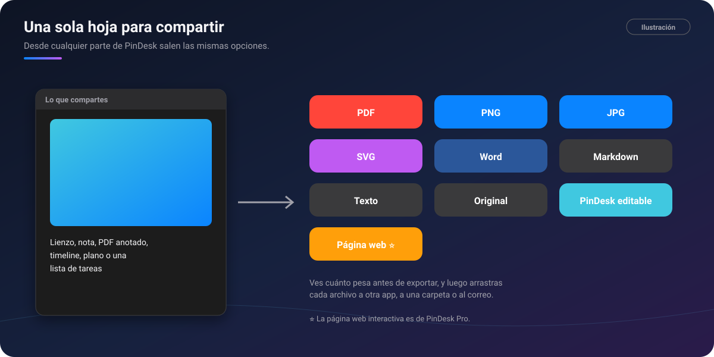
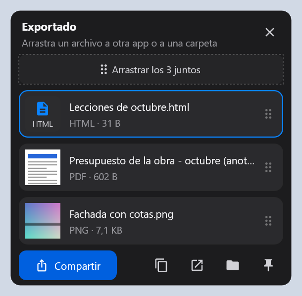
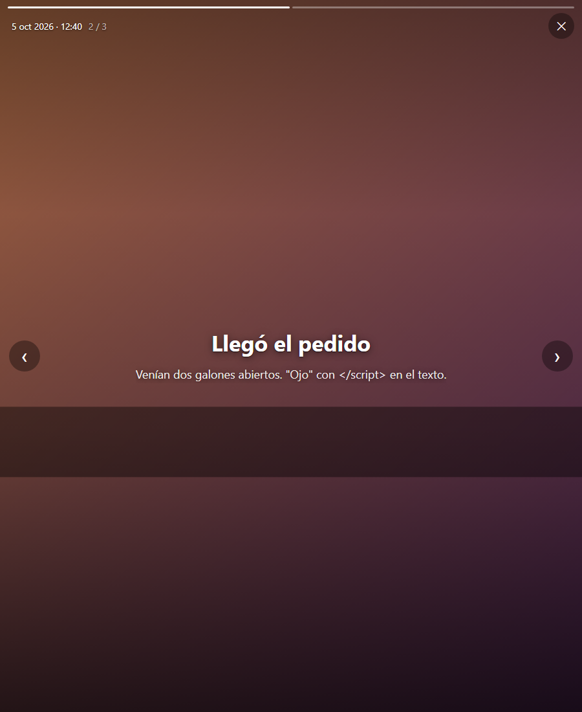

# 📤 Exportar y compartir

[🏠 Inicio](Inicio.md) · **Plan: 🟢 Gratis** (página web interactiva: ⭐ Pro)

| Windows | Android | macOS | iPad | iPhone |
|:-:|:-:|:-:|:-:|:-:|
| ✅ | ✅ | ✅ | ✅ | ⏳ |

Desde cualquier parte de PinDesk (el chat, un lienzo, un PDF anotado, el timeline, una lista de
tareas, un plano o una carpeta de páginas) sale **la misma hoja de compartir**, con las mismas
opciones.

*Ilustración: de lo que compartes a cada formato.*

## Qué hace

- **Formatos**: PDF, PNG, JPG, SVG, Word, Markdown, texto, el **original** y el **editable de
  PinDesk**, que se abre en otro PinDesk con todo en su sitio (tinta, marcos y marcadores).
- **Qué páginas**: el lienzo entero o cada marco; varias para un PDF y una para una imagen.
- **Cuánto pesará**, calculado de verdad antes de exportar.
- **Una foto con anotaciones sale siempre con el dibujo incluido**.
- **Por Wi‑Fi** a tus aparatos, con un botón.
- ⭐ **Página web interactiva**: un solo archivo que se abre en cualquier navegador, **sin instalar
  nada y sin conexión**. Quien lo recibe puede anotar encima, medir y volver a guardarlo. Vale para
  lienzos, el timeline, planos y documentos.
- En Android, también como **enlace temporal** (de 1 hora a 3 días), si lo pides.

*Captura de PinDesk para Windows: lo exportado, listo para arrastrar a otra app.*

## Cómo se usa, paso a paso

1. Pulsa **Compartir** en el menú de un mensaje, en un visor o en el lienzo.
2. Elige el **formato** y las **páginas**.
3. Mira el peso y pulsa **Exportar**.
4. En el ordenador, sale una **ventanita encima de todo** con cada archivo como una tarjeta:
   **arrástralo** a WhatsApp, al correo o a una carpeta, o cópialo, ábrelo o pinéalo. En el móvil
   se abre el panel de compartir del teléfono.

*Captura de una página web exportada del timeline ⭐, abierta en el navegador.*

## Fortalezas

- **Una sola hoja en toda la app**: aprendes una vez y ya sabes compartir cualquier cosa.
- **Arrastrar y soltar**: lo exportado se lleva con el ratón a la app que quieras, sin buscar la
  carpeta.
- **Quien recibe no necesita PinDesk**: un PDF, una imagen o una página web que abre cualquiera.
- **La página web interactiva** ⭐ sigue viva: se mueve, se acerca, se anota y se vuelve a guardar,
  todo en un solo archivo.
- **Sabes cuánto pesa** antes de mandarlo.

## Consejos

- Para mandar un cuaderno entero («Día 1», «Día 2»…), compártelo como PDF: lleva un índice con sus
  títulos.
- Una grabación de clase se comparte como página web con reproductor, PDF o Word, con las capturas
  en su minuto.

## Preguntas frecuentes

**¿Un enlace temporal es privado?** Cualquiera con el enlace puede abrirlo mientras dure. PinDesk te
lo avisa antes de subir nada; compartir como archivo no sale de tu aparato.

**¿Qué pasa con la página web si no tengo Pro?** Las que ya exportaste se siguen abriendo; crear
nuevas es de Pro.

---

[← Comunidad](Comunidad.md) · [Inicio](Inicio.md) · Siguiente: [Música y karaoke →](Musica-y-karaoke.md)
