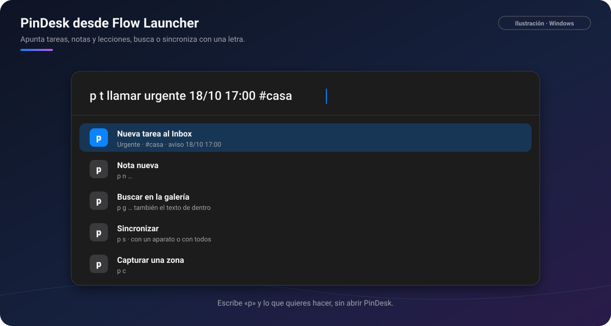
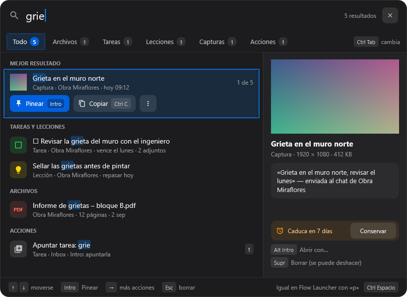

# ⌨️ Flow Launcher y atajos

[🏠 Inicio](Inicio.md) · **Plan: 🟢 Gratis**

| | Windows | Android | macOS | iPad | iPhone |
|---|:-:|:-:|:-:|:-:|:-:|
| Flow Launcher | ✅ | — | — | — | — |
| Atajos en todo el sistema | ✅ | — | ✅ | — | — |
| Buscar en PinDesk | ✅ | ✅ | ✅ | ✅ | ⏳ |
| Siri y Atajos de Apple | — | — | ✅ | ✅ | ⏳ |

Haz cosas en PinDesk **sin abrirla**: desde [Flow Launcher](https://www.flowlauncher.com/) en Windows,
con un atajo de teclado o, en los aparatos de Apple, con Siri y Atajos.



*Ilustración: escribes «p t …» y, antes de pulsar Intro, ya ves cómo quedará la tarea.*

## Flow Launcher (Windows)

**Qué hace**: si usas Flow Launcher, escribe **`p`** y lo que quieras hacer.

```
p t comprar sellador            → tarea nueva al Inbox (pega una imagen con Ctrl V)
p t llamar urgente 18/10 17:00  → tarea urgente con su aviso
p n idea para la tesis          → nota nueva
p g muro                        → buscar en la galería, también el texto de dentro
p a revisar la escala           → lección nueva
p lecciones grietas             → buscar en tus lecciones
p s                             → sincronizar con un aparato o con todos
p c                             → capturar una zona
```

**Cómo se usa**

1. Abre Flow Launcher (de fábrica, `Alt Espacio`).
2. Escribe `p`, un espacio, la letra de la acción y el texto.
3. Mira la vista previa («Urgente · #casa · ⏰ …») y pulsa **Intro**.

> [!NOTE]
> La instalación del plugin de Flow Launcher desde el ZIP llega **próximamente**.

## Buscar en todo PinDesk

Las mismas letras sirven en **Buscar en todo PinDesk**: `t` tarea, `n` nota, `l` lienzo, `g`
galería, `c` capturar, `u` última captura, `a` nueva lección. En Android es una tarjeta flotante que
busca solo en tus cosas, y en el buscador del teléfono «p tesis» deja arriba lo de PinDesk.



*Captura de PinDesk para Windows: buscar archivos, tareas, lecciones y capturas a la vez.*

## Atajos de teclado

En Windows hay **un solo atajo general** (capturar, `Ctrl Alt X`, que puedes cambiar en Ajustes) y
los gestos con Alt. El resto son letras que **solo valen dentro de la ventana abierta**, y cada botón
enseña la suya. En el Mac, la captura es `⌃⌥X` y los atajos se cambian en **Ajustes → Atajos**.

| Dónde | Teclas |
|---|---|
| En todo Windows | `Ctrl Alt X` capturar · `Alt` + arrastrar: izquierdo copia, derecho pinea, central pin en vivo · `Alt` + doble clic central: anotar la pantalla · `Ctrl 2` ocultar o mostrar los pines |
| En todo el Mac | `⌃⌥X` capturar · `⌃2` mostrar u ocultar los pines · `⌃⌥R` grabar la pantalla |
| Al capturar | `Z` `V` `P` `S` `G` `L` `T` modos · `R` repetir la zona · `C` copiar el color · `1`–`5` herramientas · `Enter` copiar · `Ctrl P` pinear · `Ctrl M` al chat · `Ctrl T` texto · `Ctrl S` guardar · `Esc` salir |
| En un pin | `A` anotar · `Ctrl C` copiar · `Ctrl 0` tamaño original · `Ctrl T` dejar pasar el clic · `Mayús` + rueda transparencia · `Espacio` pausa (vídeo) · `M` silencio |
| En el chat | `R` `P` `A` `E` `F` `L` en el menú de un mensaje · `F2` cambiar el nombre · `1`–`8` en adjuntar |
| Galería | flechas · `Espacio` elegir · `Enter` pinear · `Ctrl S` conservar · `Supr` borrar · `Ctrl Z` deshacer |
| Lecciones | `Ctrl F` buscar · `R` repasar · `1` `2` `3` en el repaso · `S` saltar |
| Lector | `F11` pantalla completa · `Esc` vuelve a pin · `Ctrl F` buscar · `Ctrl M` marcador · `A` anotar · `I` marcos · `F5` presentar |
| Lienzo | `W` ángulo con letra griega (otra vez: 90°) · `↑` `↓` cambiar la letra |
| Tareas | `Ctrl T` tarjetas · `Ctrl K` Kanban · `Ctrl H` horario |
| Plano ⭐ | `M` medir · `I` marcos · `Ctrl P` imprimir · `A` anotar · `3` ver en 3D · `F` todo · `B` tema · `T` encima |
| Modelo 3D ⭐ | `C` caja de sección · `L` niveles · `F` todo · `P` planta · `A` aristas · `B` fondo · `T` encima |
| PinDesk Plantillas | `Supr` borrar · `Ctrl D` duplicar · `Ctrl Z` / `Ctrl Y` · `Ctrl S` guardar · `Ctrl E` PDF · `Alt ↑` `Alt ↓` mover el bloque |

En el Mac, donde dice `Ctrl` suele ser `⌘`.

## Siri y Atajos (Mac e iPad)

Acciones de PinDesk para la app Atajos y para Siri: **Grabar nota de voz**, **Capturar**, **Apuntar
en el timeline**, **Mandar al lienzo**, **Mandar al móvil** o **Pinear la última captura**.

## Fortalezas

- **Un solo atajo que recordar**: todo lo demás se ve en pantalla.
- **Apuntar sin cambiar de ventana**: Flow, Buscar en PinDesk y Siri llegan a tus tareas en un
  segundo.
- **Las mismas letras en todas partes**: `t` es tarea en Flow y en Buscar en PinDesk.
- **Silenciar los atajos** desde la bandeja, para jugar o presentar sin sustos.

## Preguntas frecuentes

**¿Puedo cambiar `Ctrl Alt X`?** Sí, en **Ajustes → Atajos**.

**¿Por qué no hay Flow Launcher en el móvil?** Flow Launcher es un programa de Windows. En Android
tienes la bola flotante y Buscar en PinDesk.

---

[← Música y karaoke](Musica-y-karaoke.md) · [Inicio](Inicio.md) · Siguiente: [Idiomas →](Idiomas.md)
