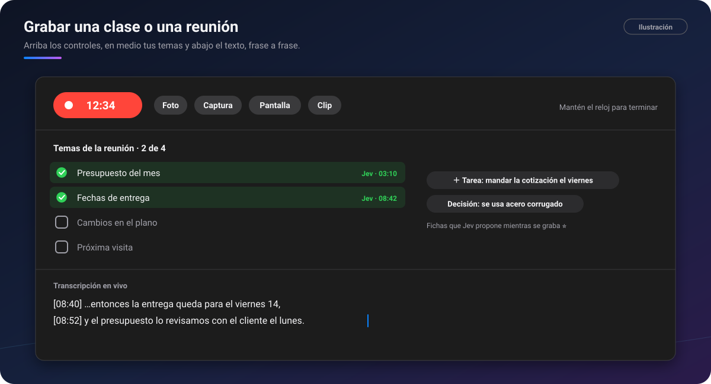

# 🎙️ Grabar clases y reuniones

[🏠 Inicio](Inicio.md) · **Plan: ⭐ Pro**

| Windows | Android | macOS | iPad | iPhone |
|:-:|:-:|:-:|:-:|:-:|
| ✅ | ✅ | ✅ | ✅ | ⏳ |

Una sola grabadora para una **clase en persona**, una **clase por pantalla** o una **reunión**. Graba
el audio, la pantalla si quieres, y las fotos y capturas que tomas, cada una en su minuto. Lo pasa a
texto **en tu propio aparato** y, mientras grabas, ves la **transcripción en vivo**.

*Ilustración: la pantalla completa de la grabación, con los temas que Jev va marcando y el texto en
vivo.*

## Qué hace

- **La barra de grabación**: el reloj **● 12:34** pausa o sigue con un toque, y **mantenerlo
  pulsado termina** y guarda. Al lado: **Foto** con la cámara, **Captura** de la pantalla,
  **Pantalla** para encender o apagar el vídeo (el audio sigue siempre) y **Clip** de cámara.
- **Pantalla completa** (⛶): arriba los controles en grande, en medio tu lista de temas y abajo
  **la transcripción en vivo**, frase a frase, con A− y A+.
- **Temas de la reunión**: escribe o pega los temas antes de empezar, o tómalos de una lista de
  tareas. Durante la reunión los marcas a mano o deja que [Jev](Jev.md) los marque solo.
- **Al terminar**, el audio, el vídeo, las capturas y el texto quedan juntos en el chat elegido, en
  una sola tarjeta, lista para **Estudiar la clase**.
- **Resumen** de la transcripción y lo importante de la clase marcado por Jev.
- **El móvil o el iPad como cámara del PC**: mientras el PC graba, sus fotos y clips entran en su
  minuto.
- **Grabar sin perder nada**: si algo se corta (batería, un cierre), PinDesk ofrece **Recuperar**.

## Cómo se usa, paso a paso

1. Ve a **Funciones → Grabar reunión**.
2. **Prepara**: elige qué grabar (pantalla, micrófono, sonido del equipo), el chat donde se guardará
   y, si quieres, los **temas** que vas a tratar.
3. **Graba**. Toma fotos o capturas cuando haya algo en la pizarra.
4. **Mantén pulsado el reloj** para terminar.
5. Abre la tarjeta del chat y pulsa **Estudiar**: texto con sus minutos, capturas y marcadores.
   Ver [Lecciones y estudio](Lecciones-y-estudio.md#estudiar-la-clase).

## Fortalezas

- **Nada se queda fuera**: voz, pantalla, fotos y capturas, sincronizadas en el tiempo.
- **Ves el texto mientras hablan**: útil si te perdiste una frase o hay ruido.
- **La agenda se marca sola**: sabes qué temas faltan antes de que termine la reunión.
- **Paso a texto en tu aparato**: la voz no tiene que salir para transcribirse.
- **Lista para estudiar o compartir**: página web con reproductor, PDF, Word o Markdown, con las
  capturas en su minuto.
- **Una sola grabadora**, la misma en todos los aparatos, sin modos confusos.

## Consejos

- Prepara los temas desde una lista de tareas: lo que no se trate pasa a la próxima reunión.
- En una clase presencial, usa el móvil como cámara y deja el PC grabando el audio.

## Preguntas frecuentes

**¿Es legal grabar?** Graba **solo cuando tengas permiso** de las personas presentes y respeta las
normas de tu centro o tu empresa.

**Si se me acaba Pro, ¿pierdo mis grabaciones?** No: las que ya hay se abren y se estudian. Lo de Pro
es grabar nuevas.

**¿Funciona sin internet?** La grabación y el paso a texto, sí. Lo de Jev y el resumen necesitan
conexión.

---

[← Comentarios avanzados](Comentarios-avanzados.md) · [Inicio](Inicio.md) · Siguiente: [Asistente IA →](Asistente-IA.md)
