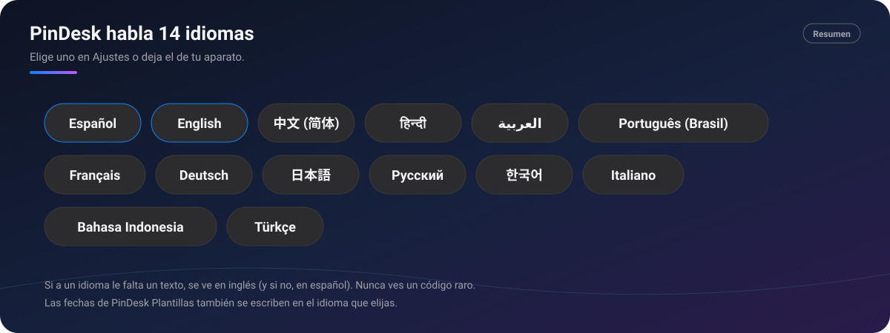

# 🌍 Idiomas

[🏠 Inicio](Inicio.md) · **Plan: 🟢 Gratis**

| Windows | Android | macOS | iPad | iPhone |
|:-:|:-:|:-:|:-:|:-:|
| ✅ | ✅ | ✅ | ✅ | ⏳ |

PinDesk habla **14 idiomas**. Elige uno en **Ajustes** o deja el de tu aparato.

*Resumen: los 14 idiomas, cada uno con su nombre en su propia lengua.*

## Qué hace

| Idioma | En el selector |
|---|---|
| Español | Español |
| Inglés | English |
| Chino simplificado | 中文 (简体) |
| Hindi | हिन्दी |
| Árabe | العربية |
| Portugués de Brasil | Português (Brasil) |
| Francés | Français |
| Alemán | Deutsch |
| Japonés | 日本語 |
| Ruso | Русский |
| Coreano | 한국어 |
| Italiano | Italiano |
| Indonesio | Bahasa Indonesia |
| Turco | Türkçe |

- **Español e inglés están completos.** En los demás, lo que aún no está traducido **se ve en inglés**
  (y si tampoco, en español). Nunca verás un código raro en su lugar.
- **El idioma del sistema**: con «El de Windows» (o «El del teléfono»), PinDesk usa el de tu aparato
  si es uno de los 14; si no, inglés.
- **Plurales y fechas** siguen las reglas de cada idioma.
- **La voz** se pasa a texto en el idioma que elijas para tus audios, con un segundo idioma si
  hablas mezclado.

## Cómo se usa, paso a paso

1. Abre **Ajustes → General → Idioma** (en Android, la tarjeta **Idioma** abajo del todo).
2. Elige un idioma de la lista o «El del sistema».
3. Listo: la app cambia de idioma.

## Fortalezas

- **14 idiomas, también los de escritura distinta**: árabe, chino, japonés, coreano, hindi.
- **Nunca te quedas a medias**: si falta un texto, sale en inglés.
- **Fechas bien escritas** en cada idioma, también en [PinDesk Plantillas](PinDesk-Plantillas.md)
  («viernes, 6 de noviembre de 2026», «2026年11月6日»).
- **Cada aparato con su idioma**, si quieres: el idioma es de cada aparato.

## Preguntas frecuentes

**¿Puedo ayudar a traducir?** Cuéntalo en [Issues](https://github.com/1xmanMAX/PINDESK-/issues/new/choose).

**Mi idioma no está en la lista.** Se verá en inglés. Propónlo en Issues.

---

[← Flow Launcher y atajos](Flow-Launcher-y-atajos.md) · [Inicio](Inicio.md) · Siguiente: [Cuenta y planes →](Cuenta-y-planes.md)
