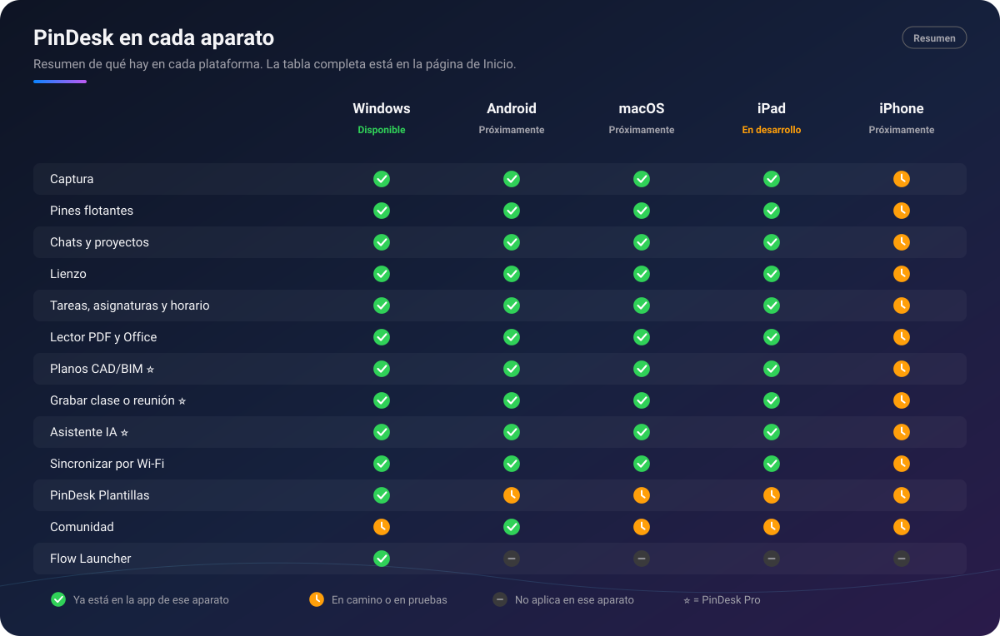

# Wiki de PinDesk

[← Volver al repositorio](../README.md) · [English summary](en/Home.md)

Te damos la bienvenida a la wiki de **PinDesk**. Aquí está todo lo que hace la app, en cada aparato,
explicado con calma y con imágenes. No hace falta leerla entera: elige lo que te interese en el
índice de abajo o en la barra lateral.

## ¿Qué es PinDesk?

**PinDesk** es una app para tener a mano todo lo que ves, apuntas y estudias:

- **Capturas** la pantalla y dejas lo que quieras **flotando encima** de tus ventanas: una foto, un
  vídeo, un PDF o una lista de tareas.
- **Lo guardas todo en chats**, uno por proyecto, como en la mensajería del móvil: notas, fotos,
  notas de voz, documentos y lienzos, cada cosa con su fecha.
- **Dibujas, mides y anotas** encima de cualquier cosa: capturas, PDF, Word, planos o un lienzo en
  blanco.
- **Organizas tu día**: tareas que entienden lo que escribes, tu horario de clases con aviso, un
  timeline de lo que pasa y lecciones aprendidas para no repetir errores.
- **Tus aparatos tienen lo mismo**: se sincronizan por la Wi‑Fi de casa, gratis, y por la nube con
  PinDesk Pro.

Está pensada para estudiantes, profesionales y cualquiera que trabaje con muchas cosas abiertas a la
vez. Arranca al instante y va fluida en equipos modestos.

*Resumen de lo que hay en cada aparato. El detalle está en la tabla de abajo.*

## Gratis y Pro, de un vistazo

En cada página verás una de estas dos marcas:

- **🟢 Gratis**: está en el plan gratuito, sin fecha de caducidad. Incluye casi todo, también
  **sincronizar por Wi‑Fi** y **PinDesk Plantillas sin IA**.
- **⭐ Pro**: es de **PinDesk Pro**: la sincronización por la nube, la inteligencia artificial
  (Asistente, la urgencia de Jev, los resúmenes de las transcripciones y Plantillas con IA) y las
  herramientas profesionales (planos CAD, comentarios avanzados, grabar clases y reuniones y
  exportar a una página web interactiva).

Cada cuenta de Google nueva tiene **30 días de Pro de prueba**. Pro se ofrece como plan **mensual**,
**anual** o **de por vida**, para **hasta 3 aparatos**. **Precios: próximamente.** Lo tienes todo
en [Cuenta y planes](Cuenta-y-planes.md).

> [!NOTE]
> Algunas funciones se abren **poco a poco**. Si en tu app ves «disponible pronto» en algo que
> describe esta wiki, es que llega en una próxima actualización.

## En qué aparatos funciona

| Plataforma | Estado | Página |
|---|---|---|
| 🪟 **Windows 10 (21H2 o posterior) y 11** | ✅ Disponible | [Windows](Windows.md) |
| 🤖 **Android 10 o posterior** | ⏳ Próximamente | [Android](Android.md) |
| 💻 **macOS 15 o posterior** | ⏳ Próximamente | [macOS](macOS.md) |
| 📱 **iPadOS 18 o posterior** | ⏳ En desarrollo | [iPad](iPad.md) |
| 📱 **iPhone (iOS)** | ⏳ Próximamente | [iPhone](iPhone.md) |

La descarga para Windows está en la [página principal](../README.md#descargar). Las demás se
publicarán en este mismo repositorio.

### Qué hay en cada aparato

**✅** ya está en la app de ese aparato · **⏳** en camino o en pruebas · **—** no aplica en ese
aparato. Las apps de Android, Mac, iPad e iPhone todavía no tienen descarga pública: ✅ quiere decir
que la función ya está hecha en esa app y llegará con ella.

| Función | Plan | Windows | Android | macOS | iPad | iPhone |
|---|:-:|:-:|:-:|:-:|:-:|:-:|
| [Captura](Captura.md) de pantalla | 🟢 | ✅ | ✅ | ✅ | ✅¹ | ⏳ |
| Texto de una imagen (OCR) | 🟢 | ✅ | ✅ | ✅ | ✅ | ⏳ |
| [Pines flotantes](Pines-flotantes.md) | 🟢 | ✅ | ✅ | ✅ | ✅² | ⏳ |
| Pin en vivo | 🟢 | ✅ | — | ✅ | — | — |
| [Chats y proyectos](Chats-y-proyectos.md) | 🟢 | ✅ | ✅ | ✅ | ✅ | ⏳ |
| Chats compartidos con otras personas | 🟢 | ✅ | ✅ | ✅ | ✅ | ⏳ |
| [Lienzo](Lienzo.md), figuras y panel de estilo | 🟢 | ✅ | ✅ | ✅ | ✅ | ⏳ |
| [Tareas](Tareas.md) en tarjetas y Kanban | 🟢 | ✅ | ✅ | ✅ | ✅ | ⏳ |
| [Asignaturas y horario](Asignaturas-y-horario.md) con aviso | 🟢 | ✅ | ✅ | ✅ | ✅ | ⏳ |
| [Lecciones aprendidas](Lecciones-y-estudio.md) y repaso | 🟢 | ✅ | ✅ | ✅ | ✅ | ⏳ |
| [Timeline](Lecciones-y-estudio.md#timeline-tu-día-minuto-a-minuto) | 🟢 | ✅ | ⏳ | ✅ | ✅ | ⏳ |
| [Lector de PDF, Office y EPUB](Lector-de-documentos.md) | 🟢 | ✅ | ✅ | ✅ | ✅ | ⏳ |
| [Marcas de texto](Lector-de-documentos.md#marcar-el-texto) | 🟢 | ✅ | ✅ | ✅ | ✅ | ⏳ |
| [Planos CAD y modelos BIM](Planos-CAD-BIM.md) | ⭐ | ✅ | ✅ | ✅ | ✅ | ⏳ |
| [Comentarios avanzados](Comentarios-avanzados.md) con minichat | ⭐ | ✅ | ✅³ | ⏳ | ⏳ | ⏳ |
| [Grabar clases y reuniones](Grabar-clases-y-reuniones.md) | ⭐ | ✅ | ✅ | ✅ | ✅ | ⏳ |
| [Asistente con IA](Asistente-IA.md) | ⭐ | ✅ | ✅ | ✅ | ✅ | ⏳ |
| Asistente que crea mini-apps, PDF y planos | ⭐ | ⏳ | ✅ | ⏳ | ⏳ | ⏳ |
| [Jev](Jev.md): urgencia y temas en vivo | ⭐ | ✅ | ✅ | ✅ | ✅ | ⏳ |
| [Sincronizar por Wi‑Fi y QR](Sincronizacion.md) | 🟢 | ✅ | ✅ | ✅ | ✅ | ⏳ |
| [Sincronizar por la nube](Sincronizacion.md#por-la-nube) | ⭐ | ✅ | ✅ | ✅ | ✅ | ⏳ |
| [PinDesk Plantillas](PinDesk-Plantillas.md) (sin IA / con IA ⭐) | 🟢 / ⭐ | ✅ | ⏳ | ⏳ | ⏳ | ⏳ |
| [Comunidad](Comunidad.md) | 🟢 | ⏳ | ✅⁴ | ⏳ | ⏳ | ⏳ |
| [Exportar y compartir](Exportar-y-compartir.md) | 🟢 | ✅ | ✅ | ✅ | ✅ | ⏳ |
| Página web interactiva | ⭐ | ✅ | ✅ | ✅ | ✅ | ⏳ |
| [Música y karaoke](Musica-y-karaoke.md) | 🟢 | ✅ | ✅ | ✅ | ✅ | ⏳ |
| [Flow Launcher](Flow-Launcher-y-atajos.md) | 🟢 | ✅ | — | — | — | — |
| [Atajos de teclado](Flow-Launcher-y-atajos.md#atajos-de-teclado) en todo el sistema | 🟢 | ✅ | — | ✅ | — | — |
| [14 idiomas](Idiomas.md) | 🟢 | ✅ | ✅ | ✅ | ✅ | ⏳ |
| [Cuenta de Google y planes](Cuenta-y-planes.md) | 🟢 | ✅ | ✅ | ⏳ | ⏳ | ⏳ |

1. En el iPad se captura lo que ves en PinDesk y tus fotos: iPadOS no deja a ninguna app capturar
   otras apps. Para eso está la captura del sistema, que se manda a PinDesk con **Compartir**.
2. En el iPad los pines flotan dentro de PinDesk, no encima de otras apps.
3. En Android, por ahora, en los planos. El resto llega pronto.
4. La Comunidad se abre poco a poco: puede que aún veas «disponible pronto».

## Todas las páginas

**Plataformas**

- 🪟 [Windows](Windows.md) · 🤖 [Android](Android.md) · 💻 [macOS](macOS.md) · 📱 [iPad](iPad.md) ·
  📱 [iPhone](iPhone.md)

**Capturar y tener a mano**

- 📸 [Captura](Captura.md): zona, ventana, pantalla, con scroll, GIF y texto.
- 📌 [Pines flotantes](Pines-flotantes.md): cualquier cosa, siempre encima.
- 💬 [Chats y proyectos](Chats-y-proyectos.md): todo guardado como en un chat.

**Crear, leer y anotar**

- ✏️ [Lienzo](Lienzo.md): hoja infinita, figuras y panel de estilo.
- 📖 [Lector de PDF, Office y EPUB](Lector-de-documentos.md), con marcas de texto.
- 📐 [Planos CAD y BIM](Planos-CAD-BIM.md) ⭐
- 🔴 [Comentarios avanzados](Comentarios-avanzados.md) ⭐
- 🗓️ [PinDesk Plantillas](PinDesk-Plantillas.md)

**Organizar y estudiar**

- ✅ [Tareas](Tareas.md)
- 🎓 [Asignaturas y horario](Asignaturas-y-horario.md)
- 💡 [Lecciones y estudio](Lecciones-y-estudio.md): lecciones, repaso y timeline.
- 🎙️ [Grabar clases y reuniones](Grabar-clases-y-reuniones.md) ⭐

**Inteligencia artificial** ⭐

- 🤖 [Asistente IA](Asistente-IA.md)
- ⚡ [Jev](Jev.md)

**Compartir y conectar**

- 🔄 [Sincronización](Sincronizacion.md): Wi‑Fi, QR, nube y sin conexión.
- 🌐 [Comunidad](Comunidad.md)
- 📤 [Exportar y compartir](Exportar-y-compartir.md)
- 🎵 [Música y karaoke](Musica-y-karaoke.md)
- ⌨️ [Flow Launcher y atajos](Flow-Launcher-y-atajos.md)

**Tu cuenta**

- 🌍 [Idiomas](Idiomas.md)
- 💳 [Cuenta y planes](Cuenta-y-planes.md)
- 🔒 [Privacidad](Privacidad.md)

## ¿Algo no va o se te ocurre una mejora?

Cuéntalo en [Issues](https://github.com/1xmanMAX/PINDESK-/issues/new/choose): hay un formulario para
informar de un fallo y otro para proponer una función. Para asuntos privados (tu cuenta, un pago o
tus datos), escribe a **max.antony.8.5.1@gmail.com**.
