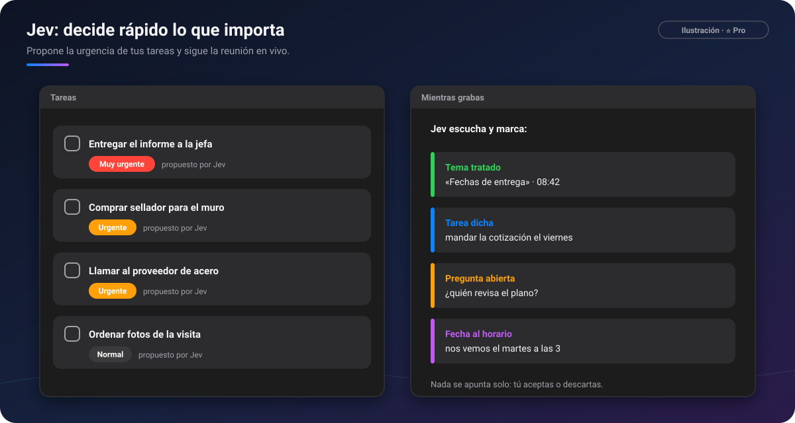

# ⚡ Jev

[🏠 Inicio](Inicio.md) · **Plan: ⭐ Pro**

| Windows | Android | macOS | iPad | iPhone |
|:-:|:-:|:-:|:-:|:-:|
| ✅ | ✅ | ✅ | ✅ | ⏳ |

**Jev** es una inteligencia artificial distinta del asistente: **no escribe textos, decide**. Contesta
en un instante preguntas como «¿esta frase encarga una tarea?» o «¿qué pasa si esta tarea se hace
tarde?». PinDesk la usa para ayudarte sin interrumpirte, y **la decisión final siempre es tuya**.

*Ilustración: a la izquierda, la urgencia que Jev propone para cada tarea; a la derecha, lo que marca
mientras grabas.*

## Qué hace

**Urgencia de las tareas**

- Lee cada tarea (y el contexto de su chat) y **propone su urgencia**: normal, urgente o muy
  urgente, sin que tengas que escribir «urgente».
- Tiene en cuenta cuánto falta para su hora, o la fecha del título de su lista («Para mañana»).
- No vuelve a preguntar por la misma tarea, y lo que decide viaja con la lista a tus aparatos.

**Temas en vivo, mientras grabas** ([Grabar clases y reuniones](Grabar-clases-y-reuniones.md))

- **Temas tratados**: marca con ✓ los temas de tu agenda a medida que se tratan, con su minuto.
- **Tareas dichas**: «＋ Tarea: mandar la cotización el viernes» con ✓ y ✕; al aceptarla entra en el
  Inbox con su urgencia y su fecha.
- **Fechas al horario**: «nos vemos el martes a las 3» se apunta con su hora.
- **Decisiones**, **preguntas abiertas**, **tiempo por tema** y **temas olvidados**.
- Al terminar, todo queda en el **acta** de la reunión.

**Al estudiar**

- Marca **lo importante de una clase**: lo que entra en examen, las definiciones y fórmulas clave,
  las decisiones y las tareas.
- **Repasar en voz alta**: explicas la clase con tus palabras y cada punto clave pasa a ✓ cubierto,
  ✗ dicho mal, · falta o ? no queda claro, con un botón para volver a ese minuto.
- **Tarjetas de Anki que valen la pena**.

**Al dictar en el chat**

- Di «anota en el chat de la obra que faltan tornillos» y aparece una chapa para anotarlo en ese
  chat. **Nunca se anota solo**: tú confirmas con Intro.

## Cómo se usa, paso a paso

1. Con PinDesk Pro, Jev se enciende en **Ajustes → Asistente → Jev**, con un interruptor para cada
   idea.
2. Abre [Tareas](Tareas.md): las urgencias propuestas aparecen solas.
3. Al [grabar una reunión](Grabar-clases-y-reuniones.md), escribe tus temas en **Preparar** y mira
   cómo se marcan.
4. Acepta (✓) o descarta (✕) cada ficha que te propone.

## Fortalezas

- **Rápido de verdad**: contesta en una fracción de segundo, así puede seguir una reunión en vivo.
- **Propone, no impone**: nada se apunta solo; tú aceptas o descartas.
- **Solo lo seguro**: si duda, no propone nada.
- **Si falla, todo sigue igual**: sin conexión o sin Pro, PinDesk funciona como siempre.
- **Te ahorra el acta**: decisiones, tareas y preguntas quedan apuntadas al terminar.

## Consejos

- Escribe la agenda como lista de tareas antes de la reunión y elígela con «De una lista».
- Apaga en Ajustes las ideas que no uses, para ver solo lo que te sirve.

## Preguntas frecuentes

**¿Qué se le envía a Jev?** Solo lo necesario para cada pregunta: el texto de la tarea, o la frase
recién transcrita de la reunión. El audio se pasa a texto en tu aparato.

**¿Jev cambia mis tareas?** No. Propone una urgencia que puedes cambiar cuando quieras.

---

[← Asistente IA](Asistente-IA.md) · [Inicio](Inicio.md) · Siguiente: [Sincronización →](Sincronizacion.md)
