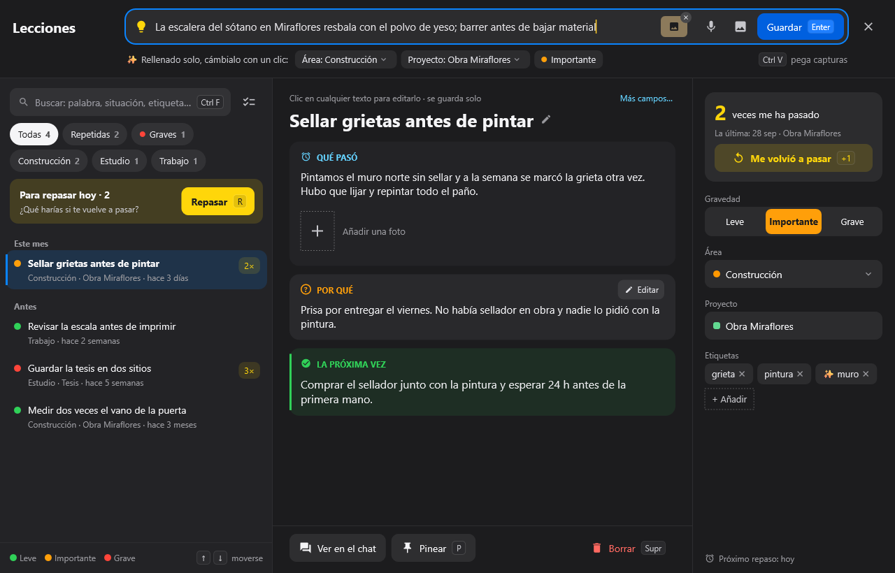
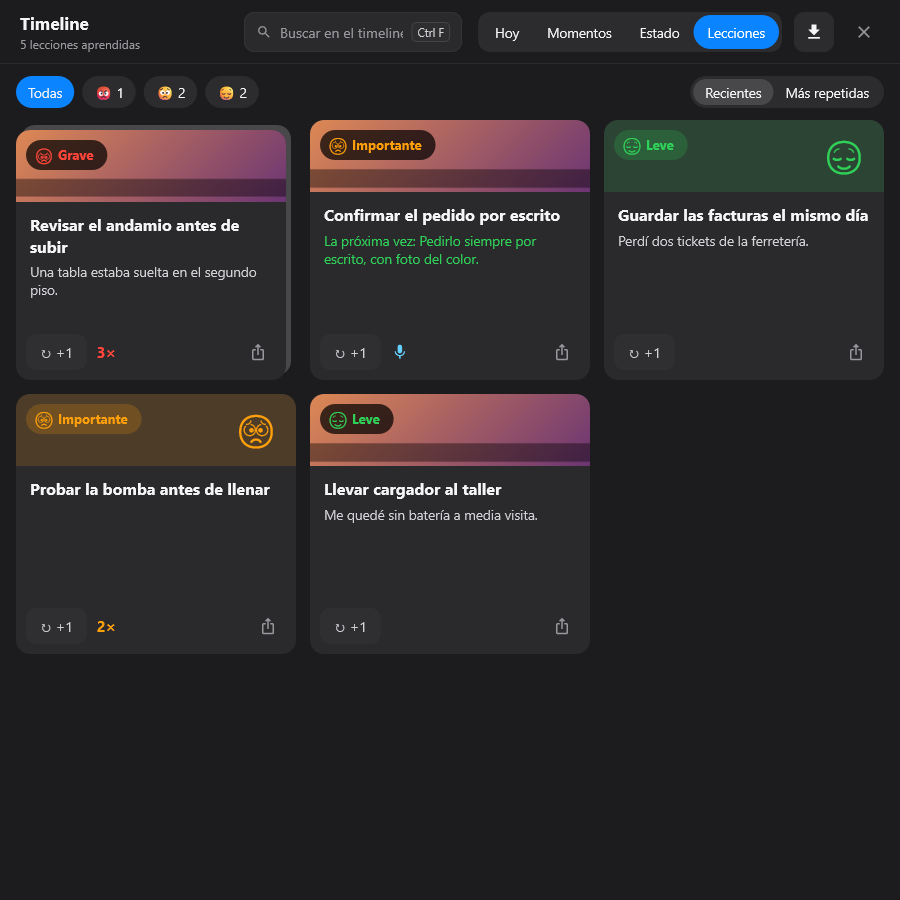
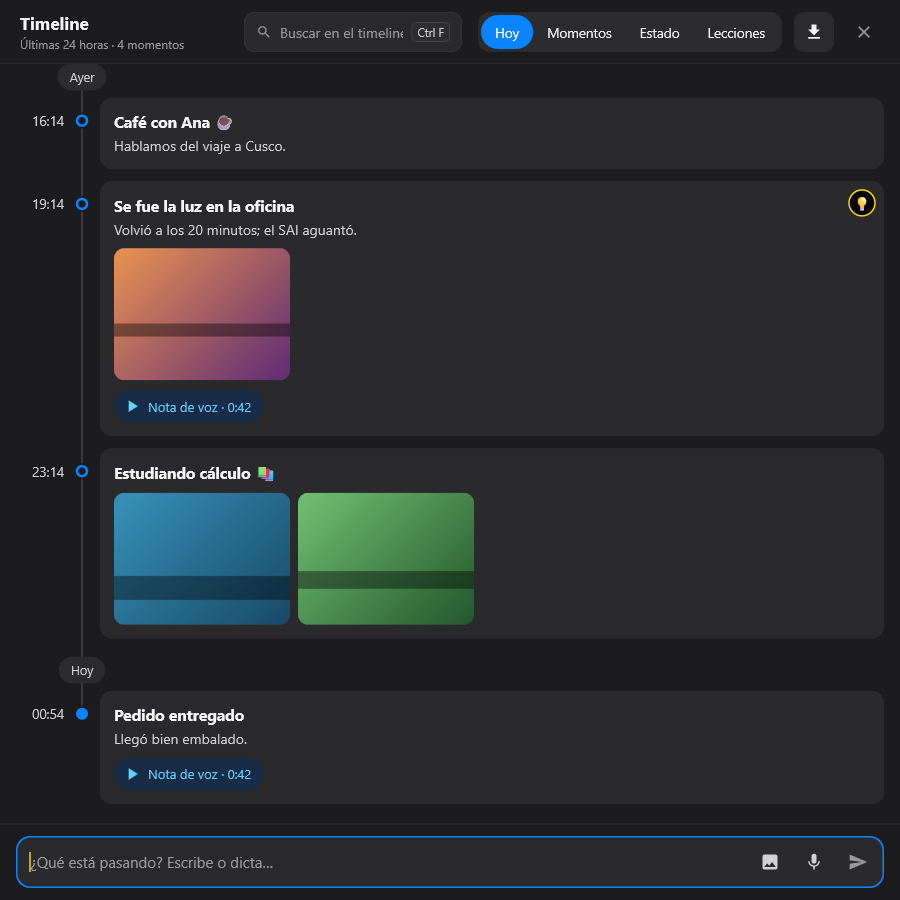
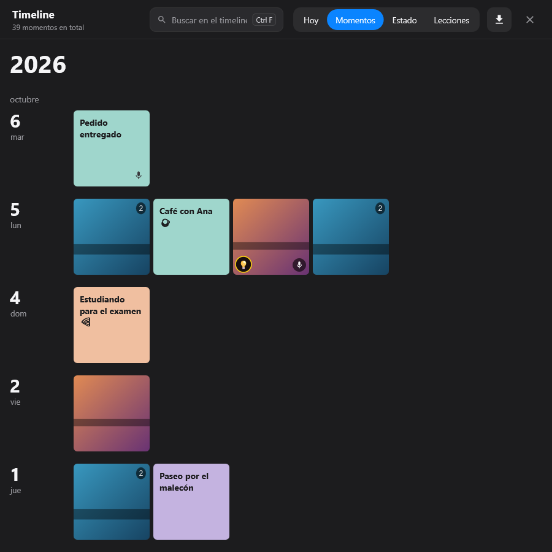
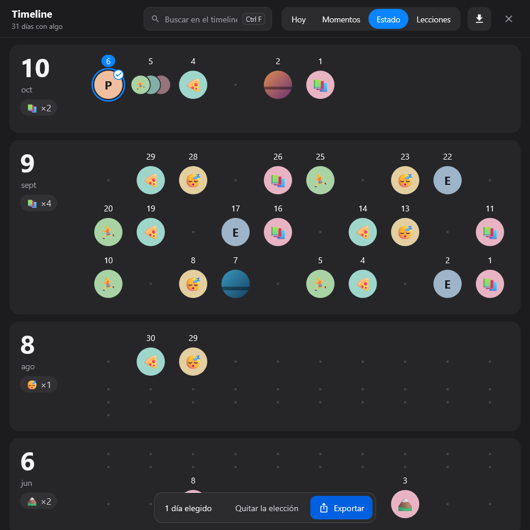
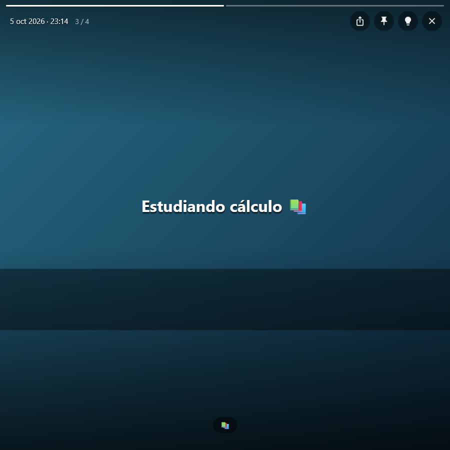

# 💡 Lecciones y estudio

[🏠 Inicio](Inicio.md) · **Plan: 🟢 Gratis**

| | Windows | Android | macOS | iPad | iPhone |
|---|:-:|:-:|:-:|:-:|:-:|
| Lecciones aprendidas y repaso | ✅ | ✅ | ✅ | ✅ | ⏳ |
| Timeline | ✅ | ⏳ | ✅ | ✅ | ⏳ |
| Estudiar una clase grabada | ✅ | ✅ | ✅ | ✅ | ⏳ |

Tres herramientas para aprender de lo que te pasa: las **lecciones aprendidas** (para no repetir
errores), el **timeline** (lo que pasa, minuto a minuto) y **Estudiar la clase** (repasar una clase
grabada).

*Captura de PinDesk para Windows: una lección con qué pasó, por qué y qué hacer la próxima vez.*

## Lecciones aprendidas

**Qué hace**

- Apuntas en dos toques lo que aprendiste, escrito o dictado, con **foto y audio**.
- **Gravedad** con emoticono y color: 😌 leve, 😟 importante, 😡 grave.
- Se proponen solas las etiquetas, el área y el proyecto; tú las cambias con un clic.
- **«Me volvió a pasar»** suma una vez más, y puedes ver primero las más repetidas.
- **Repaso espaciado**: PinDesk te las recuerda a su tiempo. En el repaso, `1` lo recordaba, `2` a
  medias y `3` lo olvidé; así sabe cuándo volver a enseñártela.

**Cómo se usa**

1. Pulsa la bombilla 💡 de un momento del timeline, o **Hacer lección** (`L`) en el menú de un
   mensaje.
2. Escribe qué pasó, por qué, y qué harás la próxima vez.
3. Cuando toque, PinDesk te propone **Repasar** (`R`).

*Captura de PinDesk para Windows: las lecciones viven como una pestaña más del timeline.*

## Timeline: tu día minuto a minuto

**Qué hace**: apuntas lo que pasa **en el momento**, con la voz, escribiendo o con una foto. Es tan
rápido como un chat, pero se ve como una línea de tiempo.

- **Hoy** (las últimas 24 horas), **Momentos** (el archivo, día a día) y **Estado** (cada mes con
  los emoticonos que usaste): tres formas de ver lo mismo.
- Al pulsar un momento se abre como una **historia**, con su foto de fondo y su nota de voz.
- **Al dictar**, «con esto pasó…» abre el título y «y así te lo cuento…» la descripción.
- **Compartir como imagen** y **exportar** a PDF; ⭐ con Pro, a una **página web interactiva** con
  las fotos y los audios dentro.

| Hoy | Momentos |
|---|---|
|  |  |
| **Estado** | **Un momento, como una historia** |
|  |  |

*Capturas de PinDesk para Windows.*

## Estudiar la clase

Una clase o reunión grabada (⭐ [Grabar clases y reuniones](Grabar-clases-y-reuniones.md)) se
estudia en **una sola pantalla**: el texto con sus minutos, las capturas y los marcadores. Un toque
en una frase salta a ese momento del audio; las capturas se pueden **anotar**.

Con ⭐ Pro, [Jev](Jev.md) marca **lo importante** de la clase (lo que entra en examen, las
decisiones, las tareas) y te deja **repasar en voz alta**: explicas la clase con tus palabras y te
dice qué puntos cubriste, cuáles dijiste mal y cuáles faltan. También puedes **mandar tarjetas a
Anki**.

## Fortalezas

- **Un error apuntado no se repite**: las lecciones vuelven a ti con el repaso espaciado, justo
  cuando empiezas a olvidarlas.
- **Sabes qué te pasa más**: «Me volvió a pasar» y el orden por repetidas te enseñan tus patrones.
- **El timeline es tan rápido como un mensaje**, pero te deja ver tu mes de un vistazo con sus
  emoticonos.
- **Tus días, compartibles**: una tarjeta bonita de un momento, o el día entero en PDF.
- **Estudiar con lo que de verdad se dijo**, con cada captura en su minuto.

## Consejos

- Si una lección se parece a una que ya tienes, PinDesk te ofrece «pasó otra vez» en lugar de
  duplicarla.
- Lo anterior a 24 horas no se borra del timeline: está en Momentos y en Estado, y se busca.

## Preguntas frecuentes

**¿Las lecciones se sincronizan?** Sí, y se juntan campo a campo si las cambias en dos aparatos.

**¿Necesito Pro para el timeline?** No. Solo la página web interactiva es de Pro.

---

[← Asignaturas y horario](Asignaturas-y-horario.md) · [Inicio](Inicio.md) · Siguiente: [Lector de documentos →](Lector-de-documentos.md)
