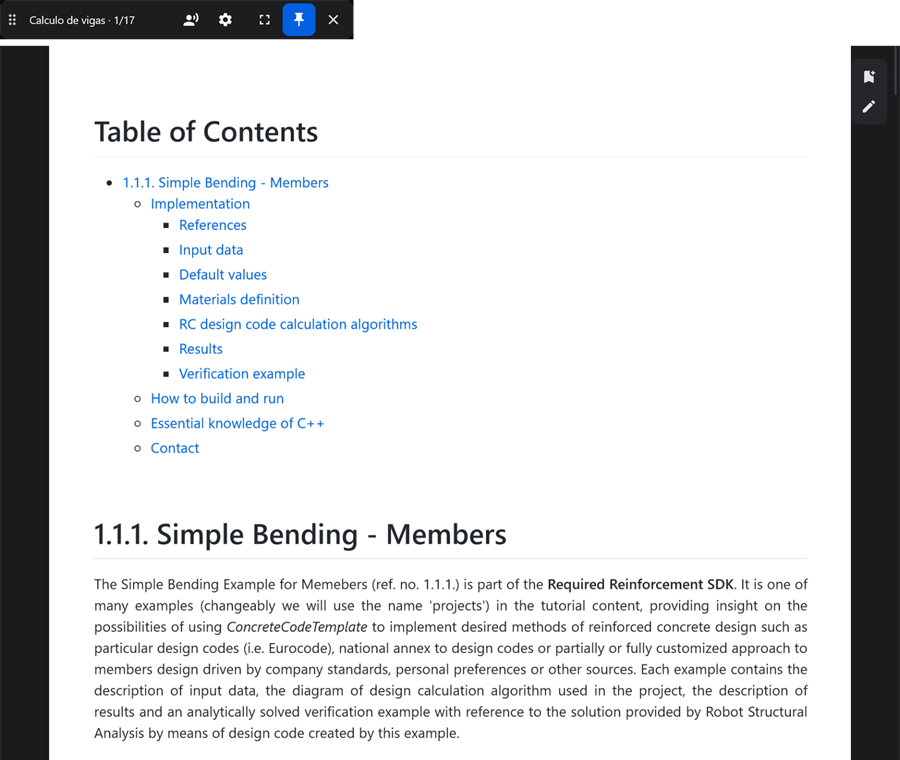
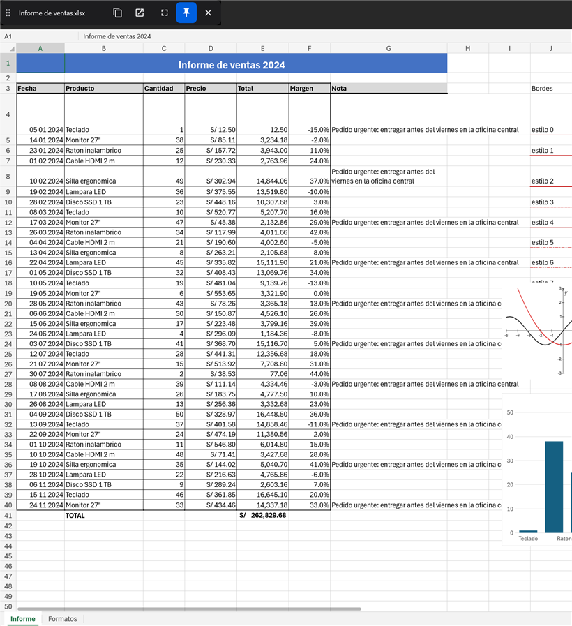
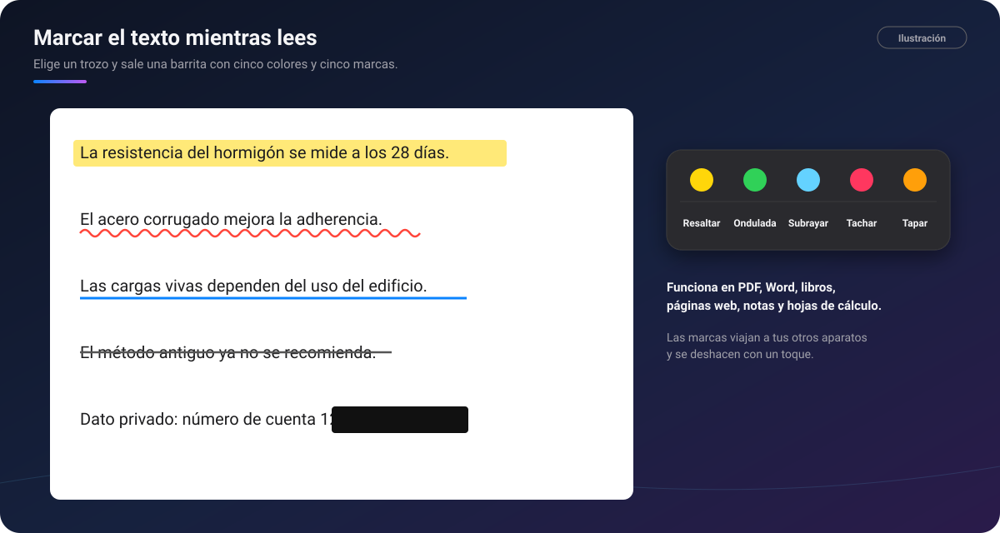

# 📖 Lector de PDF, Office y EPUB, y marcas de texto

[🏠 Inicio](Inicio.md) · **Plan: 🟢 Gratis**

| Windows | Android | macOS | iPad | iPhone |
|:-:|:-:|:-:|:-:|:-:|
| ✅ | ✅ | ✅ | ✅ | ⏳ |

Los **PDF, Word, Excel, PowerPoint, EPUB, Markdown y páginas web** se abren dentro de PinDesk, sin
otro programa. En el ordenador se abren **pequeños, como un pin**, para leer al lado de lo que haces;
o a pantalla completa con `F11`.

*Captura de PinDesk para Windows: un documento abierto como un pin, con su barra arriba.*

## Qué hace

- **Barra de arriba**: nombre y página, índice de capítulos, **escuchar en voz alta**, más opciones,
  pantalla completa y «siempre encima».
- **El riel de la derecha, igual en todos los visores**: 🔖 marcadores con su zoom (`Ctrl M`), ✏️
  anotar a mano (`A`) y ⛶ **marcos numerados** para imprimir solo esas partes (`I`; `Ctrl P` los
  imprime).
- **Word, Excel y PowerPoint al instante**, sin abrir Office: páginas, tablas, imágenes, colores,
  pestañas y gráficos. PowerPoint se presenta a pantalla completa con `F5`.
- **Hojas de Excel enormes** sin esperar, con filas y columnas fijas.
- **Leer en voz alta**, con el párrafo resaltado y un marcador que recuerda dónde lo dejaste.
- **Desplazar sola**: la página sube a tu velocidad de lectura y te dice a qué hora terminas.
- **Lo anotado viaja**: la tinta, los marcadores y los marcos se sincronizan con tus otros aparatos.

*Captura de PinDesk para Windows: un informe de Excel con sus formatos y gráficos.*

## Marcar el texto

Elige un trozo de texto y sale una **barrita** con copiar, **cinco colores** y **cinco marcas**:
**resaltar**, **ondulada**, **subrayar**, **tachar** y **tapar** (para ocultar un dato), y quitar.
Funciona en PDF, Office, Word y libros, notas, páginas web y **hojas de cálculo** (marca celdas
enteras).

*Ilustración: resaltar, ondulada, subrayar, tachar y tapar, con la barrita de colores.*

## Cómo se usa, paso a paso

1. **Abre el documento**: desde el chat, con doble clic (si PinDesk es tu app predeterminada), con
   **Espacio** en el Explorador de Windows o con «Abrir con PinDesk» en el móvil.
2. **Lee**: rueda o dedo para moverte; `F11` a pantalla completa; `Esc` vuelve a pin.
3. **Marca o anota**: elige texto para la barrita, o pulsa `A` para la tinta con las herramientas
   del [lienzo](Lienzo.md).
4. **Pon marcos** (`I`) en las partes que quieres imprimir y pulsa `Ctrl P`.
5. **Comparte** el documento con lo anotado, ya fusionado.

## En cada aparato

- **Windows**: los Word y PowerPoint **antiguos** (`.doc`, `.ppt`, RTF, OpenDocument) se ven con la
  vista previa de Office y, si tienes Office, se convierten una vez para anotarlos.
- **Android**: tres lectores iguales (Word, libro y PDF), zoom libre, un PDF **se puede ver como
  texto** y un Word como hojas, voces sin conexión y lectura con la pantalla apagada.
- **Mac e iPad**: mismos visores sin bordes, con el lápiz que trae la barra del lienzo y voz en alto
  con la palabra resaltada.

## Fortalezas

- **Office sin Office, en una décima de segundo**: un Word de cien páginas se abre al instante.
- **Leer al lado, no encima**: el documento como un pin pequeño mientras escribes en otra ventana.
- **Imprimir solo lo que importa** con los marcos numerados, cada uno en su hoja.
- **Una sola forma de anotar** en todos los formatos, y la misma barra en todos los visores.
- **Tapar datos** antes de compartir, sin salir del lector.
- **Escuchar mientras haces otra cosa**, y volver justo al párrafo donde lo dejaste.
- **Todo viaja**: marcas, tinta y marcadores, a tus otros aparatos.

## Consejos

- Un PDF entra en el chat como **un solo mensaje** y sus páginas se anotan como lienzos.
- Ajusta la velocidad de «desplazar sola» en palabras por minuto: no cambia al agrandar la letra.

## Preguntas frecuentes

**¿Necesito tener Office instalado?** No para `.docx`, `.xlsx` y `.pptx`. Solo para convertir los
antiguos (`.doc`, `.ppt`) en Windows.

**¿Se cambia el archivo original al anotarlo?** Lo anotado se guarda aparte y se une al compartir.

---

[← Lecciones y estudio](Lecciones-y-estudio.md) · [Inicio](Inicio.md) · Siguiente: [Planos CAD y BIM →](Planos-CAD-BIM.md)
