# ✏️ Lienzo

[🏠 Inicio](Inicio.md) · **Plan: 🟢 Gratis** (exportar a página web interactiva: ⭐ Pro)

| Windows | Android | macOS | iPad | iPhone |
|:-:|:-:|:-:|:-:|:-:|
| ✅ | ✅ | ✅ | ✅ | ⏳ |

Un lienzo es una **hoja infinita** para dibujar, explicar, medir o calcular. Vive dentro de su chat,
así que siempre sabes de qué proyecto es.

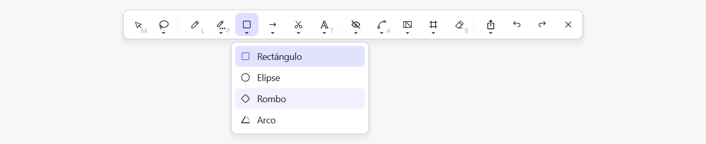

*Captura de PinDesk para Windows: la barra agrupada; cada grupo enseña su última herramienta.*

## Qué hace

- **Tinta**: lápiz, grafito (con siete durezas en Android), resaltador, goma y bote de relleno.
- **Figuras**: rectángulo, elipse, rombo, arco, líneas y flechas rectas, curvas o en codo.
- **Texto sin caja**, con **ocho tipos de letra** incluidos, también letra «a mano».
- **Construir y medir**: recortar y extender líneas, soldar vértices, puntos con letra, cotas que
  calculan, escala gráfica, calibrar y ángulos con su letra griega (`W`).
- **Señalar y tapar**: pasos numerados, foco, lupa, pixelar o desenfocar, puntero láser y
  marcadores.
- **Gráficas y tablas**, también pegadas desde Excel o Google Sheets.
- **Biblioteca de figuras**: guarda las tuyas y usa las de serie, de día o de noche.
- **Zona al chat**: un trozo del lienzo va al chat con un enlace de vuelta.

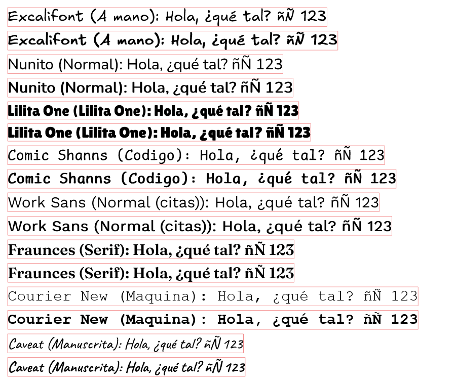

*Captura de PinDesk para Windows: los ocho tipos de letra, en normal y en negrita.*

## El panel de estilo

Al elegir una herramienta o una figura sale su **panel de estilo**:

- **Trazo**: el color de la línea, con los colores de siempre y un **selector avanzado** (código,
  tonos, opacidad, cuentagotas y recientes).
- **Fondo y relleno** de las figuras.
- **Grosor** del trazo, **presión** (sí o no) y **opacidad**.
- **Tipo de línea**: continua, discontinua o punteada; esquinas redondeadas o en pico.
- El lienzo **recuerda el último trazo a mano** que usaste.

En **Ajustes → Lienzo** eliges **qué herramientas se ven y dónde**: en todas partes, o solo en el
lienzo, en los pines o en el lector, para que cada barra lleve solo lo que usas ahí.

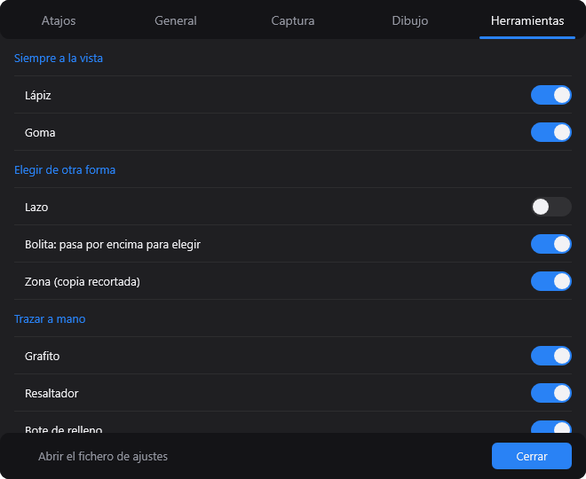

*Captura de PinDesk para Windows: qué herramientas se ven siempre.*

## Cómo se usa, paso a paso

1. **Crea un lienzo** con el «+» del chat o con **Funciones → Nuevo lienzo**.
2. **Elige una herramienta** de la barra; cada grupo despliega sus hermanas.
3. **Dibuja**. Si te paras un segundo al final de un trazo grande, se vuelve recta o rectángulo.
4. **Mide**: con la cota, el número sale solo; **calibra** con una medida conocida y las cotas salen
   en metros.
5. **Comparte o imprime**: PNG, JPG, SVG o PDF, o la **página web interactiva** ⭐.

| Soldar vértices | Pasos y foco | Gráfica | Tabla pegada |
|---|---|---|---|
| 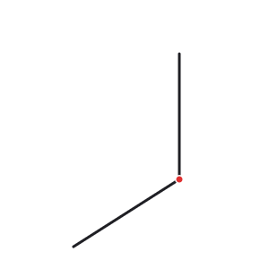 | 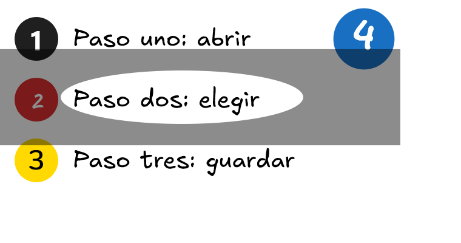 | 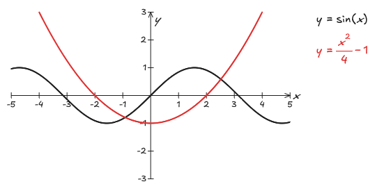 | 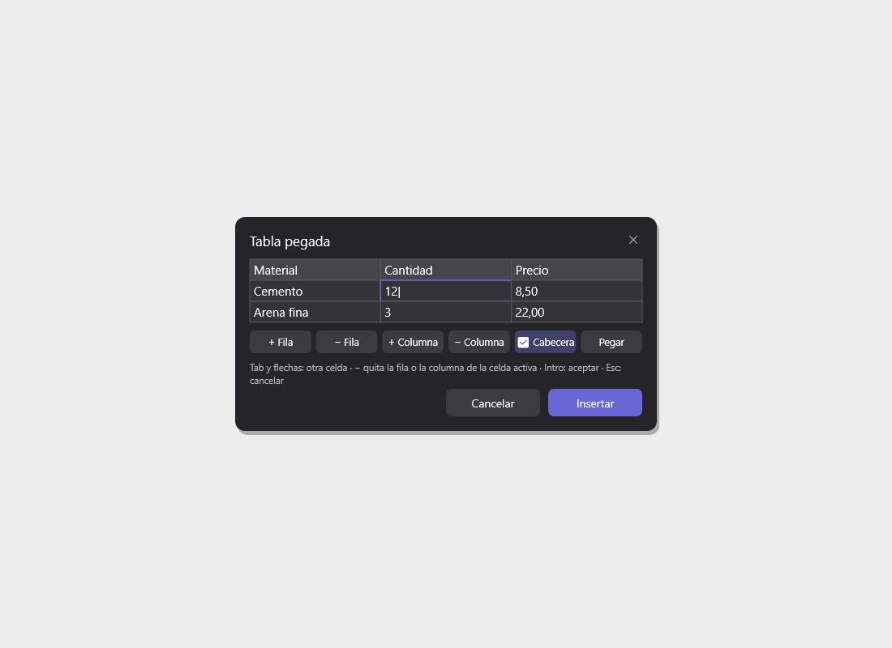 |

*Capturas de PinDesk para Windows.*

| Puntos con letra | Pixelar para tapar | Lupa |
|---|---|---|
| 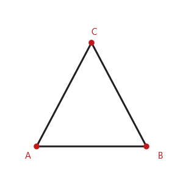 | 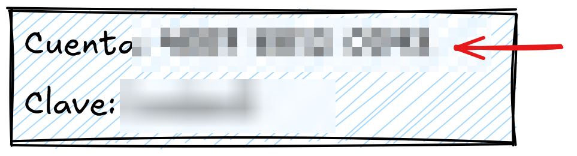 | 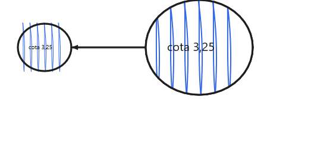 |

*Capturas de PinDesk para Windows.*

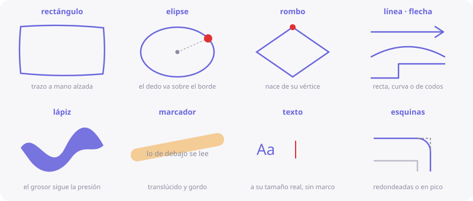

*Ilustración de PinDesk para Android: las figuras y la tinta.*

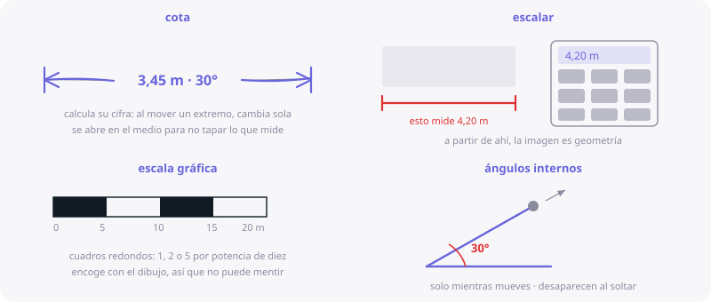

*Ilustración de PinDesk para Android: cota, escalar, escala gráfica y ángulos.*

## En cada aparato

- **Windows y Mac**: ratón, teclado y trackpad (pellizcar y mover con dos dedos); en el Mac, también
  la presión de una tableta.
- **Android**: un dedo dibuja y dos mueven; el segundo dedo convierte el trazo en figura perfecta.
  Hasta **tres lienzos abiertos a la vez** y el **croquis 3D**, que dibuja en el espacio.
- **iPad**: el **Apple Pencil** con presión, y «Dibujar con el dedo» si lo prefieres.

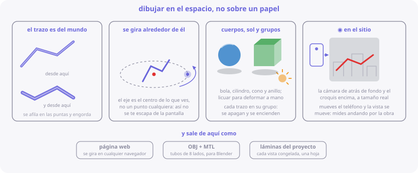

*Ilustración de PinDesk para Android: el croquis en el espacio.*

## Fortalezas

- **Medir de verdad**: cotas que calculan, calibrar con una medida conocida y ángulos con su letra
  griega. Sirve para planos y para geometría, no solo para garabatear.
- **Tapar datos sin otra app**: pixelar, desenfocar o mosaico antes de compartir.
- **Tablas de Excel que se quedan tablas**, con sus celdas combinadas.
- **Cada barra con lo que usas**: tú decides qué herramientas salen en cada sitio.
- **La misma tinta en todos tus aparatos**: dibujas en el móvil y sigues en el PC.
- **Exportar a una página web que se puede volver a anotar** ⭐: quien la recibe no necesita
  instalar nada.

## Consejos

- `W` pone la marca de ángulo con la siguiente letra libre (α, β, θ…); otra vez `W`, el de 90°.
- Manda una **zona al chat** para resolver un ejercicio aparte sin perder el original.
- Guarda tus símbolos repetidos en la **biblioteca de figuras**.

## Preguntas frecuentes

**¿Puedo abrir mis lienzos de Excalidraw?** Sí, los `.excalidraw` se siguen abriendo.

**¿Las fotos del lienzo viajan a mis otros aparatos?** Sí, con la sincronización.

---

[← Chats y proyectos](Chats-y-proyectos.md) · [Inicio](Inicio.md) · Siguiente: [Tareas →](Tareas.md)
