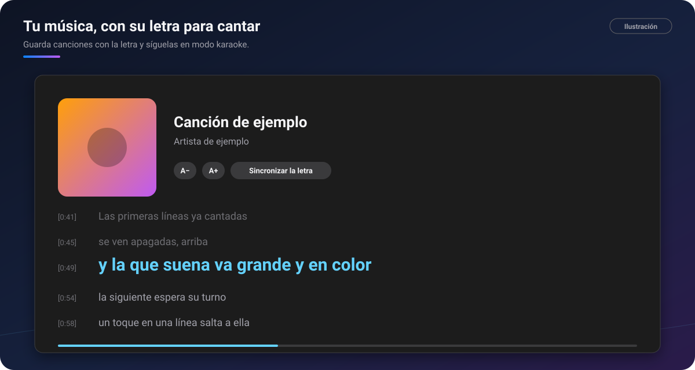

# 🎵 Música y karaoke

[🏠 Inicio](Inicio.md) · **Plan: 🟢 Gratis**

| Windows | Android | macOS | iPad | iPhone |
|:-:|:-:|:-:|:-:|:-:|
| ✅ | ✅ | ✅ | ✅ | ⏳ |

Guarda tus canciones **con su letra** en cualquier chat y cántalas cuando quieras: la línea que
suena va grande y en color, como en un karaoke.

*Ilustración: la portada, el título y la letra que sigue a la canción.*

## Qué hace

- **Adjuntar → Música**: elige tus audios (mp3, m4a, flac, ogg, wav…). Si al lado hay un archivo
  de letra con el mismo nombre, entra con ella.
- **La tarjeta de la canción** en el chat, con la **portada**, el **título** y el **artista** que
  trae el archivo.
- **El karaoke**: la línea que suena va grande, las cantadas se apagan y un toque en una línea lleva
  la canción ahí. **A−** y **A+** cambian el tamaño.
- **Pegar una letra con tiempos**: se convierte sola.
- **Sincronizar la letra**: en el PC, toca **Espacio** al empezar cada línea y queda con su minuto,
  o deja que PinDesk la **sincronice sola** escuchando la canción. En Android, «Sincronizar la letra»
  se hace con la app compañera **LetraSync Pro**, y la letra vuelve sola a PinDesk.
- **Biblioteca de audio**: toda tu música y tus notas de voz juntas.
- **Mandos del sistema** (Android): en la notificación, la pantalla de bloqueo y los auriculares;
  se pausa al quitártelos.
- Las canciones **viajan a tus otros aparatos** con su letra.

## Cómo se usa, paso a paso

1. En un chat, pulsa **Adjuntar → Música** y elige la canción.
2. Pega la letra con el lápiz de la letra, o deja que venga del archivo.
3. Si la letra no tiene tiempos, pulsa **Sincronizar la letra**.
4. Toca la tarjeta para escucharla y abre el **karaoke**.

## Fortalezas

- **La letra que pegas manda**: aunque se sincronice escuchando, el texto guardado es siempre el
  tuyo, nunca lo que «oyó» la máquina.
- **Reconoce el idioma de la canción**: una canción en inglés se escucha en inglés aunque PinDesk
  esté en español.
- **Sigue la canción, pero te deja mirar**: si mueves la letra a mano, espera unos segundos y vuelve
  sola a la línea que suena.
- **Tu música donde están tus cosas**, sin otra app, y en todos tus aparatos.

## Consejos

- Usa el chat «Mensajes guardados» como tu cancionero.
- En Android puedes oír cualquier audio por el **auricular de llamadas**, para escuchar con discreción.

## Preguntas frecuentes

**¿Se sube mi música a algún sitio?** No: se guarda en tus aparatos y viaja con tu sincronización.

**¿Puedo corregir los tiempos?** Sí: vuelve a sincronizar a toques y guarda.

---

[← Exportar y compartir](Exportar-y-compartir.md) · [Inicio](Inicio.md) · Siguiente: [Flow Launcher y atajos →](Flow-Launcher-y-atajos.md)
