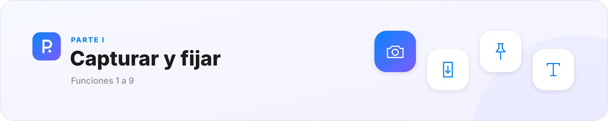
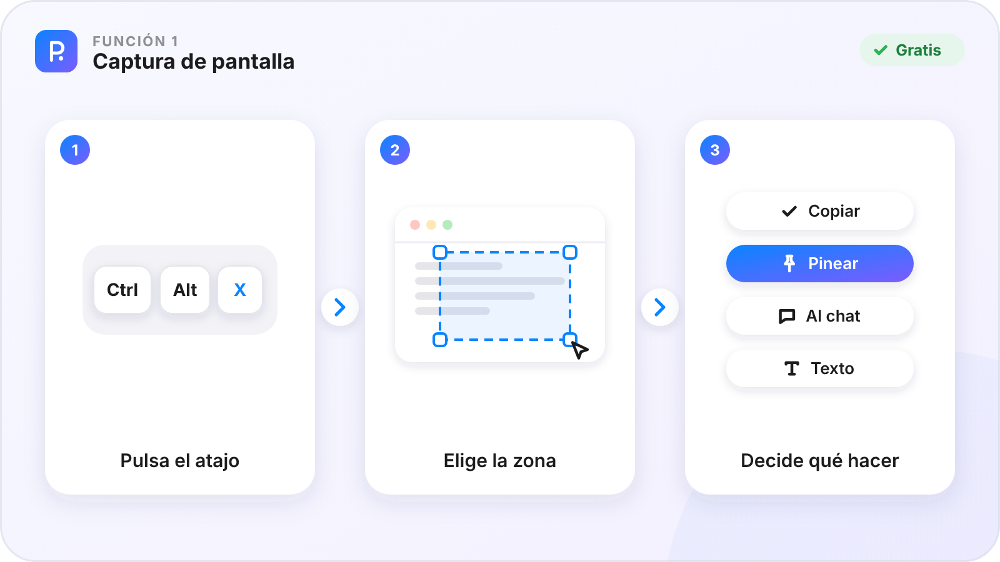
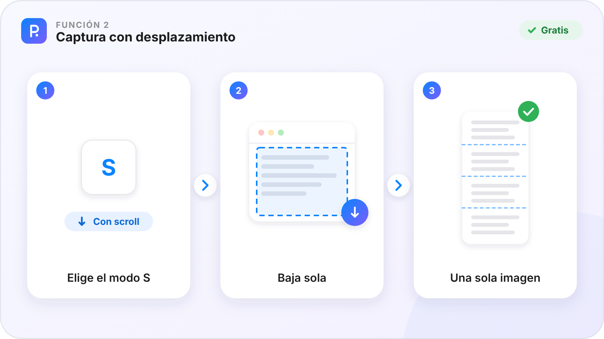
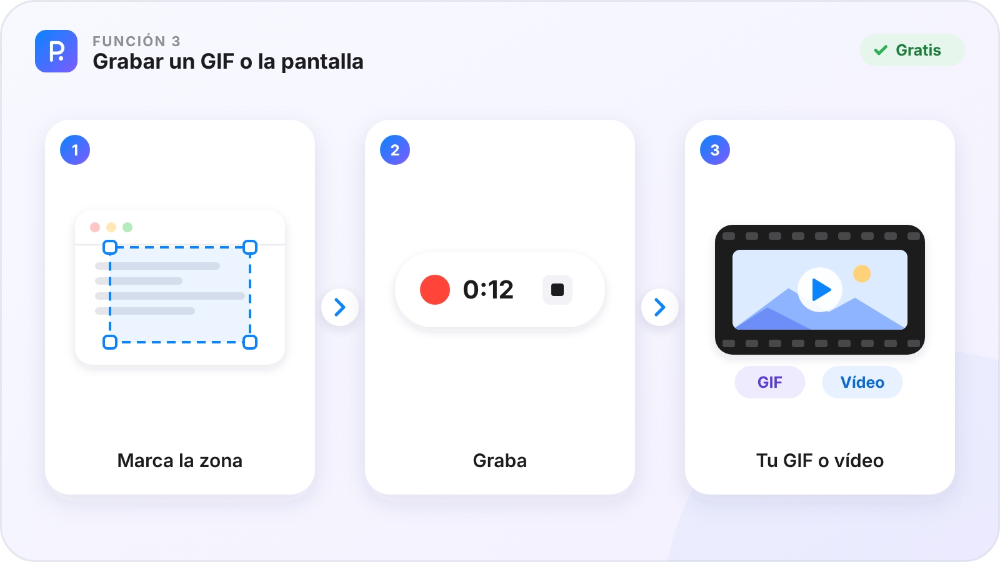
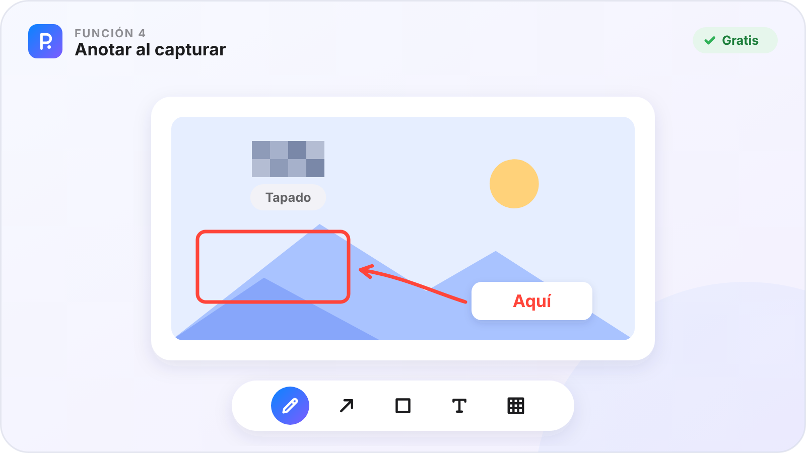
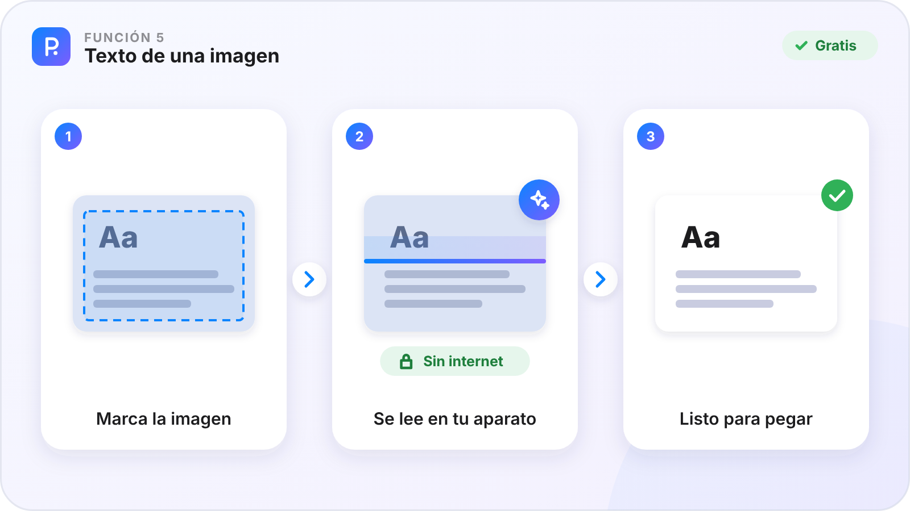
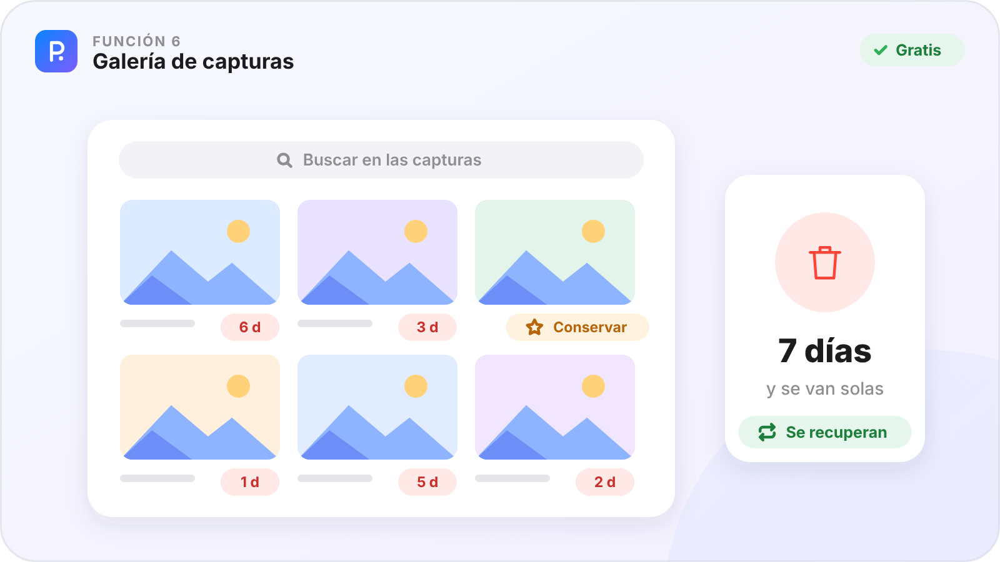
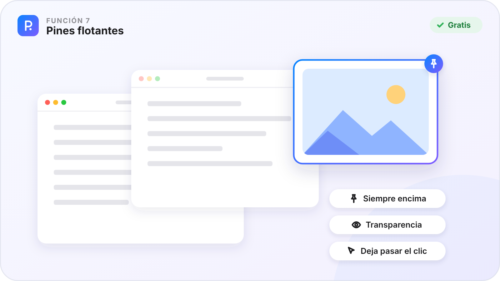
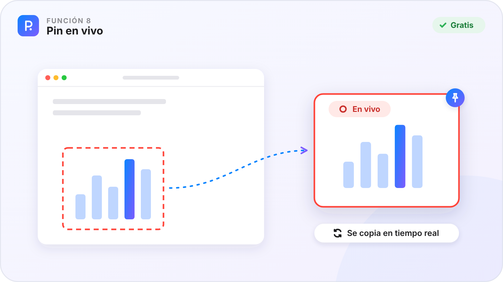
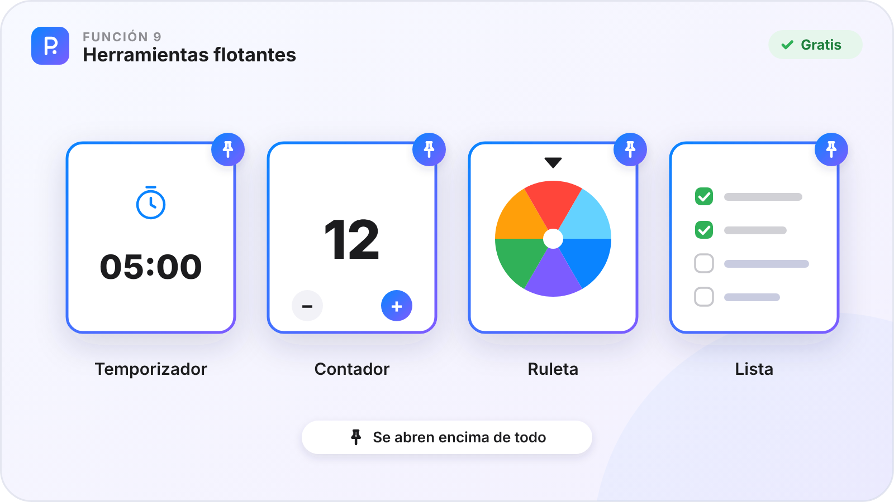

# Parte I · Capturar y fijar

[🏠 Inicio](Inicio.md) · Parte I de VII · Funciones 1–9 · [Plataformas](Plataformas.md)

Todo empieza aquí: guardas lo que ves en la pantalla y dejas a la vista lo que necesitas, flotando encima de tus ventanas.

**En esta parte**

| Nº | Función | En una frase | Plan |
|:-:|---|---|:-:|
| **1** | [Captura de pantalla](#función-1--captura-de-pantalla) | Un atajo, eliges la zona y decides al momento qué hacer con ella. | 🟢 |
| **2** | [Captura con desplazamiento](#función-2--captura-con-desplazamiento) | Una página larga, de arriba abajo, cosida en una sola imagen. | 🟢 |
| **3** | [Grabar un GIF o la pantalla](#función-3--grabar-un-gif-o-la-pantalla) | Un vídeo corto de una zona, para enseñar un paso o un fallo. | 🟢 |
| **4** | [Anotar al capturar](#función-4--anotar-al-capturar) | Marca, señala y tapa datos sin abrir otra ventana. | 🟢 |
| **5** | [Texto de una imagen](#función-5--texto-de-una-imagen) | Copia el texto que hay en una foto, una captura o un vídeo. | 🟢 |
| **6** | [Galería de capturas](#función-6--galería-de-capturas) | Tus capturas guardadas, que se limpian solas. | 🟢 |
| **7** | [Pines flotantes](#función-7--pines-flotantes) | Lo que necesitas, siempre encima de tus ventanas. | 🟢 |
| **8** | [Pin en vivo](#función-8--pin-en-vivo) | Un espejo de una parte de la pantalla, en tiempo real. | 🟢 |
| **9** | [Herramientas flotantes](#función-9--herramientas-flotantes) | Un temporizador, un contador, una ruleta o una lista, siempre a mano. | 🟢 |

**Cómo leer cada función.** ✅ ya está en la app de ese aparato · ⏳ en camino · — el sistema no lo permite. 🟢 Gratis · ⭐ Pro.

---

## Función 1 · Captura de pantalla

> **En una frase.** Un atajo, eliges la zona y decides al momento qué hacer con ella.

#### Cómo funciona

1. Pulsa `Ctrl Alt X` en Windows o `⌃⌥X` en el Mac. En Android, toca dos veces la bola flotante.
2. Elige el modo con su letra: **zona** (`Z`), **ventana** (`V`) o **pantalla entera** (`P`). Cada modo enseña su letra en pantalla.
3. Marca la zona. Si quieres, teclea la medida exacta, usa 16:9, 4:3 o 1:1, o repite la última zona con `R`. La lupa te dice el color que hay debajo y `C` lo copia.
4. Decide: **Copiar** (`Enter`), **Pinear** (`Ctrl P`), **Al chat** (`Ctrl M`), **Texto** (`Ctrl T`) o **Guardar** (`Ctrl S`).

#### Fortalezas

- **Un solo atajo que recordar**: todo lo demás se ve mientras capturas.
- **Del ojo al proyecto en un gesto**: «Al chat» la deja en su chat, con su fecha, sin carpetas.
- **Medidas exactas** para manuales y tutoriales, todas del mismo tamaño.
- **Gestos con Alt** en Windows: `Alt` + arrastrar con el botón izquierdo copia la zona y con el derecho la pinea.

#### Dónde está

| 🪟 Windows | 🤖 Android | 💻 Mac | 📱 iPad |
|:-:|:-:|:-:|:-:|
| ✅ | ✅ | ✅ | ✅¹ |

¹ En el iPad se captura lo que ves en PinDesk y tus fotos: iPadOS no deja capturar otras apps. Haz la captura del sistema y mándala a PinDesk con **Compartir**.

**Plan:** 🟢 Gratis

---

## Función 2 · Captura con desplazamiento

> **En una frase.** Una página larga, de arriba abajo, cosida en una sola imagen.

#### Cómo funciona

1. Abre la captura y elige el modo **con scroll** (`S`).
2. Marca la parte de la ventana que se desplaza.
3. PinDesk baja sola la página y va uniendo cada trozo.
4. Al terminar tienes una sola imagen larga, lista para copiar, pinear o mandar al chat.

#### Fortalezas

- **Conversaciones, webs y hojas enteras** en una sola imagen.
- **Sin coser a mano**: las uniones se hacen solas.
- En Android se llama **captura larga** y funciona igual.

#### Dónde está

| 🪟 Windows | 🤖 Android | 💻 Mac | 📱 iPad |
|:-:|:-:|:-:|:-:|
| ✅ | ✅ | ✅ | ✅¹ |

¹ En el iPad, dentro de PinDesk. Con cabeceras fijas que no se mueven, la unión puede fallar.

**Plan:** 🟢 Gratis

---

## Función 3 · Grabar un GIF o la pantalla

> **En una frase.** Un vídeo corto de una zona, para enseñar un paso o un fallo.

#### Cómo funciona

1. Abre la captura y elige **Grabar GIF** (`G`).
2. Marca la zona que quieres grabar.
3. Pulsa para empezar y otra vez para parar.
4. Guarda el GIF o el vídeo, cópialo o mándalo al chat. En el Mac, `⌃⌥R` graba la pantalla con su sonido.

#### Fortalezas

- **Explica en segundos** lo que costaría un párrafo.
- **Solo la zona que importa**, sin el resto del escritorio.
- **Ligero**, para mandarlo por mensaje.

#### Dónde está

| 🪟 Windows | 🤖 Android | 💻 Mac | 📱 iPad |
|:-:|:-:|:-:|:-:|
| ✅ | ⏳ | ✅ | ✅¹ |

¹ En el iPad, lo que pasa dentro de PinDesk.

**Plan:** 🟢 Gratis

---

## Función 4 · Anotar al capturar

> **En una frase.** Marca, señala y tapa datos sin abrir otra ventana.

#### Cómo funciona

1. Después de elegir la zona, aparece la barra de anotar.
2. Elige la herramienta con las teclas `1` a `5`: lápiz, flecha, rectángulo, texto y mosaico.
3. Cambia el color o el grosor, y deshaz si te equivocas.
4. Copia, pinea o manda la captura ya anotada.

#### Fortalezas

- **Todo en el mismo paso**: capturas, marcas y compartes.
- **El mosaico tapa datos** (un número de cuenta, una cara) antes de mandarlo.
- **Las mismas herramientas** que en el [lienzo](Parte-3-Crear.md#función-19--lienzo-infinito).

#### Dónde está

| 🪟 Windows | 🤖 Android | 💻 Mac | 📱 iPad |
|:-:|:-:|:-:|:-:|
| ✅ | ✅ | ✅ | ✅ |

**Plan:** 🟢 Gratis

---

## Función 5 · Texto de una imagen

> **En una frase.** Copia el texto que hay en una foto, una captura o un vídeo.

#### Cómo funciona

1. Abre la captura y elige el modo **Texto** (`T`), o pulsa **Texto** en una captura ya hecha.
2. Marca la zona donde está el texto.
3. PinDesk lo lee en tu aparato.
4. El texto queda copiado, listo para pegarlo donde quieras.

#### Fortalezas

- **La forma más rápida** de copiar algo de una imagen.
- **Se lee en tu aparato**: no hace falta internet.
- **Encuentras capturas por lo que dicen**: el buscador mira también el texto de dentro.

#### Dónde está

| 🪟 Windows | 🤖 Android | 💻 Mac | 📱 iPad |
|:-:|:-:|:-:|:-:|
| ✅ | ✅ | ✅ | ✅ |

**Plan:** 🟢 Gratis

---

## Función 6 · Galería de capturas

> **En una frase.** Tus capturas guardadas, que se limpian solas.

#### Cómo funciona

1. Guarda una captura con `Ctrl S` y entra en la galería.
2. Cada captura dice cuántos días le quedan: las que no conservas se van a los **7 días**.
3. Pulsa **Conservar** (`Ctrl S`) en las que quieras guardar para siempre.
4. Busca por nombre, por fecha o por **el texto de dentro**. Lo borrado se recupera desde la papelera o con `Ctrl Z`.

#### Fortalezas

- **Nunca se llena de capturas viejas**.
- **Y aun así no pierdes nada**: la papelera te deja recuperarlas.
- **Todo con el teclado**: flechas, Espacio para elegir, Intro para pinear.

#### Dónde está

| 🪟 Windows | 🤖 Android | 💻 Mac | 📱 iPad |
|:-:|:-:|:-:|:-:|
| ✅ | ✅ | ✅ | ✅ |

**Plan:** 🟢 Gratis

---

## Función 7 · Pines flotantes

> **En una frase.** Lo que necesitas, siempre encima de tus ventanas.

#### Cómo funciona

1. Pinea una captura (`Ctrl P`), o usa **Pinear** en el menú de un mensaje o **Fijar como pin** en un visor.
2. Muévelo arrastrando. La rueda lo agranda o lo achica, y `Ctrl 0` lo devuelve a su tamaño.
3. Con `Mayús` + rueda cambias su transparencia, y con `Ctrl T` **deja pasar el clic** a la ventana de debajo.
4. Pasa el ratón por encima para ver su barra: zoom, página, reproducir, copiar, anotar y más. `Ctrl 2` oculta o muestra todos los pines.

#### Fortalezas

- **Siempre encima, de verdad**: un plano, una fórmula o una lista no se esconden al cambiar de ventana.
- **No estorban**: los atraviesas con el clic y los haces transparentes.
- **Vale casi todo**: una foto, un vídeo, un PDF, una nota o una lista.
- **Vuelven solos**: al abrir PinDesk, tus pines siguen donde los dejaste.

#### Dónde está

| 🪟 Windows | 🤖 Android | 💻 Mac | 📱 iPad |
|:-:|:-:|:-:|:-:|
| ✅ | ✅ | ✅ | ✅¹ |

¹ En el iPad, los pines flotan dentro de PinDesk: iPadOS no deja ponerlos encima de otras apps.

**Plan:** 🟢 Gratis

---

## Función 8 · Pin en vivo

> **En una frase.** Un espejo de una parte de la pantalla, en tiempo real.

#### Cómo funciona

1. Abre la captura y elige **Pin en vivo** (`L`), o haz `Alt` + arrastrar con el botón central en Windows.
2. Marca la zona que quieres vigilar: una descarga, un chat o una gráfica.
3. Sale un pin que copia esa zona al momento, encima de todo.
4. Puedes hacer clic en el pin y el clic llega a la ventana original.

#### Fortalezas

- **Vigila algo sin tenerlo delante**: trabaja en otra cosa y míralo de reojo.
- **El recuadro solo lo ves tú**: no sale en las capturas.
- **Se maneja desde el propio pin**.

#### Dónde está

| 🪟 Windows | 🤖 Android | 💻 Mac | 📱 iPad |
|:-:|:-:|:-:|:-:|
| ✅ | — | ✅ | — |

En Android y en el iPad el sistema no deja copiar en vivo la ventana de otra app.

**Plan:** 🟢 Gratis

---

## Función 9 · Herramientas flotantes

> **En una frase.** Un temporizador, un contador, una ruleta o una lista, siempre a mano.

#### Cómo funciona

1. En **Adjuntar** del chat elige una herramienta: contador, ruleta, cronómetro, temporizador, gastos o lista de tareas.
2. Pinéala y queda flotando encima de todo.
3. En Android, **la palabra es el comando**: copia «timer», «todo», «gastos» o «pizarra», pinéala y sale la herramienta.
4. Lo que apuntas en ella se guarda en su chat.

#### Fortalezas

- **Sin abrir otra app** para una cuenta atrás o una lista rápida.
- **Siempre a la vista** mientras estudias o trabajas.
- **Se guardan** con tus cosas y viajan a tus aparatos.

#### Dónde está

| 🪟 Windows | 🤖 Android | 💻 Mac | 📱 iPad |
|:-:|:-:|:-:|:-:|
| ✅ | ✅ | ✅ | ✅ |

**Plan:** 🟢 Gratis

---

[← Inicio](Inicio.md) &nbsp;·&nbsp; [🏠 Inicio](Inicio.md) &nbsp;·&nbsp; [Parte II · Organizar →](Parte-2-Organizar.md)

