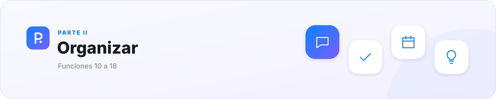
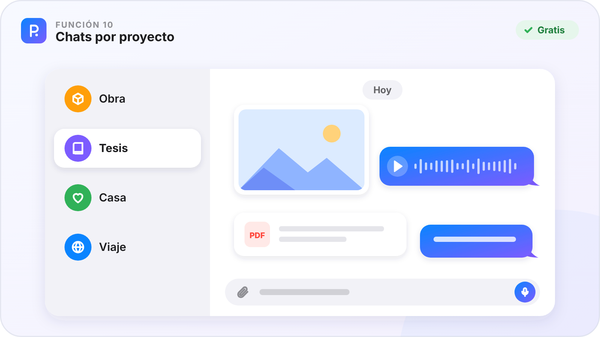
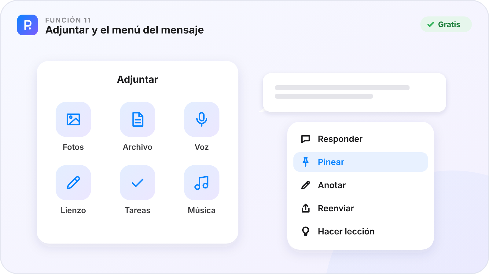
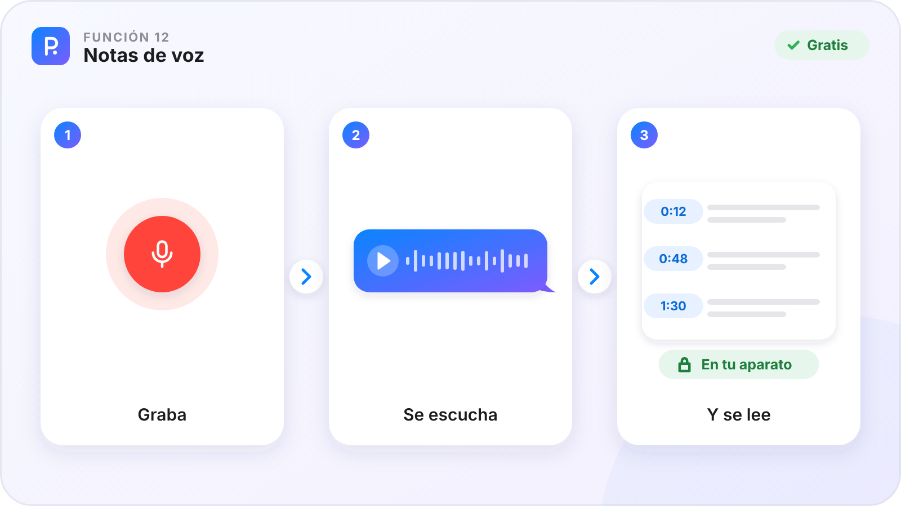
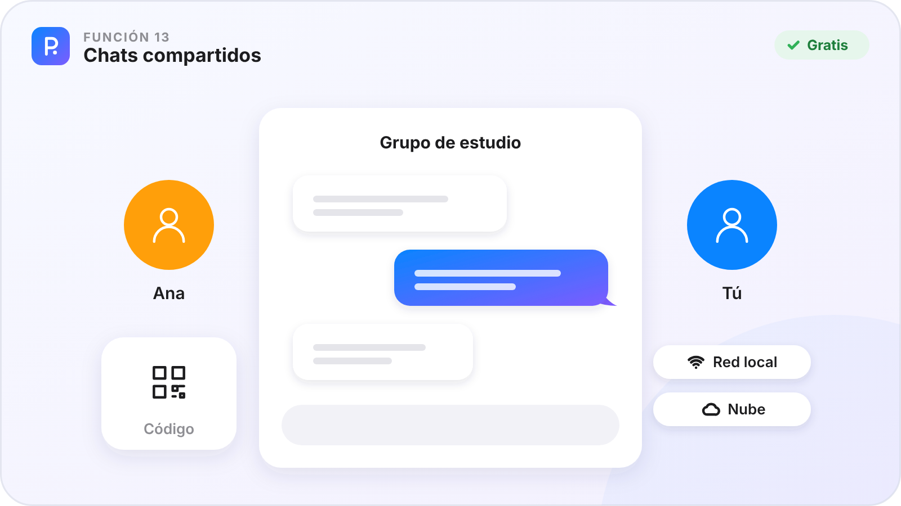
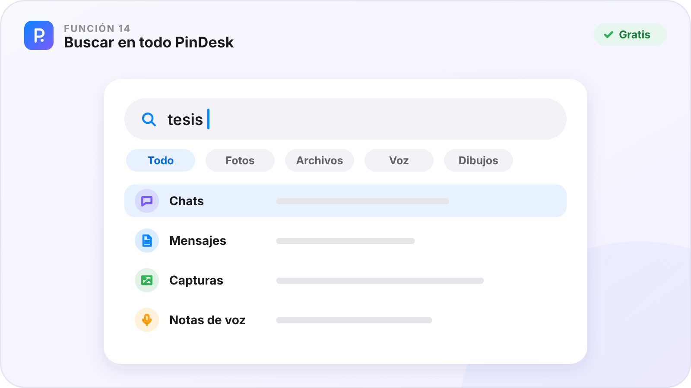
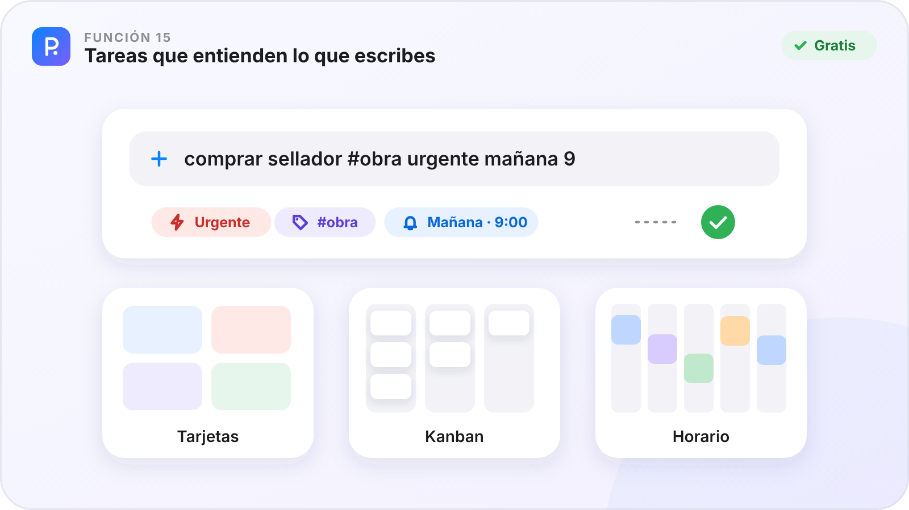
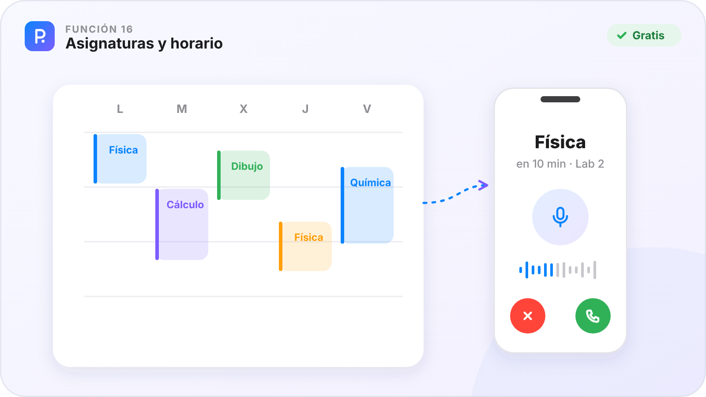
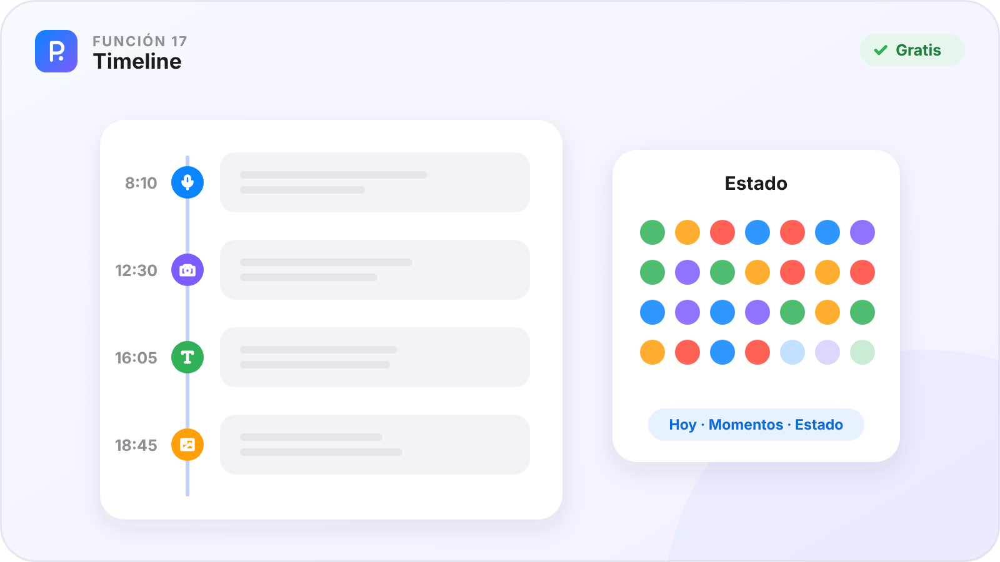
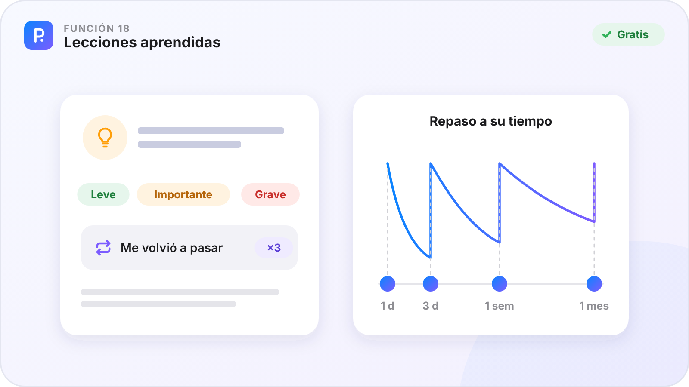

# Parte II · Organizar

[🏠 Inicio](Inicio.md) · Parte II de VII · Funciones 10–18 · [Plataformas](Plataformas.md)

Tus cosas, ordenadas sin esfuerzo: un chat por proyecto, tareas que entienden lo que escribes, tu horario de clases y lo que aprendes cada día.

**En esta parte**

| Nº | Función | En una frase | Plan |
|:-:|---|---|:-:|
| **10** | [Chats por proyecto](#función-10--chats-por-proyecto) | Cada proyecto es un chat, como los de tu móvil. | 🟢 |
| **11** | [Adjuntar y el menú del mensaje](#función-11--adjuntar-y-el-menú-del-mensaje) | Manda de todo en un toque y haz lo que tenga sentido con cada mensaje. | 🟢 |
| **12** | [Notas de voz](#función-12--notas-de-voz) | Habla, y tu voz queda guardada y escrita. | 🟢 |
| **13** | [Chats compartidos](#función-13--chats-compartidos) | Un chat con otras personas, con tus mensajes a la derecha y los suyos a la izquierda. | 🟢 |
| **14** | [Buscar en todo PinDesk](#función-14--buscar-en-todo-pindesk) | Una búsqueda que mira en todos tus chats, archivos y capturas a la vez. | 🟢 |
| **15** | [Tareas que entienden lo que escribes](#función-15--tareas-que-entienden-lo-que-escribes) | Escribe la tarea en una frase y la etiqueta, la urgencia y el aviso salen solos. | 🟢 |
| **16** | [Asignaturas y horario](#función-16--asignaturas-y-horario) | Tu horario de clases, y una llamada antes de cada una. | 🟢 |
| **17** | [Timeline](#función-17--timeline) | Tu día, minuto a minuto, tan rápido como un mensaje. | 🟢 |
| **18** | [Lecciones aprendidas](#función-18--lecciones-aprendidas) | Apunta un error una vez y PinDesk te lo recuerda a su tiempo. | 🟢 |

**Cómo leer cada función.** ✅ ya está en la app de ese aparato · ⏳ en camino · — el sistema no lo permite. 🟢 Gratis · ⭐ Pro.

---

## Función 10 · Chats por proyecto

> **En una frase.** Cada proyecto es un chat, como los de tu móvil.

#### Cómo funciona

1. Crea un chat con el «+» de la lista y ponle nombre, foto, emoji o color.
2. Manda lo que sea: notas, fotos, vídeos, notas de voz, documentos, lienzos, listas o música.
3. Cada cosa queda guardada con su fecha, sin decidir antes en qué carpeta va.
4. Ponle una etiqueta rápida a un mensaje: ⭐ ✅ ⏳ 💡 💰 📍. El interruptor **Chat · Funciones** cambia la lista por los accesos más usados.

#### Fortalezas

- **Guardar no pregunta nada**: mandas y listo.
- **Todo junto**: la foto de la pizarra, el PDF y el audio de la explicación, en orden.
- **Chats fijos** para lo de siempre: «Mensajes guardados», «Asistente» y «Asignaturas».
- **Agrupa páginas en una carpeta** («Día 1», «Día 2»…) y sácala como un solo PDF con índice.

#### Dónde está

| 🪟 Windows | 🤖 Android | 💻 Mac | 📱 iPad |
|:-:|:-:|:-:|:-:|
| ✅ | ✅ | ✅ | ✅ |

**Plan:** 🟢 Gratis

---

## Función 11 · Adjuntar y el menú del mensaje

> **En una frase.** Manda de todo en un toque y haz lo que tenga sentido con cada mensaje.

#### Cómo funciona

1. Pulsa **Adjuntar**: una cuadrícula con buscador y las teclas `1` a `8`. También puedes pegar (`Ctrl V`) o arrastrar archivos.
2. Varias fotos a la vez, cada una con su descripción.
3. Clic derecho (o mantener pulsado) en un mensaje para abrir su menú.
4. Elige: copiar, responder (`R`), escuchar, pinear (`P`), anotar (`A`), reenviar (`F`), compartir o convertirlo en lección (`L`).

#### Fortalezas

- **Un menú que no te hace pensar**: cada tipo de mensaje enseña solo lo suyo.
- **Con teclado o con el dedo**, igual de rápido.
- **Abrir desde fuera**: en Windows, PinDesk puede ser la app que abre tus fotos y documentos, en una ventanita flotante al instante.

#### Dónde está

| 🪟 Windows | 🤖 Android | 💻 Mac | 📱 iPad |
|:-:|:-:|:-:|:-:|
| ✅ | ✅ | ✅ | ✅ |

**Plan:** 🟢 Gratis

---

## Función 12 · Notas de voz

> **En una frase.** Habla, y tu voz queda guardada y escrita.

#### Cómo funciona

1. Mantén pulsado el micrófono del chat y habla.
2. La nota de voz se pasa a texto **en tu propio aparato**, con el minuto de cada párrafo.
3. Toca una frase del texto y el audio salta a ese momento.
4. Prueba también el **teleprónter** (lees un texto que baja solo mientras te grabas) y **pronunciar** (hablas, sueltas y te oyes).

#### Fortalezas

- **Tu voz no sale de tu aparato** para pasarse a texto.
- **Se busca** como cualquier otro mensaje.
- **Funciona sin internet**, una vez descargadas las voces.

#### Dónde está

| 🪟 Windows | 🤖 Android | 💻 Mac | 📱 iPad |
|:-:|:-:|:-:|:-:|
| ✅ | ✅ | ✅ | ✅ |

**Plan:** 🟢 Gratis

---

## Función 13 · Chats compartidos

> **En una frase.** Un chat con otras personas, con tus mensajes a la derecha y los suyos a la izquierda.

#### Cómo funciona

1. Pulsa «+» → **Chat compartido**.
2. Invita con un **código** o un **QR**.
3. Elige cómo viaja: por la **red local**, gratis, o por la **nube**, con Pro, para que cada persona lo reciba desde donde esté.
4. Si cambias algo de otra persona, se crea tu versión unida a la suya: nunca se pisan.

#### Fortalezas

- **Sin servidores en casa**: por la red local va directo entre aparatos.
- **Ideal para grupos de estudio** y equipos de obra.
- **Todo lo anotado viaja**: tinta, marcas y comentarios.

#### Dónde está

| 🪟 Windows | 🤖 Android | 💻 Mac | 📱 iPad |
|:-:|:-:|:-:|:-:|
| ✅ | ✅ | ✅ | ✅ |

La nube para los chats compartidos es de ⭐ Pro.

**Plan:** 🟢 Gratis

---

## Función 14 · Buscar en todo PinDesk

> **En una frase.** Una búsqueda que mira en todos tus chats, archivos y capturas a la vez.

#### Cómo funciona

1. Escribe en el buscador de la lista de chats, o abre **Buscar en todo PinDesk**.
2. Arriba salen los chats por su nombre y, debajo, **mensajes de cualquier chat**.
3. Filtra con las pestañas: fotos, vídeos, archivos, enlaces, voz o dibujos.
4. Abre el resultado o salta al mensaje exacto en su chat. Las letras rápidas (`t` tarea, `n` nota, `l` lienzo, `g` galería) crean cosas sin salir de ahí.

#### Fortalezas

- **Da igual si escribes con tildes o sin ellas**.
- **Mira dentro**: también en el texto de las capturas y de las notas de voz.
- **Todo con el teclado**, con vista previa.

#### Dónde está

| 🪟 Windows | 🤖 Android | 💻 Mac | 📱 iPad |
|:-:|:-:|:-:|:-:|
| ✅ | ✅ | ✅ | ✅ |

**Plan:** 🟢 Gratis

---

## Función 15 · Tareas que entienden lo que escribes

> **En una frase.** Escribe la tarea en una frase y la etiqueta, la urgencia y el aviso salen solos.

#### Cómo funciona

1. Abre **Funciones → Tareas** y escribe, por ejemplo, «comprar sellador #obra urgente mañana 9».
2. Mientras escribes ves cómo quedará: «Urgente · #obra · ⏰ mañana 9:00».
3. Pulsa **Intro**: entra en el **Inbox** o en la lista que elijas.
4. Mírala en **tarjetas** (`Ctrl T`), en **Kanban** (`Ctrl K`) o en el **horario** de la semana (`Ctrl H`). Arrastra para cambiarla de lista.
5. Táchala al terminar: si tenía aviso, suena a su hora en tus aparatos.

#### Fortalezas

- **Fechas como hablas**: «18 oct 5pm», «el 20 a las 9», «viernes 15:30».
- **Todas tus listas juntas**: las de cada chat, las de cada asignatura y el Inbox.
- **Fotos en las tareas**: pega una imagen y en las tarjetas es el fondo.
- **Lo tachado se queda quieto** mientras miras la lista. Y se exporta a PDF, imagen, Word o texto.

#### Dónde está

| 🪟 Windows | 🤖 Android | 💻 Mac | 📱 iPad |
|:-:|:-:|:-:|:-:|
| ✅ | ✅ | ✅ | ✅ |

La urgencia propuesta por [Jev](Parte-5-Inteligencia-artificial.md#función-38--jev-la-urgencia-de-tus-tareas) es de ⭐ Pro.

**Plan:** 🟢 Gratis

---

## Función 16 · Asignaturas y horario

> **En una frase.** Tu horario de clases, y una llamada antes de cada una.

#### Cómo funciona

1. Abre **Funciones → Horario** y escribe tus asignaturas, por ejemplo «Física @Lab 2» (la @ es el aula).
2. Arrástralas a la semana: cada clase se mueve y se alarga en saltos de 15 minutos.
3. Déjate una nota de voz para la próxima clase, si quieres.
4. Antes de clase, PinDesk te **llama**: **Contestar** reproduce tu recado. Puedes pedir que vuelva a llamar en 5, 15 o 30 minutos.

#### Fortalezas

- **Una llamada es imposible de ignorar**, mucho más que un aviso.
- **Cada asignatura es una lista de tareas**, y el chat **Asignaturas** agrupa apuntes, fotos y grabaciones por materia.
- **Evaluaciones** que avisan 3 días y 1 día antes.
- **Google Calendar**, si lo conectas, también sale en el horario (solo lectura).

#### Dónde está

| 🪟 Windows | 🤖 Android | 💻 Mac | 📱 iPad |
|:-:|:-:|:-:|:-:|
| ✅ | ✅ | ✅ | ✅ |

**Plan:** 🟢 Gratis

---

## Función 17 · Timeline

> **En una frase.** Tu día, minuto a minuto, tan rápido como un mensaje.

#### Cómo funciona

1. Abre **Funciones → Timeline** y apunta lo que pasa con la voz, escribiendo o con una foto.
2. Al dictar, «con esto pasó…» abre el título y «y así te lo cuento…» la descripción.
3. Míralo de tres formas: **Hoy**, **Momentos** (día a día) y **Estado** (cada mes con sus emoticonos).
4. Toca un momento y se abre como una historia, con su foto y su nota de voz.

#### Fortalezas

- **Tu mes de un vistazo** por sus emoticonos.
- **Compártelo como imagen** o sácalo a PDF.
- **Nada se borra**: lo anterior a hoy está en Momentos y se busca.

#### Dónde está

| 🪟 Windows | 🤖 Android | 💻 Mac | 📱 iPad |
|:-:|:-:|:-:|:-:|
| ✅ | ⏳ | ✅ | ✅ |

Exportarlo como página web interactiva es de ⭐ Pro.

**Plan:** 🟢 Gratis

---

## Función 18 · Lecciones aprendidas

> **En una frase.** Apunta un error una vez y PinDesk te lo recuerda a su tiempo.

#### Cómo funciona

1. Pulsa **Hacer lección** (`L`) en el menú de un mensaje, o la bombilla 💡 de un momento del timeline.
2. Escribe o dicta qué pasó, por qué y qué harás la próxima vez. Añade foto o audio.
3. Elige la gravedad: 😌 leve, 😟 importante o 😡 grave. Las etiquetas y el proyecto se proponen solos.
4. Cuando toque, PinDesk te propone **Repasar** (`R`): `1` lo recordaba, `2` a medias, `3` lo olvidé.

#### Fortalezas

- **Repaso espaciado**: vuelven justo cuando empiezas a olvidarlas.
- **«Me volvió a pasar»** suma una vez más y te enseña tus patrones.
- **Sin duplicados**: si se parece a una que ya tienes, te ofrece sumarla.

#### Dónde está

| 🪟 Windows | 🤖 Android | 💻 Mac | 📱 iPad |
|:-:|:-:|:-:|:-:|
| ✅ | ✅ | ✅ | ✅ |

**Plan:** 🟢 Gratis

---

[← Parte I · Capturar y fijar](Parte-1-Capturar-y-fijar.md) &nbsp;·&nbsp; [🏠 Inicio](Inicio.md) &nbsp;·&nbsp; [Parte III · Crear →](Parte-3-Crear.md)

