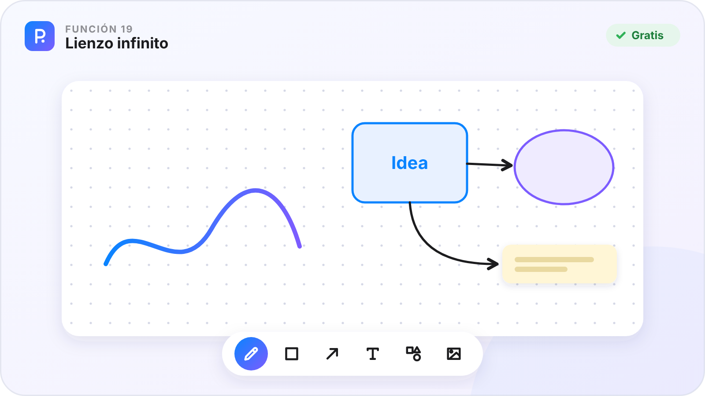
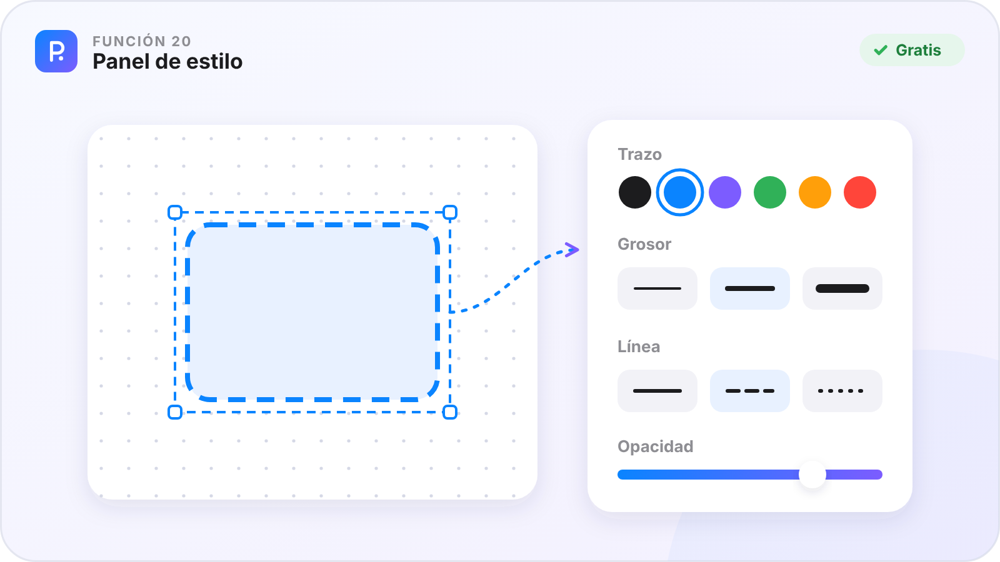
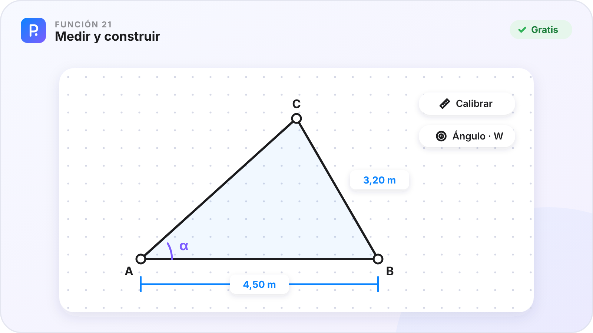
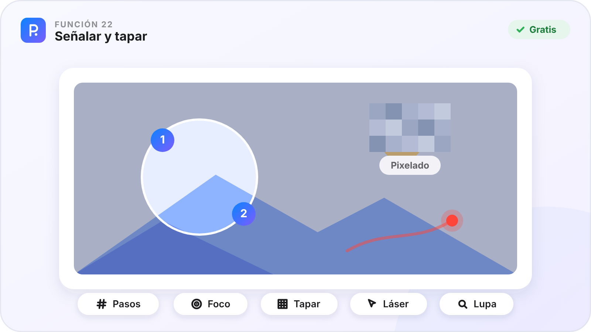
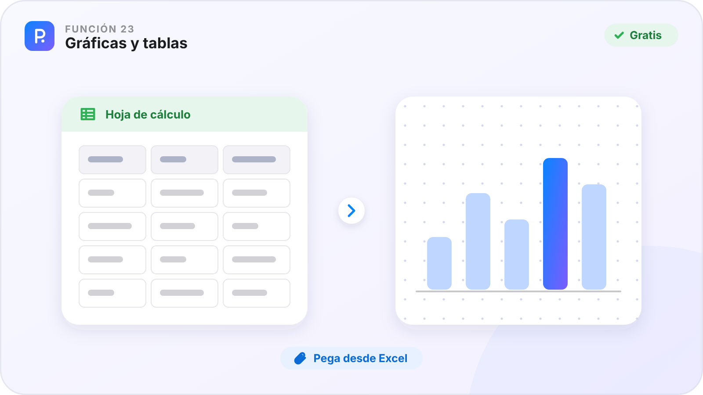
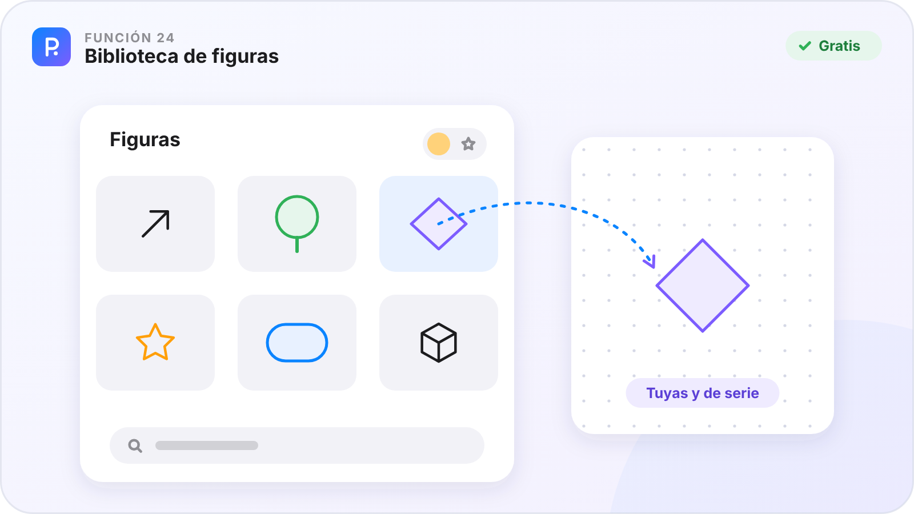
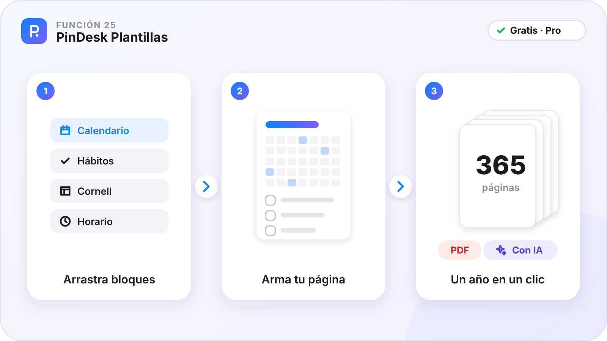
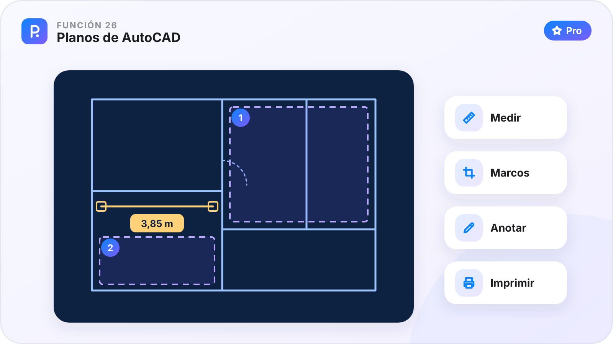
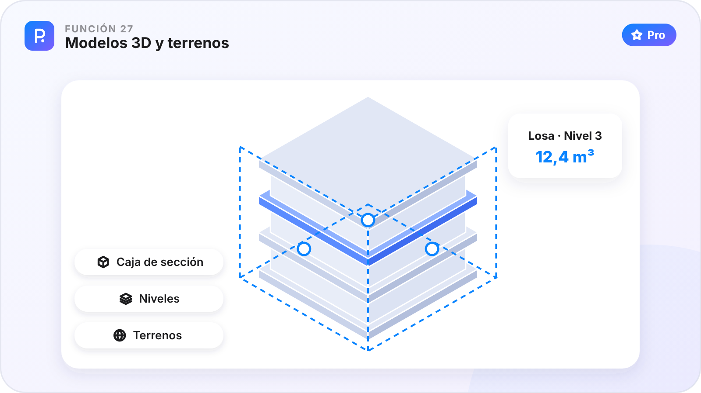

# Parte III · Crear

[🏠 Inicio](Inicio.md) · Parte III de VII · Funciones 19–27 · [Plataformas](Plataformas.md)

Una hoja infinita para dibujar, explicar y medir, tus propias plantillas y los planos y modelos de obra, sin programas caros.

**En esta parte**

| Nº | Función | En una frase | Plan |
|:-:|---|---|:-:|
| **19** | [Lienzo infinito](#función-19--lienzo-infinito) | Una hoja sin bordes para dibujar, explicar y pensar. | 🟢 |
| **20** | [Panel de estilo](#función-20--panel-de-estilo) | El color, el grosor y el tipo de línea de cada trazo, a la vista. | 🟢 |
| **21** | [Medir y construir](#función-21--medir-y-construir) | Cotas que calculan, ángulos con su letra y medidas reales. | 🟢 |
| **22** | [Señalar y tapar](#función-22--señalar-y-tapar) | Pasos numerados, foco, lupa, láser y pixelado para explicar o proteger. | 🟢 |
| **23** | [Gráficas y tablas](#función-23--gráficas-y-tablas) | Pega una tabla de Excel y sigue siendo una tabla, o conviértela en gráfica. | 🟢 |
| **24** | [Biblioteca de figuras](#función-24--biblioteca-de-figuras) | Tus símbolos de siempre, listos para arrastrar. | 🟢 |
| **25** | [PinDesk Plantillas](#función-25--pindesk-plantillas) | Diseña diarios, agendas y planificadores por bloques, y saca un año entero en un clic. | 🟢 / ⭐ |
| **26** | [Planos de AutoCAD](#función-26--planos-de-autocad) | Abre, mide, anota e imprime planos DWG y DXF sin tener AutoCAD. | ⭐ |
| **27** | [Modelos 3D y terrenos](#función-27--modelos-3d-y-terrenos) | Recorre modelos de Revit e IFC y terrenos de Civil 3D, y córtalos por donde quieras. | ⭐ |

**Cómo leer cada función.** ✅ ya está en la app de ese aparato · ⏳ en camino · — el sistema no lo permite. 🟢 Gratis · ⭐ Pro.

---

## Función 19 · Lienzo infinito

> **En una frase.** Una hoja sin bordes para dibujar, explicar y pensar.

#### Cómo funciona

1. Crea un lienzo con el «+» del chat o con **Funciones → Nuevo lienzo**. Vive dentro de su chat.
2. Elige una herramienta de la barra: lápiz, grafito, resaltador, goma, figuras, flechas o texto con ocho tipos de letra.
3. Dibuja. Si te paras un segundo al final de un trazo, se vuelve recta, círculo o rectángulo.
4. Manda una **zona al chat**: ese trozo va con un enlace de vuelta al lienzo.

#### Fortalezas

- **Con ratón, trackpad, dedo o lápiz**, con presión donde hay.
- **La misma tinta en todos tus aparatos**: dibujas en el móvil y sigues en el PC.
- **Ligero**: va fluido incluso con muchas figuras.

#### Dónde está

| 🪟 Windows | 🤖 Android | 💻 Mac | 📱 iPad |
|:-:|:-:|:-:|:-:|
| ✅ | ✅ | ✅ | ✅ |

En Android: hasta tres lienzos a la vez y el croquis 3D, que dibuja en el espacio.

**Plan:** 🟢 Gratis

---

## Función 20 · Panel de estilo

> **En una frase.** El color, el grosor y el tipo de línea de cada trazo, a la vista.

#### Cómo funciona

1. Elige una herramienta o una figura y sale su panel de estilo.
2. Cambia el **trazo** y el **relleno**: colores de siempre o el selector avanzado, con código, opacidad, cuentagotas y recientes.
3. Ajusta el **grosor**, la **presión** y el **tipo de línea**: continua, discontinua o punteada, con esquinas redondeadas o en pico.
4. En **Ajustes → Lienzo** eliges qué herramientas salen en cada sitio: el lienzo, los pines o el lector.

#### Fortalezas

- **Recuerda tu último trazo a mano**.
- **Cada barra con lo que usas** ahí, nada más.
- **El mismo panel** en el lienzo, los pines, los PDF y los planos.

#### Dónde está

| 🪟 Windows | 🤖 Android | 💻 Mac | 📱 iPad |
|:-:|:-:|:-:|:-:|
| ✅ | ✅ | ✅ | ✅ |

**Plan:** 🟢 Gratis

---

## Función 21 · Medir y construir

> **En una frase.** Cotas que calculan, ángulos con su letra y medidas reales.

#### Cómo funciona

1. Pon una **cota** entre dos puntos: el número sale solo.
2. **Calibra** con una medida conocida y todas las cotas pasan a metros.
3. Pulsa `W` para marcar un ángulo con la siguiente letra griega libre (α, β, θ…); otra vez `W`, el de 90°.
4. Recorta y extiende líneas, suelda vértices y pon puntos con letra.

#### Fortalezas

- **Sirve para geometría y para planos**, no solo para garabatear.
- **Escala gráfica** que se ajusta sola.
- **Exacto con el dedo**: en Android, apoyar el segundo dedo vuelve el trazo perfecto.

#### Dónde está

| 🪟 Windows | 🤖 Android | 💻 Mac | 📱 iPad |
|:-:|:-:|:-:|:-:|
| ✅ | ✅ | ✅ | ✅ |

**Plan:** 🟢 Gratis

---

## Función 22 · Señalar y tapar

> **En una frase.** Pasos numerados, foco, lupa, láser y pixelado para explicar o proteger.

#### Cómo funciona

1. Pon **pasos numerados** para guiar la mirada: 1, 2, 3…
2. Usa el **foco** para oscurecer todo salvo lo importante, o la **lupa** para agrandar un detalle.
3. **Pixela** o **desenfoca** un dato antes de compartir.
4. Presenta con el **puntero láser**, que se borra solo.

#### Fortalezas

- **Tutoriales claros** sin otro programa.
- **Privacidad en un gesto**: tapa lo que no debe verse.
- **Ideal para clases y presentaciones**.

#### Dónde está

| 🪟 Windows | 🤖 Android | 💻 Mac | 📱 iPad |
|:-:|:-:|:-:|:-:|
| ✅ | ✅ | ✅ | ✅ |

**Plan:** 🟢 Gratis

---

## Función 23 · Gráficas y tablas

> **En una frase.** Pega una tabla de Excel y sigue siendo una tabla, o conviértela en gráfica.

#### Cómo funciona

1. Copia unas celdas en Excel o en una hoja de cálculo de Google.
2. Pégalas en el lienzo: llegan como una tabla, con sus celdas combinadas.
3. Crea una **gráfica** desde los datos.
4. Muévelas, cámbialas de tamaño y anótalas como cualquier figura.

#### Fortalezas

- **Tablas de verdad**, no una foto de la tabla.
- **Datos y explicación juntos** en la misma hoja.
- **Viajan** a tus otros aparatos con el lienzo.

#### Dónde está

| 🪟 Windows | 🤖 Android | 💻 Mac | 📱 iPad |
|:-:|:-:|:-:|:-:|
| ✅ | ✅ | ✅ | ✅ |

**Plan:** 🟢 Gratis

---

## Función 24 · Biblioteca de figuras

> **En una frase.** Tus símbolos de siempre, listos para arrastrar.

#### Cómo funciona

1. Abre **Figuras** desde la barra del lienzo o desde **Funciones**.
2. Busca entre las de serie o las tuyas; el botón ☀/☾ cambia a las de día o de noche.
3. Toca una para verla grande y pulsa **Usar**, o arrástrala al lienzo.
4. Guarda cualquier dibujo tuyo como figura para reutilizarlo.

#### Fortalezas

- **No dibujas dos veces lo mismo**.
- **Tus plantillas también llegan aquí** desde PinDesk Plantillas.
- **Viajan** a todos tus aparatos.

#### Dónde está

| 🪟 Windows | 🤖 Android | 💻 Mac | 📱 iPad |
|:-:|:-:|:-:|:-:|
| ✅ | ✅ | ✅ | ✅ |

**Plan:** 🟢 Gratis

---

## Función 25 · PinDesk Plantillas

> **En una frase.** Diseña diarios, agendas y planificadores por bloques, y saca un año entero en un clic.

#### Cómo funciona

1. Abre **PinDesk Plantillas** desde el menú Inicio de Windows: viene incluida con PinDesk.
2. Empieza con un modelo de la galería o con una hoja en blanco.
3. Arrastra bloques: encabezados, renglones, cuadrícula, listas, tablas, calendarios, horarios, hábitos, notas Cornell o acta de reunión.
4. Activa **Repetir** (cada día, semana o mes): las fechas se llenan solas, en tu idioma.
5. Exporta a PDF, PNG o SVG, o pulsa **Enviar a PinDesk** para usarla en tus lienzos.

#### Fortalezas

- **Una agenda de 365 páginas en un minuto**, cada página con su fecha.
- **Fechas correctas en los 14 idiomas**, también si la semana empieza en lunes o en domingo.
- **Con IA ⭐**: descríbela en una frase («planner semanal con hábitos») y se arma sola; también ajusta un bloque o propone ideas.

#### Dónde está

| 🪟 Windows | 🤖 Android | 💻 Mac | 📱 iPad |
|:-:|:-:|:-:|:-:|
| ✅ | ⏳ | ⏳ | ⏳ |

Lo que envías a PinDesk aparece en la biblioteca de figuras y viaja a tus otros aparatos.

**Plan:** 🟢 Gratis sin IA · ⭐ Pro con IA

---

## Función 26 · Planos de AutoCAD

> **En una frase.** Abre, mide, anota e imprime planos DWG y DXF sin tener AutoCAD.

#### Cómo funciona

1. Manda el plano a un chat o ábrelo con doble clic: se abre al momento, como un pin.
2. Muévete con la rueda y arrastrando; doble clic (o `F`) lo enseña entero.
3. **Mide** (`M`): la regla se engancha sola a esquinas, centros, líneas y perpendiculares. En Android, una medida cerrada te da el área.
4. **Anota** (`A`) con las herramientas del lienzo y marca **marcos** (`I`) para imprimir solo esas zonas con `Ctrl P`.

#### Fortalezas

- **Sin licencias caras**, también en el móvil o el iPad, en obra.
- **Medir con enganche de verdad**, como en un programa de CAD.
- **Letras de AutoCAD** bien vistas, con ñ, tildes, ° y Ø.
- **Lo anotado viaja** a tus otros aparatos.

#### Dónde está

| 🪟 Windows | 🤖 Android | 💻 Mac | 📱 iPad |
|:-:|:-:|:-:|:-:|
| ✅ | ✅ | ✅ | ✅ |

PinDesk no cambia la geometría original del plano: es para ver, medir, anotar e imprimir.

**Plan:** ⭐ Pro

---

## Función 27 · Modelos 3D y terrenos

> **En una frase.** Recorre modelos de Revit e IFC y terrenos de Civil 3D, y córtalos por donde quieras.

#### Cómo funciona

1. Abre el modelo: gira arrastrando, mueve con el botón derecho y acerca con la rueda (o con los dedos).
2. Toca una pieza: te dice qué es, en qué planta está, su **volumen** y su **área**. Otro toque la **aísla**.
3. Usa la **caja de sección** (`C`) para cortar el modelo, y **niveles y categorías** (`L`) para ocultar plantas, muros o losas.
4. Guarda un **marcador** con la cámara y el corte: vuelve igual en otro aparato.

#### Fortalezas

- **Proyectos de Revit 2023 a 2025** sin Revit.
- **Terrenos y carreteras** con colores por altura y curvas de nivel.
- **Lo cortado se ve macizo**, fácil de leer.

#### Dónde está

| 🪟 Windows | 🤖 Android | 💻 Mac | 📱 iPad |
|:-:|:-:|:-:|:-:|
| ✅ | ✅ | ✅ | ✅ |

Los Revit de 2022 o anteriores todavía no se abren.

**Plan:** ⭐ Pro

---

[← Parte II · Organizar](Parte-2-Organizar.md) &nbsp;·&nbsp; [🏠 Inicio](Inicio.md) &nbsp;·&nbsp; [Parte IV · Leer, escuchar y estudiar →](Parte-4-Leer-escuchar-y-estudiar.md)

