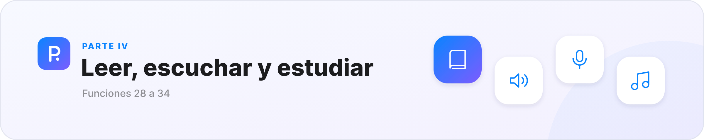
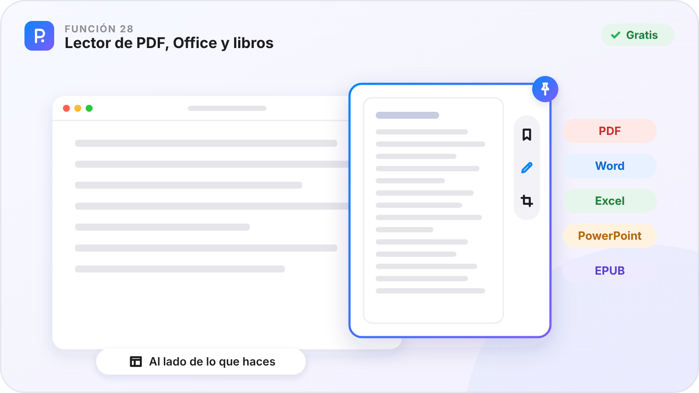
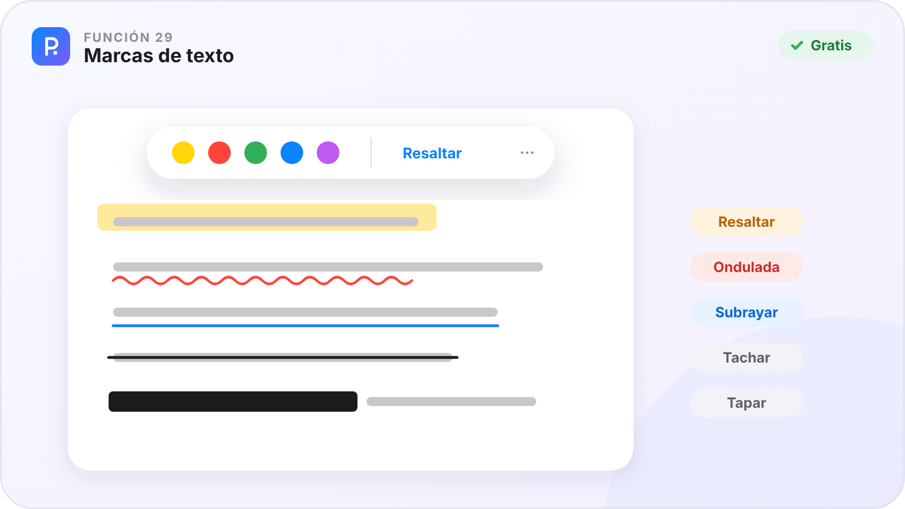
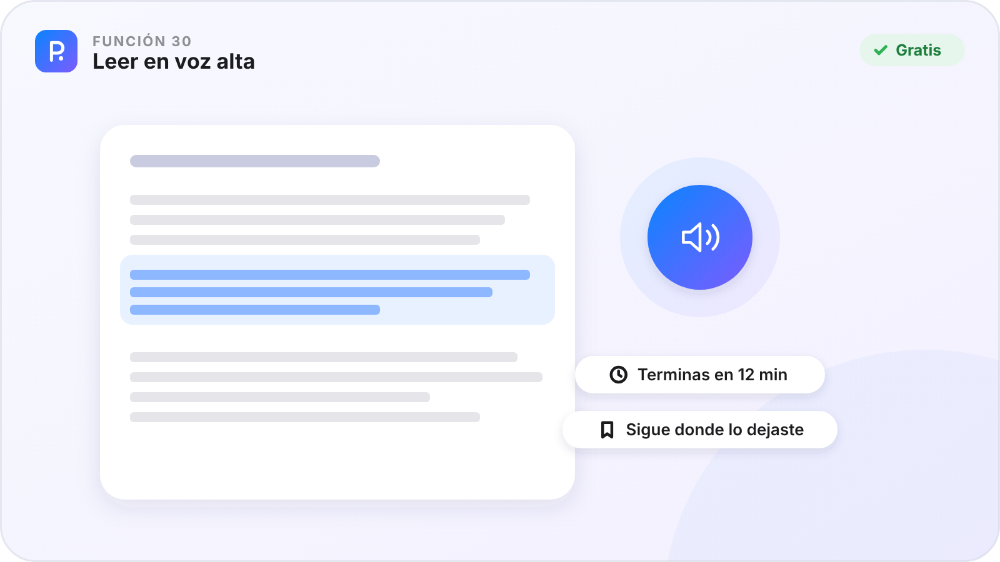
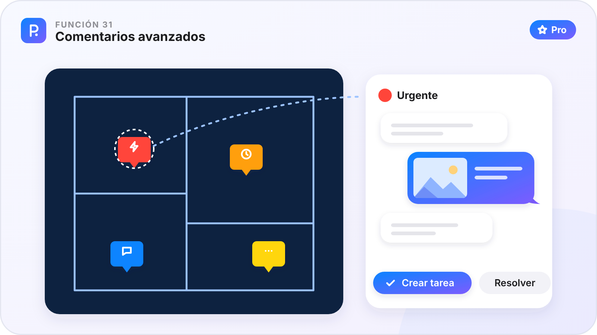
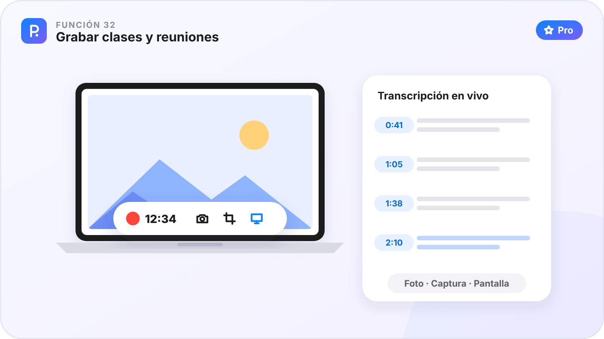
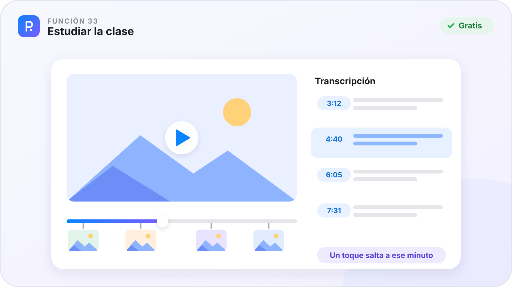
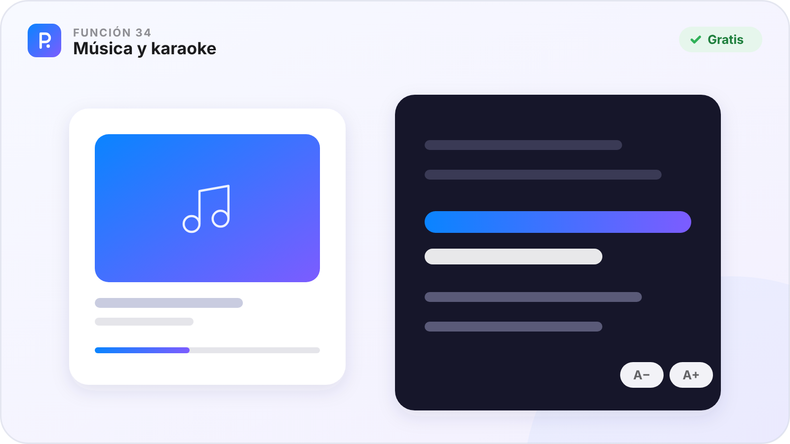

# Parte IV · Leer, escuchar y estudiar

[🏠 Inicio](Inicio.md) · Parte IV de VII · Funciones 28–34 · [Plataformas](Plataformas.md)

Abre cualquier documento al instante, márcalo, escúchalo, comenta sobre él y estudia lo que se dijo en clase.

**En esta parte**

| Nº | Función | En una frase | Plan |
|:-:|---|---|:-:|
| **28** | [Lector de PDF, Office y libros](#función-28--lector-de-pdf-office-y-libros) | PDF, Word, Excel, PowerPoint, EPUB y páginas web, al instante y sin otro programa. | 🟢 |
| **29** | [Marcas de texto](#función-29--marcas-de-texto) | Resalta, subraya, tacha o tapa un trozo de texto en cualquier documento. | 🟢 |
| **30** | [Leer en voz alta](#función-30--leer-en-voz-alta) | Escucha tus documentos mientras haces otra cosa. | 🟢 |
| **31** | [Comentarios avanzados](#función-31--comentarios-avanzados) | Una pegatina en el punto exacto, con su propia conversación. | ⭐ |
| **32** | [Grabar clases y reuniones](#función-32--grabar-clases-y-reuniones) | Una sola grabadora para la clase, la clase por pantalla o la reunión. | ⭐ |
| **33** | [Estudiar la clase](#función-33--estudiar-la-clase) | Toda una clase grabada en una pantalla: el texto, las capturas y los marcadores. | 🟢 |
| **34** | [Música y karaoke](#función-34--música-y-karaoke) | Tus canciones con su letra, y la línea que suena en grande. | 🟢 |

**Cómo leer cada función.** ✅ ya está en la app de ese aparato · ⏳ en camino · — el sistema no lo permite. 🟢 Gratis · ⭐ Pro.

---

## Función 28 · Lector de PDF, Office y libros

> **En una frase.** PDF, Word, Excel, PowerPoint, EPUB y páginas web, al instante y sin otro programa.

#### Cómo funciona

1. Abre el documento desde el chat, con doble clic, con **Espacio** en el Explorador de Windows o con **Abrir con PinDesk** en el móvil.
2. En el ordenador se abre **pequeño, como un pin**, al lado de lo que haces; `F11` lo pone a pantalla completa.
3. Usa el riel de la derecha: 🔖 marcadores (`Ctrl M`), ✏️ anotar (`A`) y ⛶ **marcos numerados** (`I`) para imprimir solo esas partes.
4. Comparte el documento con lo anotado ya unido.

#### Fortalezas

- **Office sin Office**, en una décima de segundo.
- **Hojas de Excel enormes** sin esperar, y PowerPoint presentado con `F5`.
- **La misma barra en todos los visores**.
- **Desplazar sola**: la página sube a tu ritmo y te dice a qué hora terminas.

#### Dónde está

| 🪟 Windows | 🤖 Android | 💻 Mac | 📱 iPad |
|:-:|:-:|:-:|:-:|
| ✅ | ✅ | ✅ | ✅ |

Los Word y PowerPoint antiguos (`.doc`, `.ppt`) se ven en Windows con la vista previa de Office y se anotan si tienes Office instalado.

**Plan:** 🟢 Gratis

---

## Función 29 · Marcas de texto

> **En una frase.** Resalta, subraya, tacha o tapa un trozo de texto en cualquier documento.

#### Cómo funciona

1. Elige un trozo de texto (con el ratón o manteniendo el dedo).
2. Sale una barrita con copiar y **cinco colores**.
3. Elige la marca: **resaltar**, **ondulada**, **subrayar**, **tachar** o **tapar**.
4. Para quitarla, elígela otra vez y pulsa quitar.

#### Fortalezas

- **En casi todo**: PDF, Office, Word y libros, notas, páginas web y hojas de cálculo.
- **Tapar** oculta un dato antes de compartir.
- **Viajan** a tus otros aparatos.

#### Dónde está

| 🪟 Windows | 🤖 Android | 💻 Mac | 📱 iPad |
|:-:|:-:|:-:|:-:|
| ✅ | ✅ | ✅ | ✅ |

**Plan:** 🟢 Gratis

---

## Función 30 · Leer en voz alta

> **En una frase.** Escucha tus documentos mientras haces otra cosa.

#### Cómo funciona

1. Pulsa **Escuchar** en la barra de arriba del lector.
2. El párrafo que suena se resalta.
3. Pausa cuando quieras: un marcador recuerda dónde lo dejaste.
4. En Android sigue sonando con la pantalla apagada, con mandos en la notificación y los auriculares.

#### Fortalezas

- **Vuelves justo al párrafo** donde lo dejaste.
- **Voces sin conexión** en el móvil.
- **Para estudiar caminando** o descansar la vista.

#### Dónde está

| 🪟 Windows | 🤖 Android | 💻 Mac | 📱 iPad |
|:-:|:-:|:-:|:-:|
| ✅ | ✅ | ✅ | ✅ |

**Plan:** 🟢 Gratis

---

## Función 31 · Comentarios avanzados

> **En una frase.** Una pegatina en el punto exacto, con su propia conversación.

#### Cómo funciona

1. Abre un documento o un plano y pulsa el botón de comentario.
2. Elige el tipo: 🔴 urgente, 🟠 alta, 🟡 media o 💬 nota, y toca el punto donde va.
3. Escribe en su **minichat**: adjunta fotos o archivos, o enlaza un mensaje o una figura.
4. Cuando esté hecha, **Resuelve**. Si era urgente, **Crear tarea** la manda al Inbox.

#### Fortalezas

- **El comentario va en su sitio**, no en un mensaje que hay que explicar.
- **Una conversación por punto**, con sus fotos.
- **Los colores dicen la prioridad** de un vistazo.
- **De la duda a la tarea** en un clic.

#### Dónde está

| 🪟 Windows | 🤖 Android | 💻 Mac | 📱 iPad |
|:-:|:-:|:-:|:-:|
| ✅ | ✅¹ | ⏳ | ⏳ |

¹ En Android, por ahora en los planos. En Windows: lienzos, PDF y Office, libros, hojas de cálculo y planos.

**Plan:** 🟢 Gratis los comentarios en las notas · ⭐ Pro las pegatinas con minichat

---

## Función 32 · Grabar clases y reuniones

> **En una frase.** Una sola grabadora para la clase, la clase por pantalla o la reunión.

#### Cómo funciona

1. Ve a **Funciones → Grabar reunión** y elige qué grabar (micrófono, sonido del equipo, pantalla) y en qué chat se guarda.
2. Si quieres, escribe los **temas** que se van a tratar.
3. Graba. En la barra: **Foto**, **Captura**, **Pantalla** y **Clip**. Toca el reloj para pausar y mantenlo pulsado para terminar.
4. Mira la **transcripción en vivo** a pantalla completa, frase a frase.
5. Al terminar, todo queda en una tarjeta del chat, lista para estudiar.

#### Fortalezas

- **Nada se queda fuera**: voz, pantalla, fotos y capturas, cada una en su minuto.
- **Pasa a texto en tu aparato**.
- **Si algo se corta**, PinDesk ofrece **Recuperar**.

#### Dónde está

| 🪟 Windows | 🤖 Android | 💻 Mac | 📱 iPad |
|:-:|:-:|:-:|:-:|
| ✅ | ✅ | ✅ | ✅ |

Graba solo cuando tengas permiso de las personas presentes.

**Plan:** ⭐ Pro

---

## Función 33 · Estudiar la clase

> **En una frase.** Toda una clase grabada en una pantalla: el texto, las capturas y los marcadores.

#### Cómo funciona

1. Abre la tarjeta de una grabación y pulsa **Estudiar**.
2. Lee la transcripción con sus minutos.
3. Toca una frase y el audio salta a ese momento; las capturas aparecen en su minuto.
4. Anota las capturas, pon marcadores y compártelo como página web, PDF o Word.

#### Fortalezas

- **Estudias con lo que de verdad se dijo**.
- **Cada captura en su sitio** del tiempo.
- **Con Jev ⭐**, lo importante viene marcado.

#### Dónde está

| 🪟 Windows | 🤖 Android | 💻 Mac | 📱 iPad |
|:-:|:-:|:-:|:-:|
| ✅ | ✅ | ✅ | ✅ |

Grabar clases nuevas es de ⭐ Pro; las que ya tienes se estudian siempre.

**Plan:** 🟢 Gratis

---

## Función 34 · Música y karaoke

> **En una frase.** Tus canciones con su letra, y la línea que suena en grande.

#### Cómo funciona

1. En un chat, pulsa **Adjuntar → Música** y elige la canción. Si al lado hay un archivo de letra, entra con ella.
2. La tarjeta trae la portada, el título y el artista.
3. Toca la tarjeta y abre el **karaoke**: la línea que suena va grande y en color; un toque en otra lleva la canción ahí.
4. Si la letra no tiene tiempos, pulsa **Sincronizar la letra**.

#### Fortalezas

- **La letra que pegas manda**, siempre.
- **A− y A+** para verla desde lejos.
- **Tu música donde están tus cosas**, en todos tus aparatos.

#### Dónde está

| 🪟 Windows | 🤖 Android | 💻 Mac | 📱 iPad |
|:-:|:-:|:-:|:-:|
| ✅ | ✅ | ✅ | ✅ |

En Android, sincronizar la letra se hace con la app compañera **LetraSync Pro**, y la letra vuelve sola a PinDesk.

**Plan:** 🟢 Gratis

---

[← Parte III · Crear](Parte-3-Crear.md) &nbsp;·&nbsp; [🏠 Inicio](Inicio.md) &nbsp;·&nbsp; [Parte V · Inteligencia artificial →](Parte-5-Inteligencia-artificial.md)

