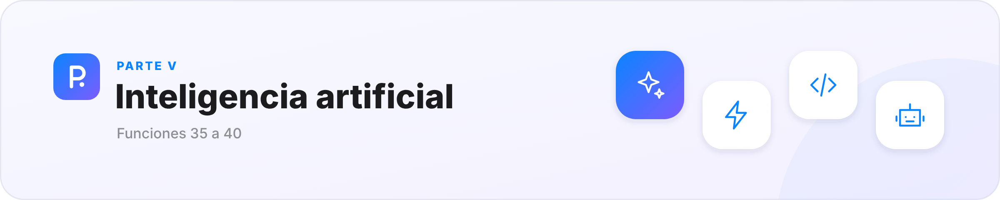
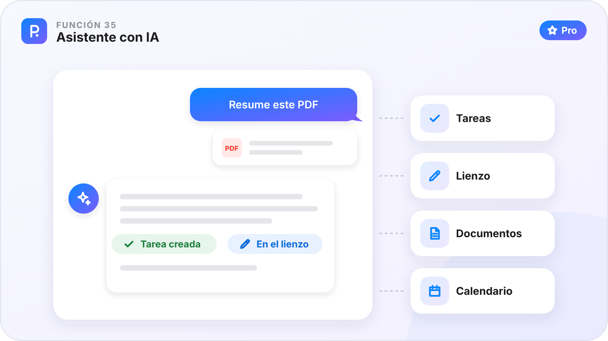
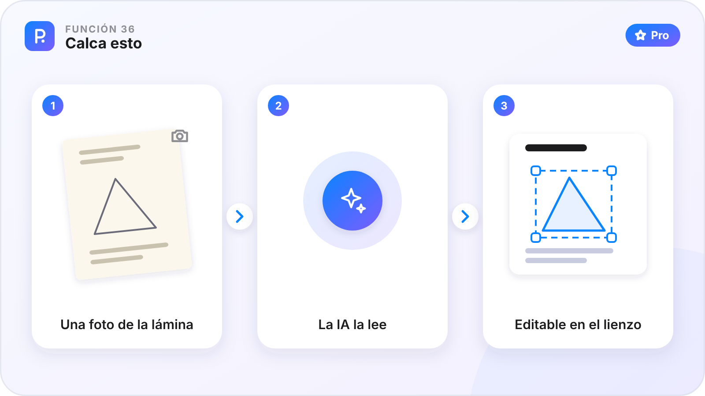
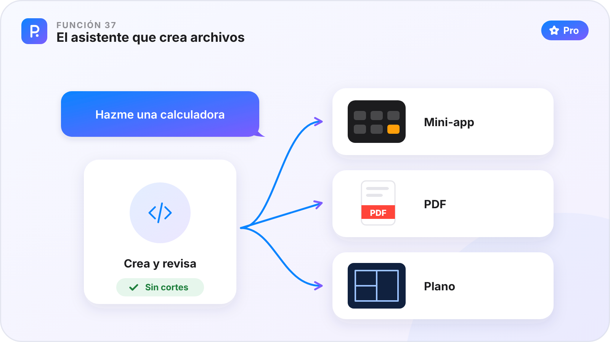
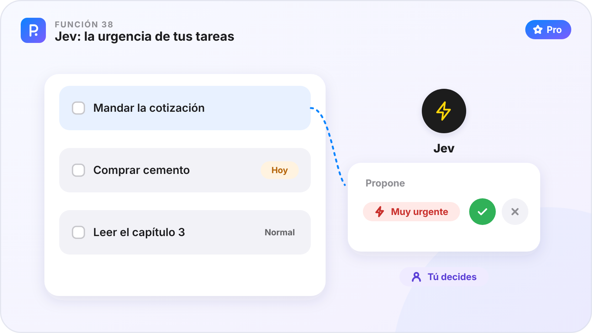
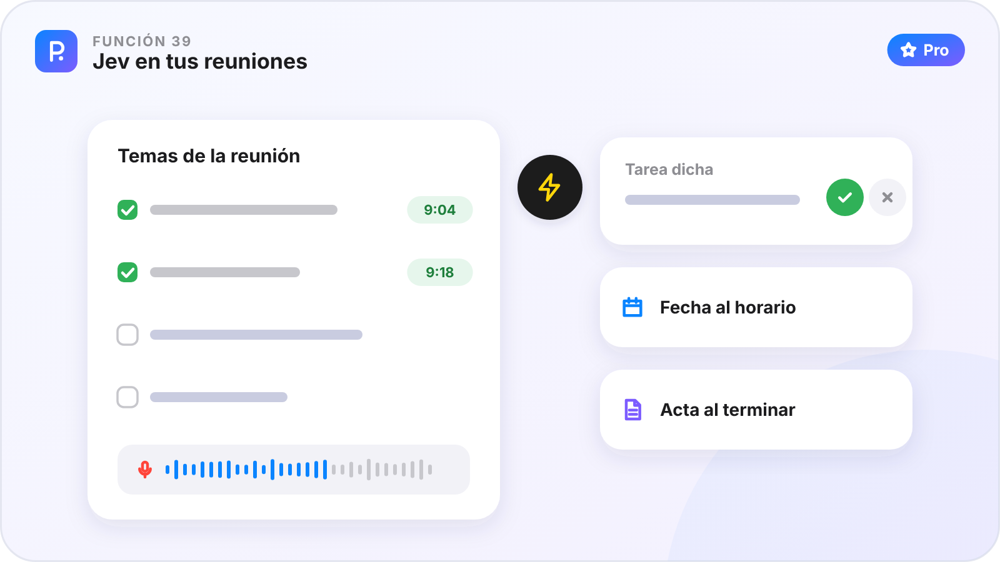
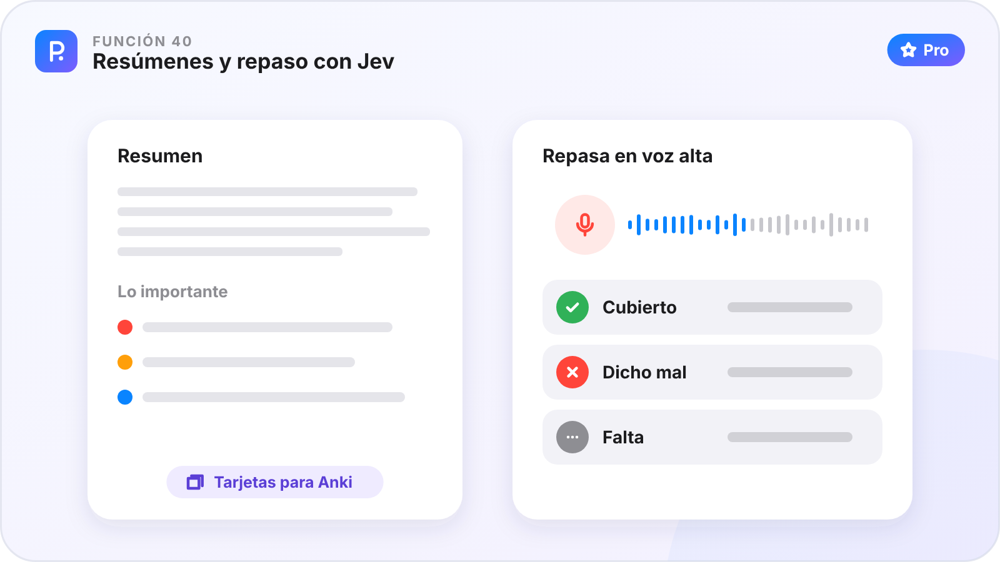

# Parte V · Inteligencia artificial

[🏠 Inicio](Inicio.md) · Parte V de VII · Funciones 35–40 · [Plataformas](Plataformas.md)

Dos ayudantes con IA: el Asistente, que conversa y hace cosas por ti, y Jev, que decide al instante y te propone sin interrumpir. Todo es de PinDesk Pro.

**En esta parte**

| Nº | Función | En una frase | Plan |
|:-:|---|---|:-:|
| **35** | [Asistente con IA](#función-35--asistente-con-ia) | Un chat con una inteligencia artificial que hace cosas dentro de PinDesk. | ⭐ |
| **36** | [Calca esto](#función-36--calca-esto) | Una foto de una lámina o un apunte pasa al lienzo, editable. | ⭐ |
| **37** | [El asistente que crea archivos](#función-37--el-asistente-que-crea-archivos) | Pídele una herramienta y te la hace: mini-apps, PDF y planos. | ⭐ |
| **38** | [Jev: la urgencia de tus tareas](#función-38--jev-la-urgencia-de-tus-tareas) | Jev lee tus tareas y te propone cuáles son urgentes. | ⭐ |
| **39** | [Jev en tus reuniones](#función-39--jev-en-tus-reuniones) | Mientras grabas, Jev marca los temas tratados y apunta lo que se encarga. | ⭐ |
| **40** | [Resúmenes y repaso con Jev](#función-40--resúmenes-y-repaso-con-jev) | Lo importante de cada clase, y un repaso en voz alta que te corrige. | ⭐ |

**Cómo leer cada función.** ✅ ya está en la app de ese aparato · ⏳ en camino · — el sistema no lo permite. 🟢 Gratis · ⭐ Pro.

---

## Función 35 · Asistente con IA

> **En una frase.** Un chat con una inteligencia artificial que hace cosas dentro de PinDesk.

#### Cómo funciona

1. Abre el chat **Asistente**.
2. Pide lo que quieras como se lo dirías a una persona: «apúntame comprar cemento para el viernes», «resume este PDF», «¿qué tengo hoy?».
3. Adjunta una foto o un documento si hace falta.
4. Revisa la respuesta. Si algo no está bien, díselo y lo corrige.

#### Fortalezas

- **No solo contesta: actúa** con tus tareas, tus lienzos y tus documentos.
- **Conoce tus cosas por su fecha**: «¿qué apunté en la obra el martes?».
- **Google Drive y Calendar**, si los conectas, y páginas web cuando le hacen falta.
- **Elige el modelo** desde la pastilla de arriba del chat.

#### Dónde está

| 🪟 Windows | 🤖 Android | 💻 Mac | 📱 iPad |
|:-:|:-:|:-:|:-:|
| ✅ | ✅ | ✅ | ✅ |

Una IA puede equivocarse: revisa lo importante.

**Plan:** ⭐ Pro

---

## Función 36 · Calca esto

> **En una frase.** Una foto de una lámina o un apunte pasa al lienzo, editable.

#### Cómo funciona

1. Manda al Asistente la foto de una lámina, un apunte o una captura.
2. Pídele «calca esto».
3. En un par de segundos ves lo principal en el lienzo; el resto va llegando.
4. Mueve y corrige los textos, las tablas, las figuras y las fórmulas.

#### Fortalezas

- **No es una foto pegada**: cada cosa es editable.
- **Tablas desde una foto**, listas para usar.
- **Ahorra horas** de pasar a limpio.

#### Dónde está

| 🪟 Windows | 🤖 Android | 💻 Mac | 📱 iPad |
|:-:|:-:|:-:|:-:|
| ✅ | ⏳ | ✅ | ✅ |

**Plan:** ⭐ Pro

---

## Función 37 · El asistente que crea archivos

> **En una frase.** Pídele una herramienta y te la hace: mini-apps, PDF y planos.

#### Cómo funciona

1. Pide en el Asistente lo que necesitas: «hazme una calculadora de vigas», «un PDF con esta ficha», «un plano de la planta».
2. El asistente crea el archivo y lo **revisa solo** antes de entregarlo.
3. Queda en el chat, listo para abrir en su visor.
4. Pídele cambios: edita solo el trozo que le dices.

#### Fortalezas

- **Herramientas a tu medida** sin programar.
- **Mini-apps, PDF y planos con capas, arcos y cotas**, y también imágenes vectoriales, textos y tablas.
- **Compártelas** en la [Comunidad](Parte-6-Conectar.md#función-46--comunidad).

#### Dónde está

| 🪟 Windows | 🤖 Android | 💻 Mac | 📱 iPad |
|:-:|:-:|:-:|:-:|
| ⏳ | ✅ | ⏳ | ⏳ |

Llega primero a Android y después a Windows, Mac e iPad.

**Plan:** ⭐ Pro

---

## Función 38 · Jev: la urgencia de tus tareas

> **En una frase.** Jev lee tus tareas y te propone cuáles son urgentes.

#### Cómo funciona

1. Con PinDesk Pro, enciende Jev en **Ajustes → Asistente → Jev**, con un interruptor para cada idea.
2. Abre **Tareas**: las urgencias propuestas aparecen solas.
3. Jev tiene en cuenta lo que dice la tarea, su chat y cuánto falta para su hora.
4. Acepta (✓) o descarta (✕). No vuelve a preguntar por la misma tarea.

#### Fortalezas

- **Propone, no impone**: la decisión es tuya.
- **Rápido**: contesta en una fracción de segundo.
- **Solo lo seguro**: si duda, no propone nada.

#### Dónde está

| 🪟 Windows | 🤖 Android | 💻 Mac | 📱 iPad |
|:-:|:-:|:-:|:-:|
| ✅ | ✅ | ✅ | ✅ |

**Plan:** ⭐ Pro

---

## Función 39 · Jev en tus reuniones

> **En una frase.** Mientras grabas, Jev marca los temas tratados y apunta lo que se encarga.

#### Cómo funciona

1. Antes de grabar, escribe los temas o tómalos de una lista de tareas.
2. Durante la reunión, Jev marca ✓ cada tema con su minuto.
3. Te propone **tareas dichas** («＋ Tarea: mandar la cotización el viernes») y **fechas al horario**.
4. Al terminar, decisiones, preguntas abiertas y tareas quedan en el **acta**.

#### Fortalezas

- **Sabes qué falta** antes de que termine la reunión.
- **Te ahorra el acta**.
- **Nada se apunta solo**: tú aceptas cada ficha. Y al dictar en el chat («anota en la obra que faltan tornillos»), confirmas con Intro.

#### Dónde está

| 🪟 Windows | 🤖 Android | 💻 Mac | 📱 iPad |
|:-:|:-:|:-:|:-:|
| ✅ | ✅ | ✅ | ✅ |

**Plan:** ⭐ Pro

---

## Función 40 · Resúmenes y repaso con Jev

> **En una frase.** Lo importante de cada clase, y un repaso en voz alta que te corrige.

#### Cómo funciona

1. Abre una clase grabada en **Estudiar la clase**.
2. Lee el **resumen** y lo importante marcado: lo que entra en examen, definiciones, fórmulas y tareas.
3. Pulsa **Repasar en voz alta** y explica la clase con tus palabras.
4. Cada punto clave pasa a ✓ cubierto, ✗ dicho mal o · falta, con un botón para volver a ese minuto. Saca **tarjetas para Anki** de lo que vale la pena.

#### Fortalezas

- **Estudias activo**, no solo releyendo.
- **Sabes qué te falta** antes del examen.
- **Tarjetas que valen la pena**, no un montón de ellas.

#### Dónde está

| 🪟 Windows | 🤖 Android | 💻 Mac | 📱 iPad |
|:-:|:-:|:-:|:-:|
| ✅ | ✅ | ✅ | ✅ |

**Plan:** ⭐ Pro

---

[← Parte IV · Leer, escuchar y estudiar](Parte-4-Leer-escuchar-y-estudiar.md) &nbsp;·&nbsp; [🏠 Inicio](Inicio.md) &nbsp;·&nbsp; [Parte VI · Conectar →](Parte-6-Conectar.md)

