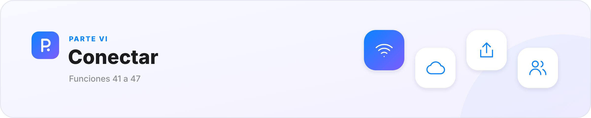
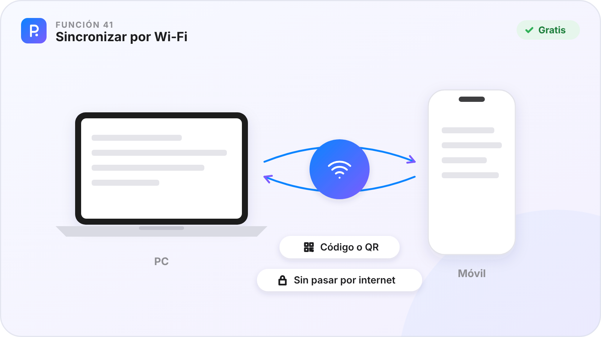
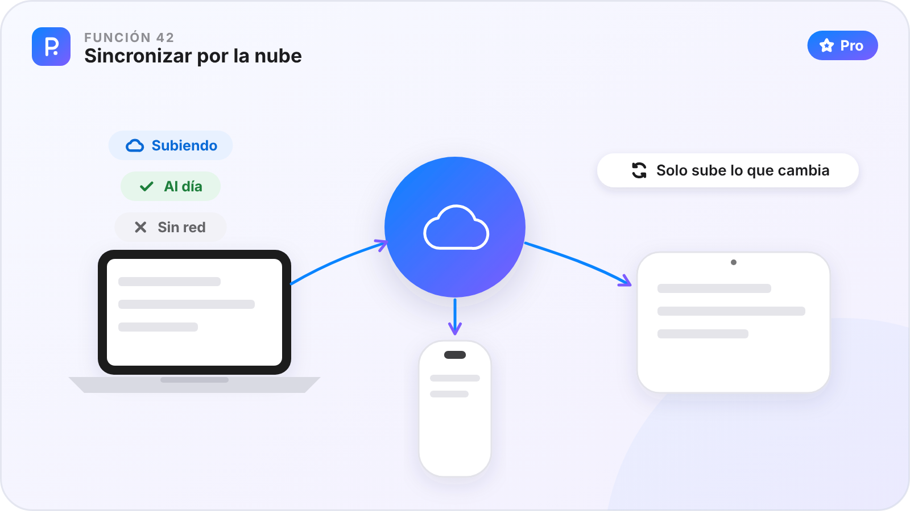
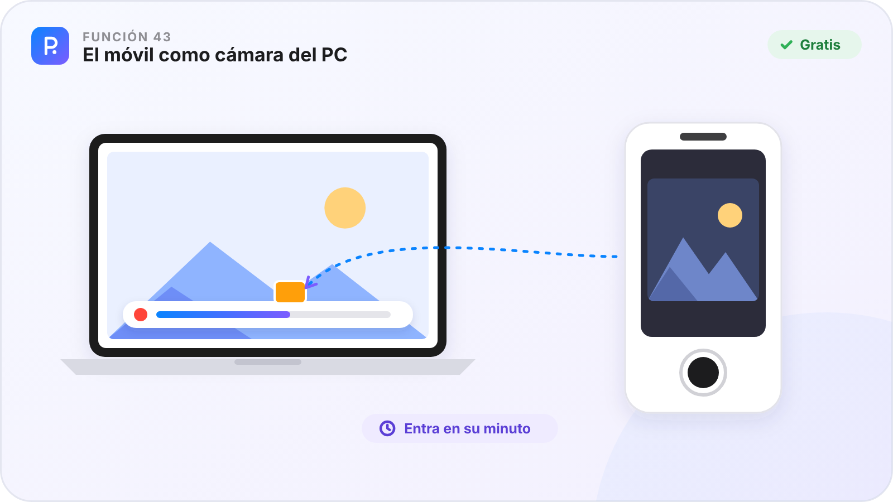
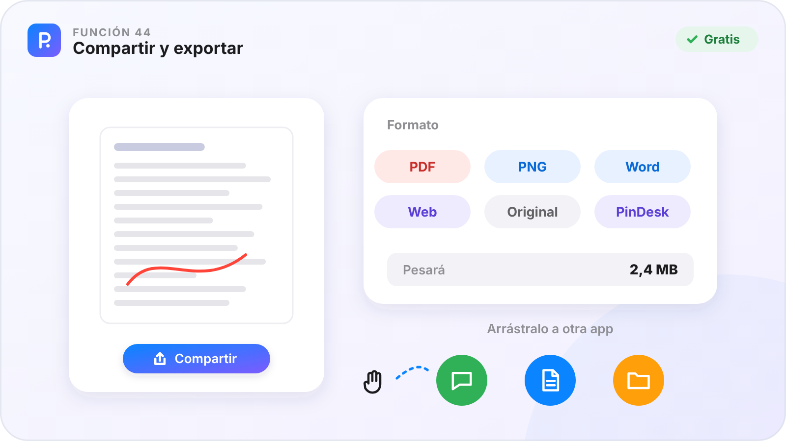
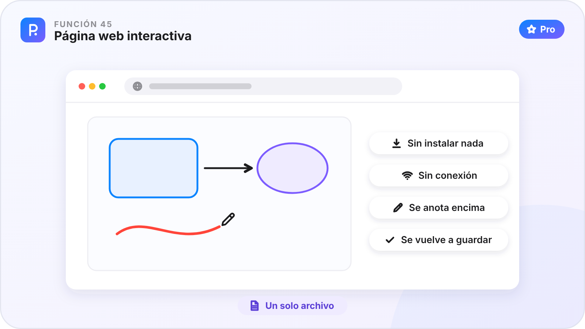
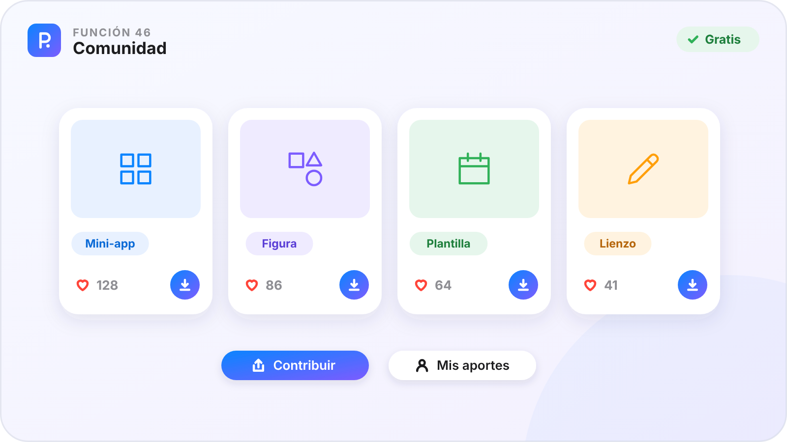
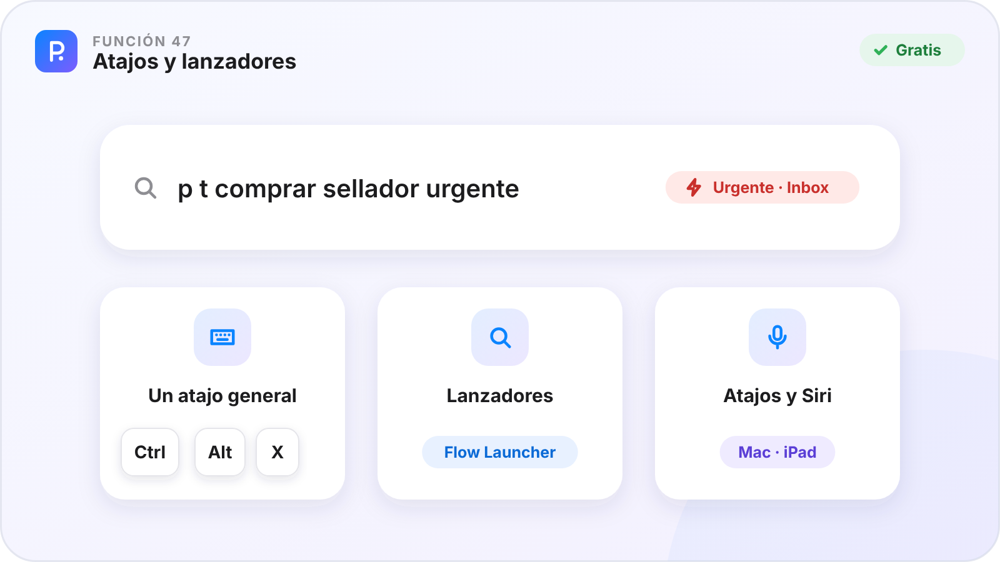

# Parte VI · Conectar

[🏠 Inicio](Inicio.md) · Parte VI de VII · Funciones 41–47 · [Plataformas](Plataformas.md)

Tus aparatos con lo mismo, tus cosas compartidas como tú quieras y la Comunidad de PinDesk.

**En esta parte**

| Nº | Función | En una frase | Plan |
|:-:|---|---|:-:|
| **41** | [Sincronizar por Wi‑Fi](#función-41--sincronizar-por-wifi) | Tus aparatos tienen lo mismo, por la Wi‑Fi de casa y gratis. | 🟢 |
| **42** | [Sincronizar por la nube](#función-42--sincronizar-por-la-nube) | Tus aparatos al día aunque no estéis en la misma Wi‑Fi. | ⭐ |
| **43** | [El móvil como cámara del PC](#función-43--el-móvil-como-cámara-del-pc) | Mientras el PC graba la clase, tus fotos del móvil entran en su minuto. | 🟢 |
| **44** | [Compartir y exportar](#función-44--compartir-y-exportar) | La misma hoja de compartir en toda la app, con el formato que necesites. | 🟢 |
| **45** | [Página web interactiva](#función-45--página-web-interactiva) | Un solo archivo que se abre en cualquier navegador y se puede seguir anotando. | ⭐ |
| **46** | [Comunidad](#función-46--comunidad) | Una galería compartida con lo que crea la gente con PinDesk. | 🟢 |
| **47** | [Atajos y lanzadores](#función-47--atajos-y-lanzadores) | Haz cosas en PinDesk sin abrirla. | 🟢 |

**Cómo leer cada función.** ✅ ya está en la app de ese aparato · ⏳ en camino · — el sistema no lo permite. 🟢 Gratis · ⭐ Pro.

---

## Función 41 · Sincronizar por Wi‑Fi

> **En una frase.** Tus aparatos tienen lo mismo, por la Wi‑Fi de casa y gratis.

#### Cómo funciona

1. En un aparato, abre **Sincronizar** y crea tu grupo: sale un **código** y un **QR**.
2. En el otro, escribe el código o **lee el QR** con cualquier cámara.
3. Listo: los aparatos se encuentran solos en la misma red y juntan los cambios de los dos lados.
4. El botón de sincronizar gira mientras trabaja y se pone rojo si la última vez falló.

#### Fortalezas

- **Sin pasar por internet**: va cifrado, directo entre tus aparatos.
- **Junta, no pisa**: los lienzos figura a figura, las tablas celda a celda.
- **Copia de seguridad** antes de recibir, y antes de borrar se pregunta.
- **Enviar una sola vez** a alguien con un código de seis cifras.

#### Dónde está

| 🪟 Windows | 🤖 Android | 💻 Mac | 📱 iPad |
|:-:|:-:|:-:|:-:|
| ✅ | ✅ | ✅ | ✅¹ |

¹ En el iPad se sincroniza con la app abierta: iPadOS corta la red de las apps en segundo plano.

**Plan:** 🟢 Gratis

---

## Función 42 · Sincronizar por la nube

> **En una frase.** Tus aparatos al día aunque no estéis en la misma Wi‑Fi.

#### Cómo funciona

1. Activa Pro con tu cuenta.
2. Elige **Nube** en los chats que quieras, también en los compartidos.
3. Una nubecita dice cómo va: azul subiendo, verde al día, gris sin red.
4. En los documentos, **En línea / Sin conexión** te deja trabajar sin red y decidir después qué te quedas.

#### Fortalezas

- **Solo sube lo que cambia**: una raya en un plano viaja como una raya, no como el plano entero.
- **Tus chats compartidos** llegan a cada persona esté donde esté.
- **Si Pro vence**, la nube se pausa pero la Wi‑Fi sigue.

#### Dónde está

| 🪟 Windows | 🤖 Android | 💻 Mac | 📱 iPad |
|:-:|:-:|:-:|:-:|
| ✅ | ✅ | ✅ | ✅ |

**Plan:** ⭐ Pro

---

## Función 43 · El móvil como cámara del PC

> **En una frase.** Mientras el PC graba la clase, tus fotos del móvil entran en su minuto.

#### Cómo funciona

1. Empieza a grabar una clase o una reunión en el PC.
2. En el móvil o el iPad, junto al «+» de los chats aparece el botón de la cámara.
3. Haz fotos o clips de la pizarra.
4. Entran solos en la grabación del PC, en el minuto en que las hiciste.

#### Fortalezas

- **La pizarra nítida** y el audio desde el PC.
- **Sin pasar archivos a mano**.
- **Cada foto en su momento** de la transcripción.

#### Dónde está

| 🪟 Windows | 🤖 Android | 💻 Mac | 📱 iPad |
|:-:|:-:|:-:|:-:|
| ✅ | ✅ | ⏳ | ✅ |

Grabar la clase en el PC es de ⭐ Pro.

**Plan:** 🟢 Gratis

---

## Función 44 · Compartir y exportar

> **En una frase.** La misma hoja de compartir en toda la app, con el formato que necesites.

#### Cómo funciona

1. Pulsa **Compartir** en un mensaje, un visor, el lienzo, el timeline, una lista de tareas o un plano.
2. Elige el formato: PDF, PNG, JPG, SVG, Word, Markdown, texto, el original o el editable de PinDesk.
3. Elige las páginas y mira **cuánto pesará** antes de exportar.
4. En el ordenador, arrastra el archivo a WhatsApp, al correo o a una carpeta. En el móvil se abre el panel de compartir.

#### Fortalezas

- **Aprendes una vez** y compartes cualquier cosa.
- **Una foto anotada sale con su dibujo**.
- **Por Wi‑Fi a tus aparatos**, con un botón.

#### Dónde está

| 🪟 Windows | 🤖 Android | 💻 Mac | 📱 iPad |
|:-:|:-:|:-:|:-:|
| ✅ | ✅ | ✅ | ✅ |

En Android también puedes pedir un enlace temporal, de 1 hora a 3 días.

**Plan:** 🟢 Gratis

---

## Función 45 · Página web interactiva

> **En una frase.** Un solo archivo que se abre en cualquier navegador y se puede seguir anotando.

#### Cómo funciona

1. Pulsa **Compartir** en un lienzo, el timeline, un plano o un documento.
2. Elige **Página web interactiva**.
3. Mándala: quien la recibe la abre en su navegador, sin instalar nada y sin conexión.
4. Puede moverla, acercarla, anotar encima, medir y volver a guardarla.

#### Fortalezas

- **Quien la recibe no necesita PinDesk**.
- **Sigue viva**: no es una foto, se trabaja encima.
- **Las clases grabadas** viajan con su reproductor.

#### Dónde está

| 🪟 Windows | 🤖 Android | 💻 Mac | 📱 iPad |
|:-:|:-:|:-:|:-:|
| ✅ | ✅ | ✅ | ✅ |

Las que ya exportaste se siguen abriendo aunque no tengas Pro.

**Plan:** ⭐ Pro

---

## Función 46 · Comunidad

> **En una frase.** Una galería compartida con lo que crea la gente con PinDesk.

#### Cómo funciona

1. Abre **Funciones → Comunidad**.
2. Explora por tipo (mini-apps, figuras, plantillas, lienzos, planos y documentos) o busca «horario», «vigas», «hábitos»…
3. Abre una tarjeta y pulsa **Descargar** o **Usar**: las figuras entran en tu biblioteca y lo demás, en tu chat.
4. Pulsa **Contribuir** para subir algo tuyo con su portada. En **Mis aportes** ves su estado y subes versiones nuevas.

#### Fortalezas

- **No empiezas de cero**.
- **Cuidada**: lo que se sube se revisa antes de publicarse.
- **Las mini-apps del asistente** ayudan a otros.

#### Dónde está

| 🪟 Windows | 🤖 Android | 💻 Mac | 📱 iPad |
|:-:|:-:|:-:|:-:|
| ⏳ | ✅¹ | ⏳ | ⏳ |

¹ Llega primero a Android y se abre poco a poco: si ves «disponible pronto», aún no está abierta para tu cuenta. Lo que subes es público: no subas datos personales.

**Plan:** 🟢 Gratis

---

## Función 47 · Atajos y lanzadores

> **En una frase.** Haz cosas en PinDesk sin abrirla.

#### Cómo funciona

1. En Windows, un solo atajo general: `Ctrl Alt X` captura desde cualquier sitio. En el Mac, `⌃⌥X`.
2. Con **Flow Launcher** en Windows, escribe `p t comprar sellador` y la tarea queda apuntada; `p n` crea una nota y `p g` busca en la galería.
3. En el Mac y el iPad, usa **Siri y Atajos**: grabar una nota de voz, capturar, apuntar en el timeline o mandar al lienzo.
4. Dentro de cada ventana, cada botón enseña su letra.

#### Fortalezas

- **Un solo atajo que recordar**.
- **Las mismas letras en todas partes**: `t` es tarea en Flow y en Buscar en PinDesk.
- **Silencia los atajos** desde la bandeja para jugar o presentar.

#### Dónde está

| 🪟 Windows | 🤖 Android | 💻 Mac | 📱 iPad |
|:-:|:-:|:-:|:-:|
| ✅ | — | ✅ | ✅¹ |

¹ En el iPad, con Siri y Atajos. Android no tiene atajos globales: ahí tienes la bola flotante y el buscador. La instalación del plugin de Flow Launcher desde el ZIP llega próximamente.

**Plan:** 🟢 Gratis

---

[← Parte V · Inteligencia artificial](Parte-5-Inteligencia-artificial.md) &nbsp;·&nbsp; [🏠 Inicio](Inicio.md) &nbsp;·&nbsp; [Parte VII · Tu cuenta →](Parte-7-Tu-cuenta.md)

