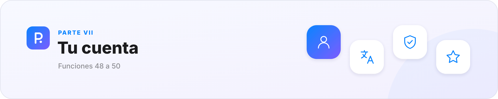
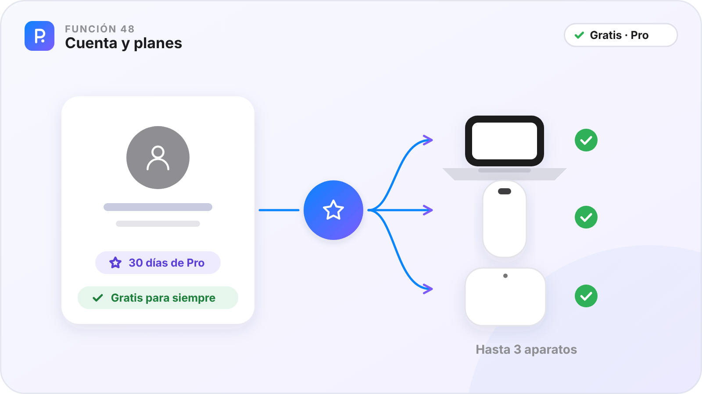
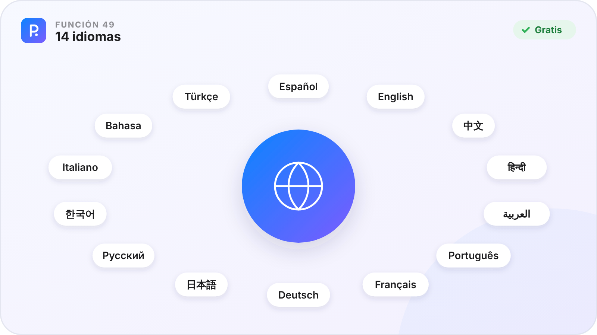
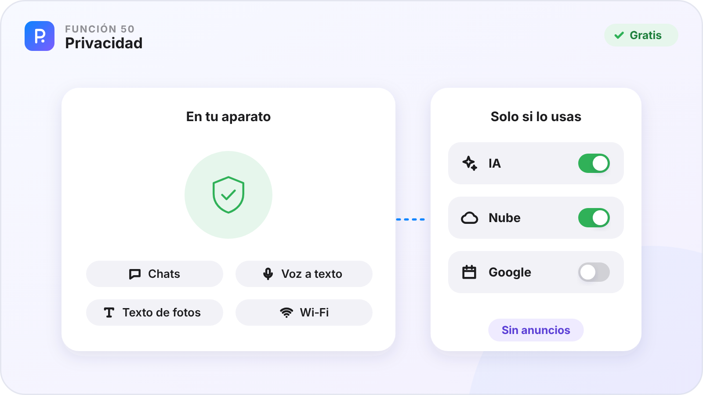

# Parte VII · Tu cuenta

[🏠 Inicio](Inicio.md) · Parte VII de VII · Funciones 48–50 · [Plataformas](Plataformas.md)

Tu cuenta, tus planes, tu idioma y tu privacidad.

**En esta parte**

| Nº | Función | En una frase | Plan |
|:-:|---|---|:-:|
| **48** | [Cuenta y planes](#función-48--cuenta-y-planes) | Entra con Google y tienes el plan gratuito; Pro añade la nube, la IA y las herramientas profesionales. | 🟢 / ⭐ |
| **49** | [14 idiomas](#función-49--14-idiomas) | PinDesk habla tu idioma, o el de tu aparato. | 🟢 |
| **50** | [Privacidad](#función-50--privacidad) | Lo tuyo se queda en tu aparato y solo sale cuando usas algo que lo necesita. | 🟢 |

**Cómo leer cada función.** ✅ ya está en la app de ese aparato · ⏳ en camino · — el sistema no lo permite. 🟢 Gratis · ⭐ Pro.

---

## Función 48 · Cuenta y planes

> **En una frase.** Entra con Google y tienes el plan gratuito; Pro añade la nube, la IA y las herramientas profesionales.

#### Cómo funciona

1. Inicia sesión en PinDesk con tu **cuenta de Google**: ya tienes el plan gratuito, sin fecha de caducidad.
2. Cada cuenta nueva tiene **30 días de Pro** para probarlo todo.
3. Para seguir con Pro, elige **mensual**, **anual** o **de por vida**. Precios: próximamente.
4. Pro se activa en **hasta 3 aparatos** con la misma cuenta. ¿Uno nuevo? Quita otro de la lista: pasa al plan gratuito sin perder nada.

#### Fortalezas

- **Casi todo es gratis**, para siempre y sin límite de aparatos.
- **Tus datos nunca se borran** si Pro vence: lo hecho con Pro se sigue abriendo y exportando.
- **La Wi‑Fi sigue** aunque no tengas Pro.

#### Dónde está

| 🪟 Windows | 🤖 Android | 💻 Mac | 📱 iPad |
|:-:|:-:|:-:|:-:|
| ✅ | ✅ | ⏳ | ⏳ |

Todo el detalle de los planes, en [Gratis y Pro](../docs/planes.md).

**Plan:** 🟢 Gratis para siempre · ⭐ Pro

---

## Función 49 · 14 idiomas

> **En una frase.** PinDesk habla tu idioma, o el de tu aparato.

#### Cómo funciona

1. Abre **Ajustes → General → Idioma** (en Android, la tarjeta **Idioma** al final de Ajustes).
2. Elige uno de los 14, o «El del sistema».
3. La app cambia al momento. El idioma es de cada aparato.

#### Fortalezas

- **Español, inglés, chino, hindi, árabe, portugués, francés, alemán, japonés, ruso, coreano, italiano, indonesio y turco**.
- **Nunca te quedas a medias**: si falta un texto, sale en inglés.
- **Fechas y plurales** bien escritos en cada idioma.

#### Dónde está

| 🪟 Windows | 🤖 Android | 💻 Mac | 📱 iPad |
|:-:|:-:|:-:|:-:|
| ✅ | ✅ | ✅ | ✅ |

Español e inglés están completos; en los demás, lo que aún no está traducido se ve en inglés.

**Plan:** 🟢 Gratis

---

## Función 50 · Privacidad

> **En una frase.** Lo tuyo se queda en tu aparato y solo sale cuando usas algo que lo necesita.

#### Cómo funciona

1. Tus chats, fotos, notas, lienzos y tareas se guardan en tu aparato.
2. El texto de las capturas y la voz a texto se hacen en tu aparato.
3. Solo sale lo necesario cuando usas la IA, la nube o Google Drive y Calendar, y solo si los usas.
4. En **Ajustes → General → Privacidad y datos** tienes la política, qué sale de tu aparato y cómo borrar tus datos.

#### Fortalezas

- **Sin anuncios** y **sin vender tus datos**.
- **Lo básico funciona sin internet**.
- **Nunca vemos los datos de tu tarjeta**.

#### Dónde está

| 🪟 Windows | 🤖 Android | 💻 Mac | 📱 iPad |
|:-:|:-:|:-:|:-:|
| ✅ | ✅ | ✅ | ✅ |

El texto legal completo está en la [Política de privacidad](../docs/privacidad.md) y los [Términos de uso](../docs/terminos.md).

**Plan:** 🟢 Para todos los planes

---

[← Parte VI · Conectar](Parte-6-Conectar.md) &nbsp;·&nbsp; [🏠 Inicio](Inicio.md) &nbsp;·&nbsp; [Plataformas →](Plataformas.md)

