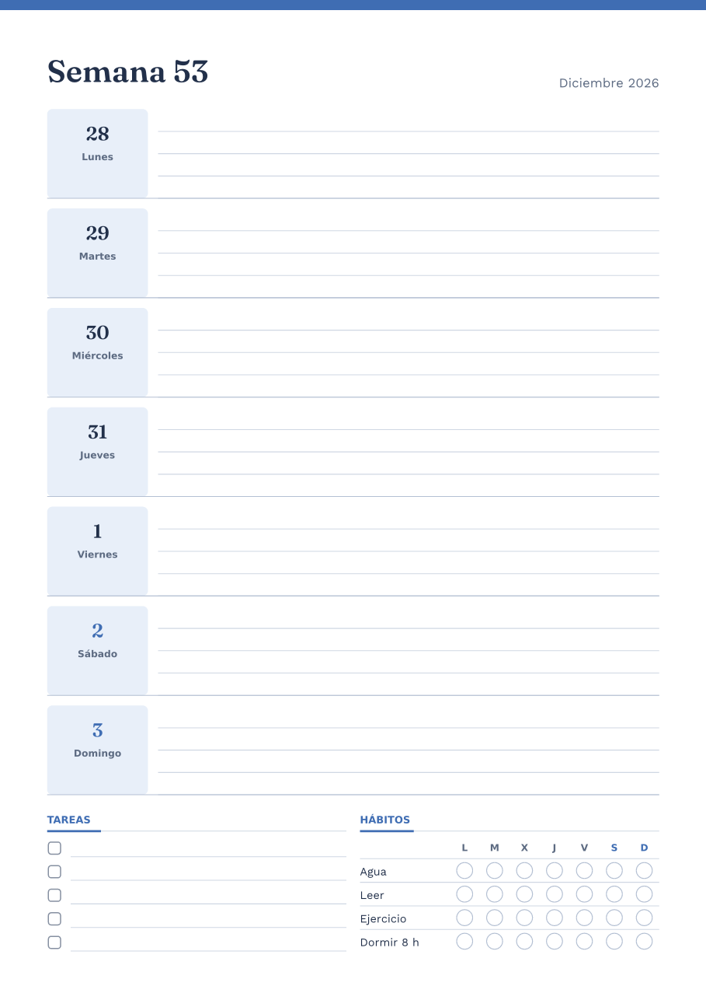
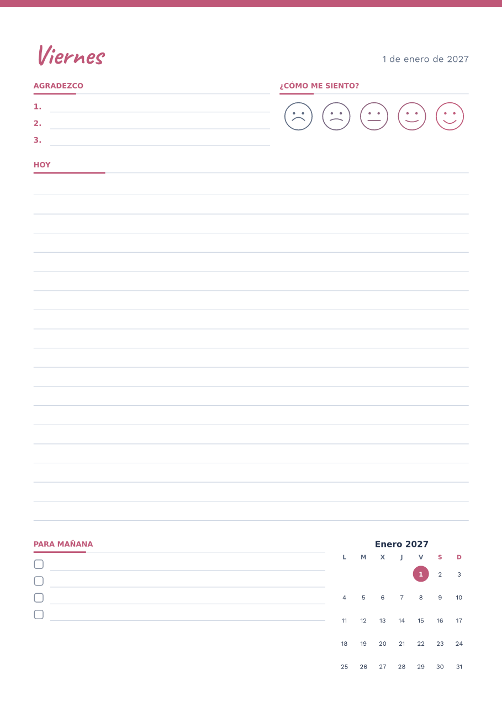
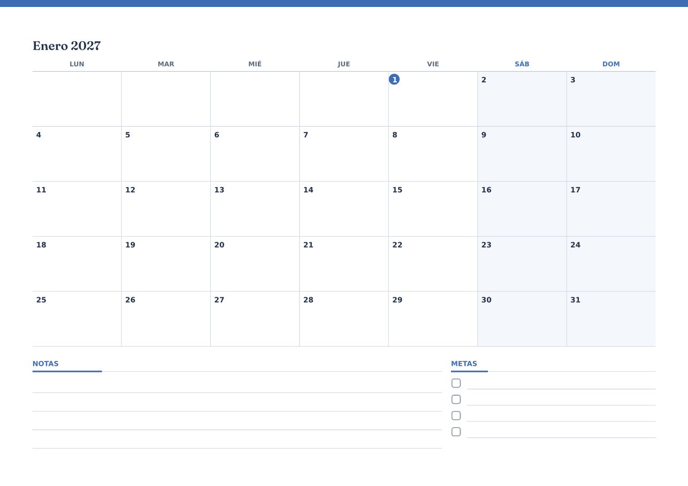
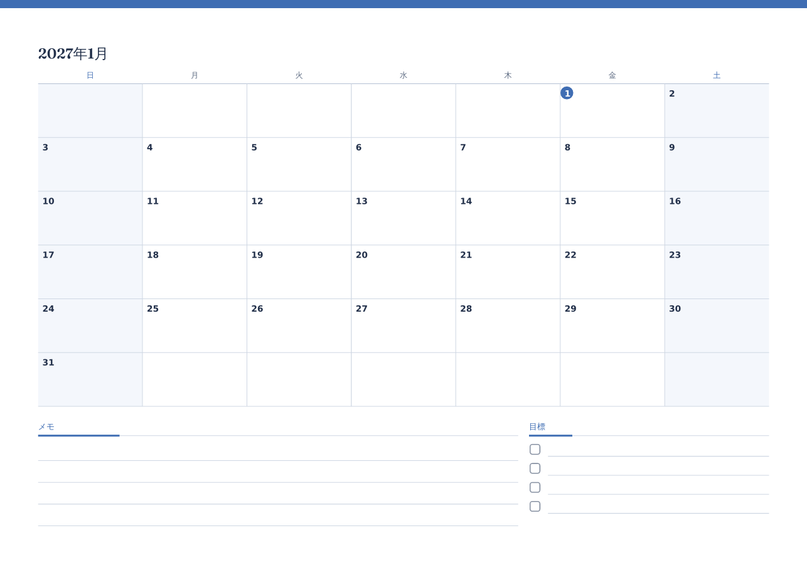
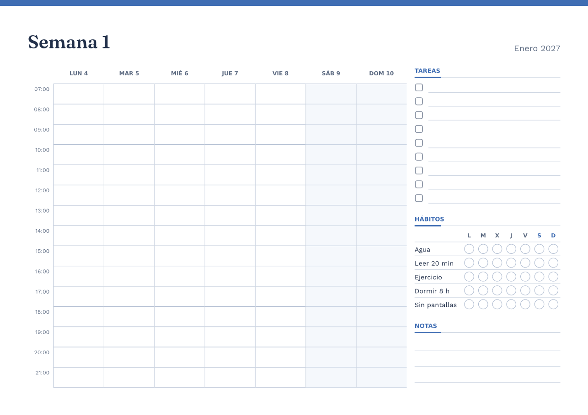

# 🗓️ PinDesk Plantillas

[🏠 Inicio](Inicio.md) · **Plan: 🟢 Gratis** (sin IA) · **⭐ Pro** (con IA)

| Windows | Android | macOS | iPad | iPhone |
|:-:|:-:|:-:|:-:|:-:|
| ✅ | ⏳ | ⏳ | ⏳ | ⏳ |

Una app aparte, **incluida con PinDesk** en Windows (búscala en el menú Inicio como **PinDesk
Plantillas**), para **diseñar plantillas por bloques**: diarios, planificadores, calendarios, listas
de hábitos, notas Cornell o actas de reunión. Las usas en tus lienzos o las sacas a PDF para
imprimir.

| Planificador semanal | Diario |
|---|---|
|  |  |
| **Calendario del mes** | **El mismo calendario, en japonés** |
|  |  |

*Muestras hechas con PinDesk Plantillas.*

## Qué hace

- **Por bloques**: arrastra desde la paleta encabezados, textos, renglones, cuadrícula, listas,
  casillas, tablas, calendarios del mes o de la semana, horarios, hábitos, prioridades, ánimo,
  notas Cornell o reunión. Una guía azul te enseña dónde va a caer.
- **Fechas que se llenan solas**: pon la fecha, el día o la semana y la plantilla los escribe por ti,
  **en el idioma que elijas** (de los 14 de PinDesk).
- **Repetir**: una página por día, por semana o por mes, para convertir una plantilla en un diario
  o una agenda del año entero (incluso solo los días laborables).
- **Galería** con modelos para empezar, y **temas de colores**.
- **Exportar** a PDF, PNG o SVG, o mandarla al [lienzo](Lienzo.md).
- **Enviar a PinDesk**: tu plantilla aparece en la **biblioteca de figuras**, lista para usarla en
  cualquier chat.
- ⭐ **Con IA**:
  - **Descríbelo** («planner semanal con horario de 7 a 22, tareas y hábitos») y se arma la
    plantilla entera.
  - **Ajusta** el bloque elegido («más filas», «en dos columnas»).
  - Pide **ideas de relleno**.
  - Siempre ves una vista previa y decides si la aplicas.

*Muestra hecha por la IA de PinDesk Plantillas ⭐ a partir de una frase.*

## Cómo se usa, paso a paso

1. Abre **PinDesk Plantillas** desde el menú Inicio.
2. Empieza con un modelo de la **galería** o con una hoja en blanco.
3. Arrastra bloques desde la paleta; cambia sus propiedades a la derecha.
4. Si quieres un diario, activa **Repetir** (cada día, semana o mes) y elige desde y hasta.
5. **Exporta a PDF** (`Ctrl E`) o pulsa **Enviar a PinDesk** para usarla en tus lienzos.

**Atajos**: `Supr` borrar · `Ctrl D` duplicar · `Ctrl Z` / `Ctrl Y` deshacer y rehacer · `Ctrl S`
guardar · `Ctrl E` exportar a PDF · `Alt ↑` `Alt ↓` subir y bajar el bloque.

## Fortalezas

- **Una agenda de 365 páginas en un minuto**: diseñas un día y la repetición hace el año, cada página
  con su fecha.
- **Fechas correctas en cualquier idioma**: nombres de días y meses, y si la semana empieza en lunes
  o en domingo, según el idioma.
- **Bloques pensados para estudiar y trabajar**: Cornell, hábitos, prioridades, acta de reunión.
- **De la plantilla al lienzo**: la usas en PinDesk para escribir encima a mano.
- **Sin IA es gratis**; con IA ⭐ describes lo que quieres y aparece.

## Consejos

- Para imprimir una agenda a doble cara, exporta a PDF con la repetición puesta.
- Guarda tus colores como tema para que todas tus plantillas combinen.

## Preguntas frecuentes

**¿Está en el móvil?** Por ahora es una app de Windows. Lo que envías a PinDesk aparece en la
biblioteca de figuras y **viaja a tus otros aparatos**.

**¿Necesito Pro?** Solo para lo de la IA. Diseñar, repetir y exportar es gratis.

---

[← Sincronización](Sincronizacion.md) · [Inicio](Inicio.md) · Siguiente: [Comunidad →](Comunidad.md)
