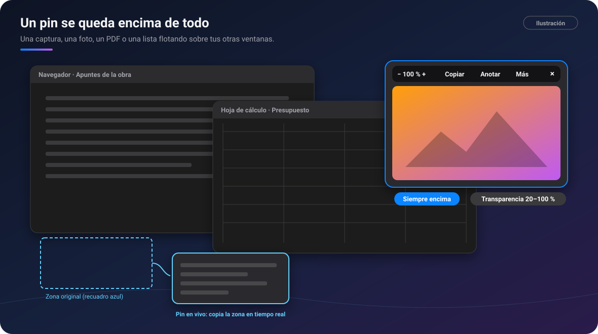
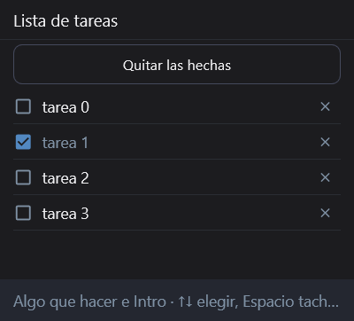
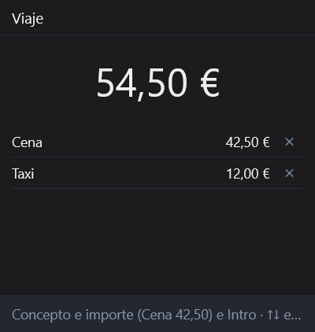
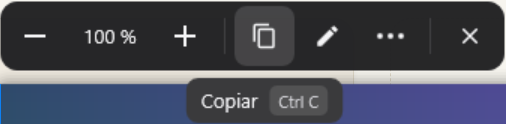
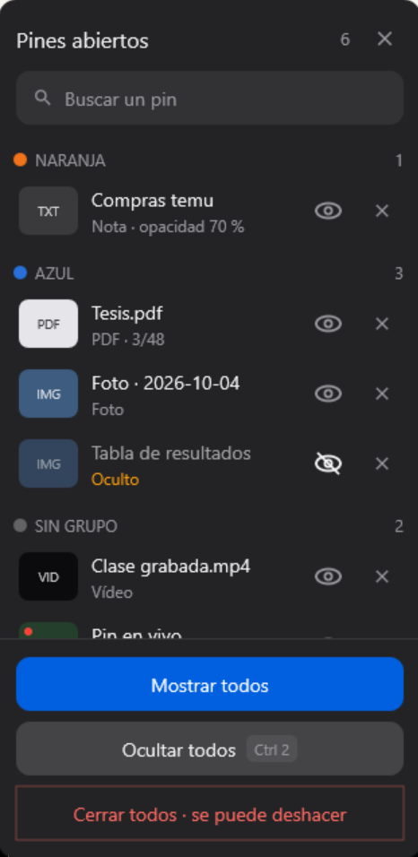
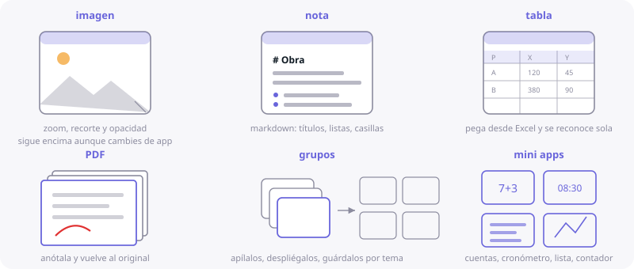

# 📌 Pines flotantes

[🏠 Inicio](Inicio.md) · **Plan: 🟢 Gratis**

| Windows | Android | macOS | iPad | iPhone |
|:-:|:-:|:-:|:-:|:-:|
| ✅ | ✅ | ✅ | ✅ (dentro de la app) | ⏳ |

Un **pin** es una ventanita que se queda **siempre encima** de las demás. Así tienes a la vista lo
que necesitas mientras trabajas en otra cosa.

*Ilustración: un pin de imagen encima de las ventanas y un pin en vivo que copia una zona.*

## Qué se puede pinear

- Una **captura**, una **foto** o un **vídeo** (con su línea de tiempo y volumen).
- Un **PDF**, con su página, o una **nota**.
- Una **lista de tareas** o una **herramienta**: contador, ruleta, cronómetro, temporizador,
  gastos.
- Un **pin en vivo** (Windows y Mac): copia una zona de la pantalla en tiempo real.

| Lista de tareas | Gastos |
|---|---|
|  |  |

*Capturas de PinDesk para Windows: dos herramientas como pin.*

## Cómo se usa, paso a paso

1. **Crea un pin**: pinea una captura (`Ctrl P`), usa «Pinear» en el menú de un mensaje del chat o
   «Fijar como pin» en un visor.
2. **Muévelo** arrastrándolo. La **rueda** lo agranda o lo achica; `Ctrl 0` lo devuelve a su
   tamaño.
3. **Ajusta la transparencia** con `Mayús` + rueda, del 20 al 100 %.
4. Si te estorba, **deja pasar el clic** (`Ctrl T`): se ve, pero los clics van a la ventana de
   debajo.
5. **Pasa el ratón** por encima: arriba sale su barra, con su control propio (zoom, página,
   reproducir…), **Copiar**, **Anotar** y **Más**.

*Captura de PinDesk para Windows: la barra común, con la chapita de su atajo.*

### Pines abiertos

Una lista de todos tus pines, **agrupados por color**, para encontrar los que ocultaste. `Ctrl 2`
los oculta o los muestra todos de golpe, y «Cerrar todos» se puede deshacer.

*Captura de PinDesk para Windows: el panel «Pines abiertos».*

## En cada aparato

- **Windows y Mac**: encima de cualquier programa, con guías azules y un imán suave para alinearlos.
  En Windows, `Ctrl` + arrastrar un pin lo suelta en otra app (WhatsApp, el correo, una carpeta).
- **Android**: encima de cualquier app. **La palabra es el comando**: copia «timer», «todo»,
  «gastos» o «pizarra», pinéala y sale la herramienta. Mantén pulsada la bola flotante para ocultar
  o mostrar todos.
- **iPad**: los pines flotan dentro de PinDesk (iPadOS no deja ponerlos encima de otras apps).

*Ilustración de PinDesk para Android: imagen, nota, tabla, PDF, grupos y mini-apps.*

## Fortalezas

- **Siempre encima, de verdad**: un plano de referencia, una fórmula o la lista de la compra se
  quedan a la vista aunque cambies de ventana.
- **No estorban**: transparencia y «dejar pasar el clic» para trabajar *a través* del pin.
- **La misma barra en todos**: aprendes un pin y ya sabes usar todos.
- **El pin en vivo** es como un espejo de una parte de la pantalla: vigila una descarga, un chat o
  una gráfica mientras haces otra cosa, y hasta haz clic en ella desde el pin.
- **Se guardan y vuelven**: al volver a abrir PinDesk, tus pines siguen donde los dejaste.
- **Anotar encima** con las mismas herramientas del [lienzo](Lienzo.md).

## Consejos

- Para comparar dos versiones de un diseño, pinea las dos con la transparencia al 50 % y ponlas una
  encima de otra.
- Agrupa pines por color para encontrarlos rápido en «Pines abiertos».

## Preguntas frecuentes

**¿El recuadro azul del pin en vivo sale en las capturas?** No, solo lo ves tú.

**En Android, mis pines desaparecen.** El sistema cerró PinDesk para ahorrar batería: quítala de la
optimización de batería.

---

[← Captura](Captura.md) · [Inicio](Inicio.md) · Siguiente: [Chats y proyectos →](Chats-y-proyectos.md)
