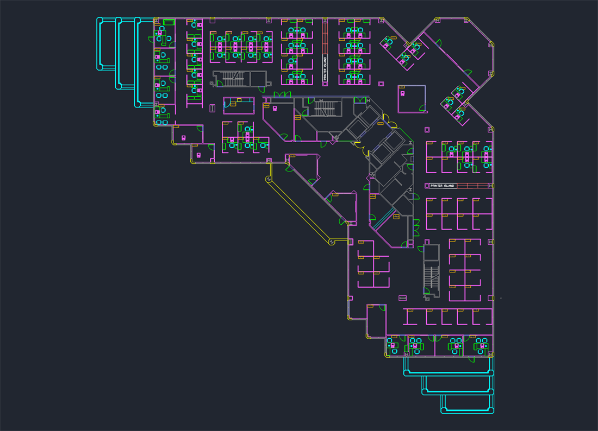
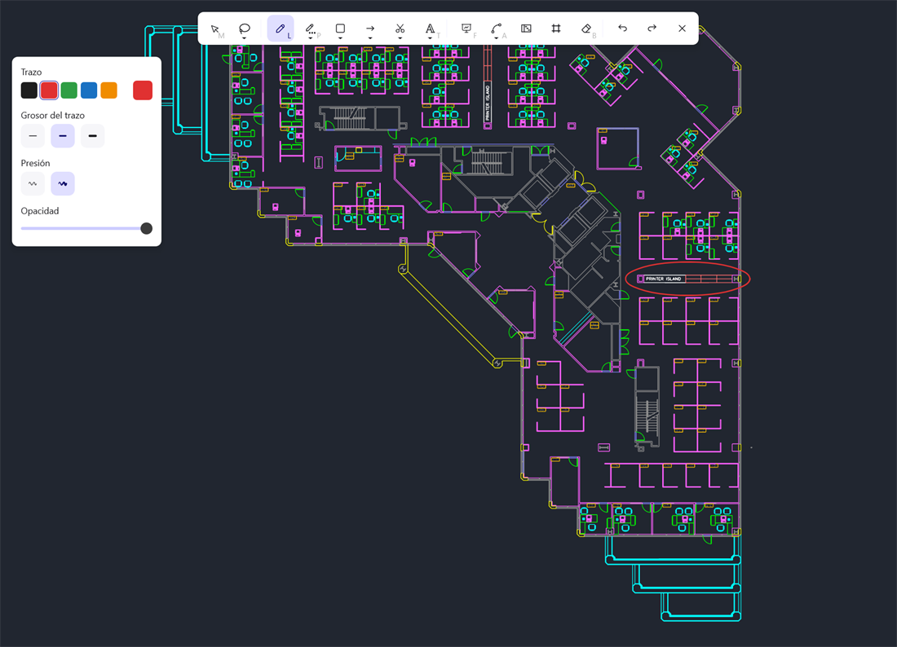
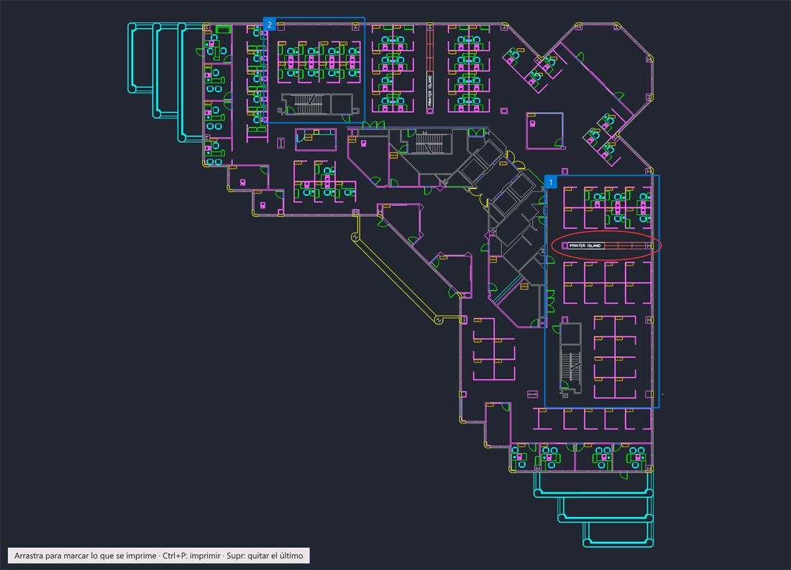
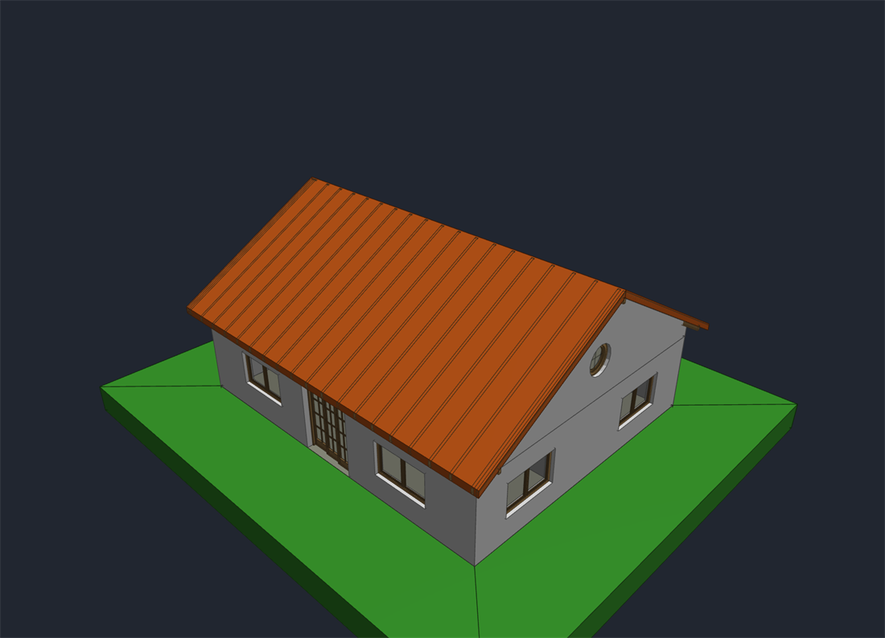
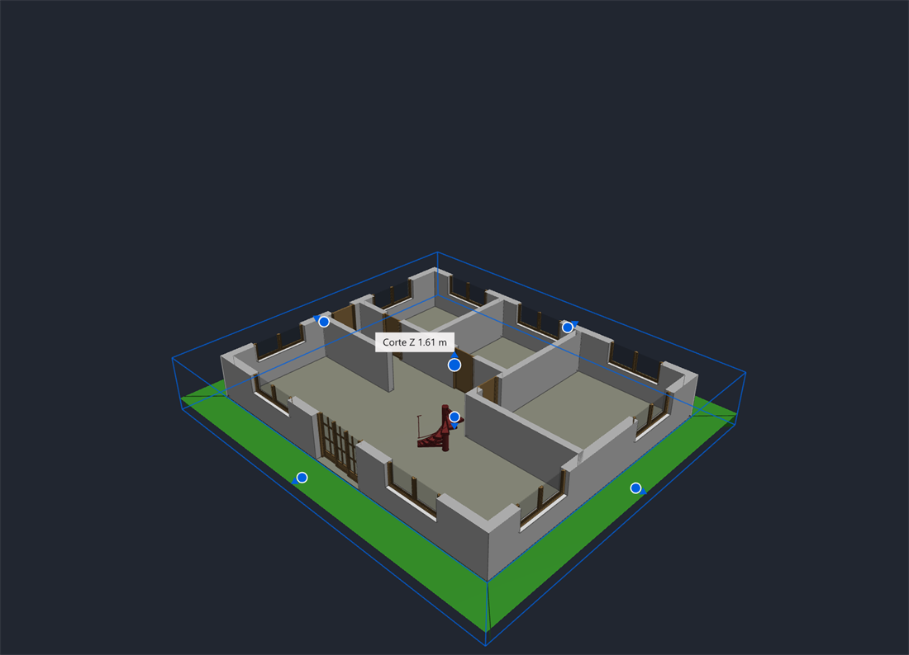
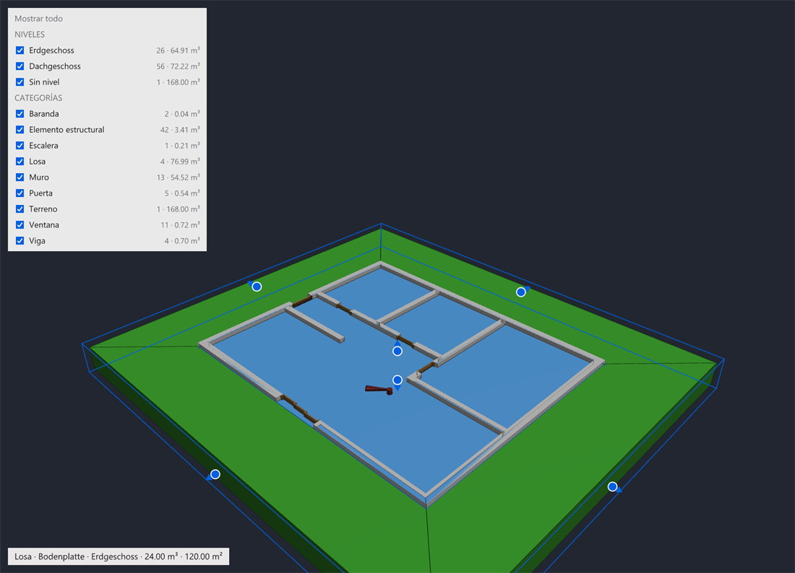
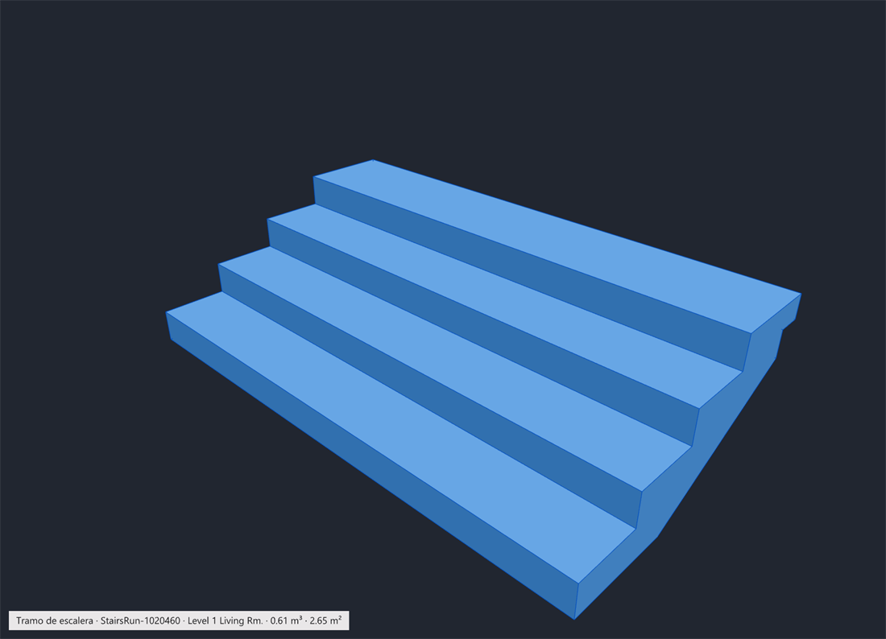
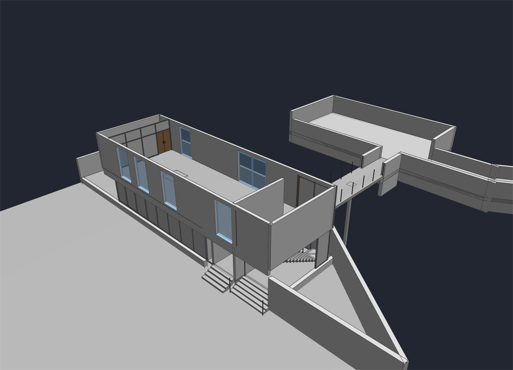
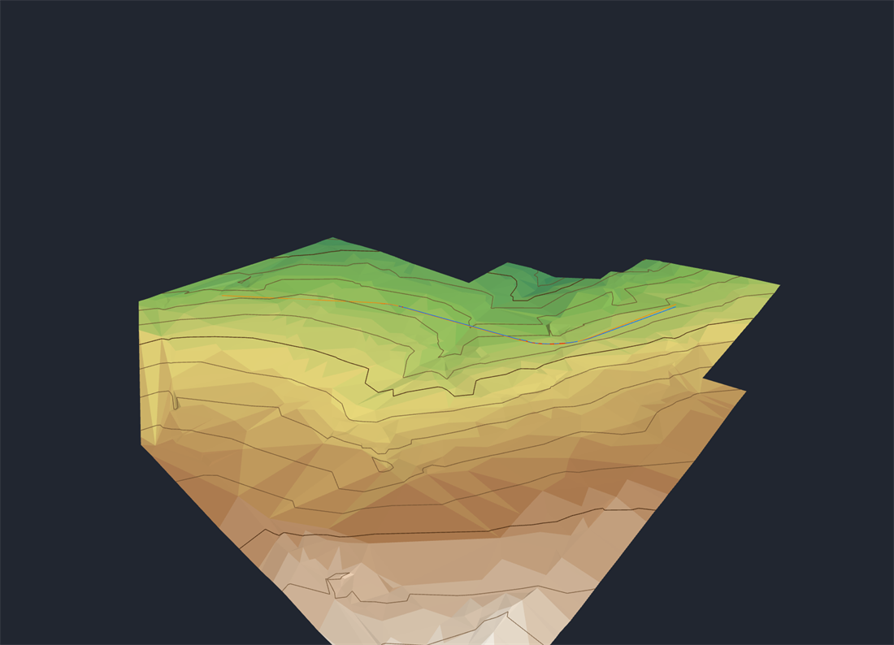

# 📐 Planos CAD y modelos BIM

[🏠 Inicio](Inicio.md) · **Plan: ⭐ Pro**

| Windows | Android | macOS | iPad | iPhone |
|:-:|:-:|:-:|:-:|:-:|
| ✅ | ✅ | ✅ | ✅ | ⏳ |

Abre **planos de AutoCAD** (DWG y DXF), **modelos de Revit e IFC** y **terrenos de Civil 3D** sin
tener ninguno de esos programas. Mide, marca, anota e imprime.

*Captura de PinDesk para Windows: un plano DWG abierto como pin.*

## Qué hace

**Planos (DWG y DXF)**

- Se abren al momento, como un pin, encima de todo.
- **Moverse**: la rueda acerca hacia donde apunta el ratón, arrastrar mueve el plano y doble clic
  (o `F`) lo enseña entero.
- **Medir** (`M`): la regla se engancha sola a esquinas, centros, cualquier punto de una línea y la
  perpendicular. En Android, una polilínea cerrada te da el **área** y el perímetro.
- **Marcos** (`I`) para imprimir solo las partes que eliges, cada una en su hoja (`Ctrl P`), con
  membrete o sin él.
- **Anotar** (`A`) con todas las herramientas del lienzo; lo anotado se guarda y sale al imprimir.
- **Letras de AutoCAD** que se ven bien aunque no lo tengas, con ñ, tildes, ° y Ø.

| Anotar encima del plano | Marcar lo que se imprime |
|---|---|
|  |  |

*Capturas de PinDesk para Windows.*

**Modelos 3D (Revit e IFC)**

*Captura de PinDesk para Windows: un modelo IFC en 3D, como un pin.*

- **Girar** arrastrando con el botón izquierdo, **mover** con el derecho, **acercar** con la rueda
  (en tablet y móvil, con los dedos).
- **¿Qué es esto?**: un clic en una pieza dice qué es, en qué planta está, su **volumen** y su
  **área**. Otro clic la **aísla**; `Esc` vuelve a todo.
- **Caja de sección** (`C`): un tirador en cada cara para cortar el modelo por donde quieras.
- **Niveles y categorías** (`L`): oculta o muestra plantas, muros, losas, vigas…
- **Marcadores con todo el estado**: cámara, corte, lo aislado y lo oculto; vuelven igual en otro
  aparato.
- Abre proyectos de **Revit 2023 a 2025**.

| Caja de sección | Niveles y categorías |
|---|---|
|  |  |
| **Una pieza aislada, con lo que mide** | **Un modelo de Revit** |
|  |  |

*Capturas de PinDesk para Windows.*

**Terrenos y carreteras (Civil 3D)**: archivos LandXML y de puntos se ven en 3D con **colores por
altura** y **curvas de nivel**, con sus ejes, perfiles, tuberías y parcelas.

*Captura de PinDesk para Windows: un terreno de Civil 3D con colores por altura.*

## Cómo se usa, paso a paso

1. Manda el plano o el modelo a un chat, o ábrelo con doble clic.
2. Pasa el ratón por encima: arriba sale la barra con **Medir**, **Marcos**, **Anotar**, **3D**,
   **Tema** (claro u oscuro) y **Encima**.
3. Mide, marca o anota. Todo se guarda solo.
4. Pulsa `Ctrl P` para imprimir los marcos, o comparte el plano con lo anotado.

## Fortalezas

- **Sin licencias caras**: ves y mides un DWG o un Revit sin AutoCAD ni Revit, también en el móvil o
  el iPad, en obra.
- **Medir con enganche de verdad**, como en un programa de CAD.
- **La caja de sección** corta un edificio por donde quieras, y lo cortado se ve **macizo**.
- **Imprimir solo lo que hace falta**, cada zona en su hoja.
- **Volumen y área de cada pieza** con un clic.
- **Lo anotado viaja**: marcas en el PC, las ves en el móvil, y al revés.
- **Combina con los [comentarios avanzados](Comentarios-avanzados.md)**: pegatinas con minichat
  sobre el plano.

## Consejos

- El grosor de la tinta se adapta al zoom: un trazo fino se ve fino en el plano.
- Si un DWG de Civil 3D se guardó sin sus gráficos, PinDesk te avisa.

## Preguntas frecuentes

**¿Puedo editar el plano?** PinDesk es para ver, medir, anotar e imprimir; no cambia la geometría
original.

**¿Y los Revit 2022 o anteriores?** Todavía no se pueden abrir.

**¿Qué pasa si se me acaba Pro?** Los planos ya anotados se siguen viendo; abrir y editar planos
vuelve con Pro.

---

[← Lector de documentos](Lector-de-documentos.md) · [Inicio](Inicio.md) · Siguiente: [Comentarios avanzados →](Comentarios-avanzados.md)
