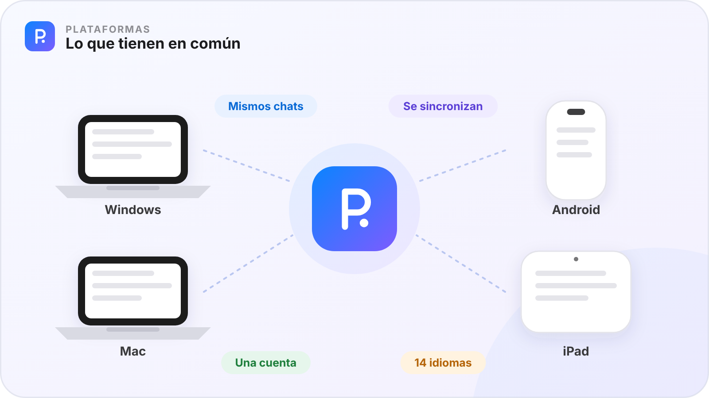
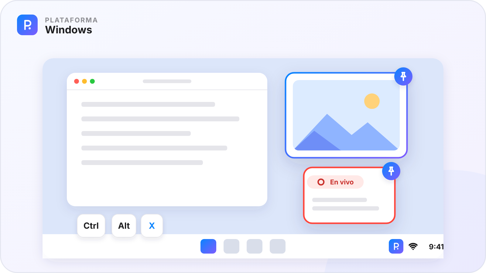
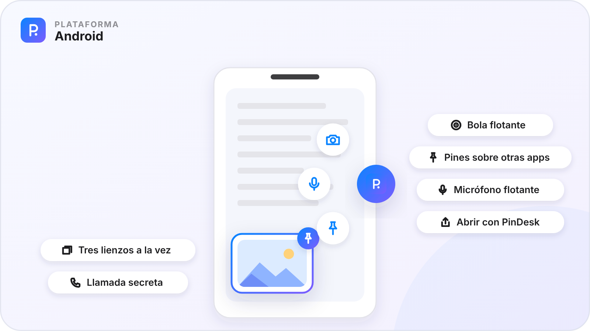
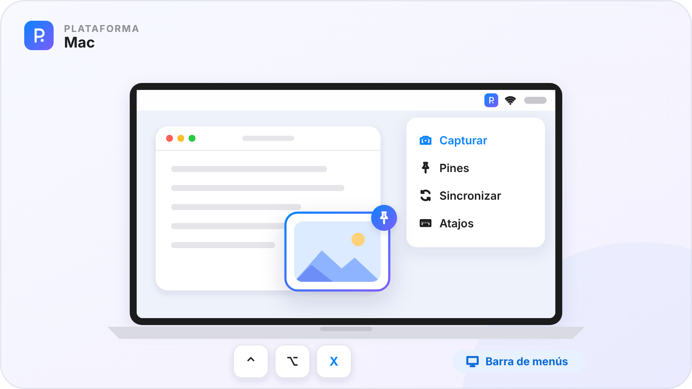
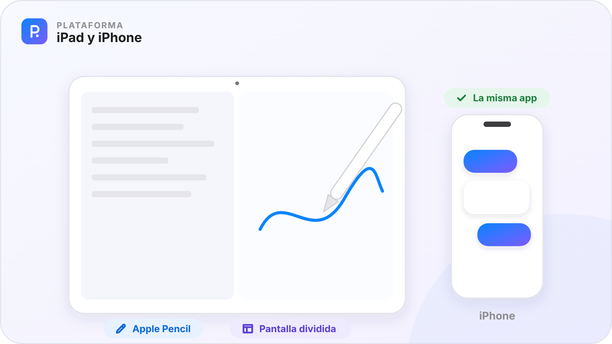

# Plataformas

[🏠 Inicio](Inicio.md) · [Lo común](#lo-que-tienen-en-común-las-4) · [Windows](#windows) · [Android](#android) · [Mac](#mac) · [iPad](#ipad) · [iPhone](#iphone-la-misma-app-que-el-ipad)

PinDesk tiene **cuatro apps**: Windows, Android, Mac e iPad. El **iPhone usa la app del iPad**. Las cuatro hacen lo mismo y se entienden entre ellas; cada una, además, aprovecha lo mejor de su aparato.

| Plataforma | Estado | Requisitos |
|---|---|---|
| 🪟 **Windows** | ✅ Disponible | Windows 10 (21H2 o posterior) y 11, de 64 bits |
| 🤖 **Android** | ⏳ Próximamente | Android 10 o posterior |
| 💻 **Mac** | ⏳ Próximamente | macOS 15 o posterior, Apple Silicon o Intel |
| 📱 **iPad** | ⏳ En desarrollo | iPadOS 18 o posterior |
| 📱 **iPhone** | ⏳ Próximamente | La misma app del iPad |

En todas hace falta una **cuenta de Google** para iniciar sesión. La descarga para Windows está en la [página principal](../README.md#descargar); las demás se publicarán en este mismo repositorio.

---

## Lo que tienen en común las 4

### Lo mismo en todos tus aparatos

- **Los mismos chats por proyecto**, con tus notas, fotos, notas de voz, documentos, lienzos y listas.
- **El mismo lienzo**, con sus figuras, su panel de estilo, sus medidas y su biblioteca de figuras.
- **El mismo lector** de PDF, Word, Excel, PowerPoint y libros, con marcas de texto, marcadores, marcos y lectura en voz alta.
- **Tareas, horario, timeline y lecciones**, con sus avisos.
- **Los mismos planos y modelos 3D** ⭐, la misma grabadora de clases ⭐ y el mismo Asistente ⭐.
- **El mismo aspecto**: claro, oscuro o el tema estrellado, y los **14 idiomas**.

### Se entienden entre ellas

- **Sincronizan** por la Wi‑Fi de casa, gratis, con el mismo código o QR, y por la nube con Pro. Ver [Función 41 · Sincronizar por Wi‑Fi](Parte-6-Conectar.md#función-41--sincronizar-por-wifi) y [Función 42 · Sincronizar por la nube](Parte-6-Conectar.md#función-42--sincronizar-por-la-nube).
- **Juntan, no pisan**: lo que cambias en dos aparatos se une figura a figura, celda a celda y párrafo a párrafo.
- **Lo anotado viaja**: la tinta, los marcadores, los marcos, las marcas de texto, los comentarios y la urgencia de las tareas.
- **El móvil o el iPad hacen de cámara** del PC mientras graba una clase. Ver [Función 43 · El móvil como cámara del PC](Parte-6-Conectar.md#función-43--el-móvil-como-cámara-del-pc).

### Una sola cuenta

- **Una cuenta de Google** en todos, con el plan gratuito para siempre y **30 días de Pro** de prueba.
- **Pro vale para hasta 3 aparatos**, en cualquier combinación. Ver [Función 48 · Cuenta y planes](Parte-7-Tu-cuenta.md#función-48--cuenta-y-planes).
- **Tus datos se quedan en tus aparatos**: la voz a texto y el texto de las capturas se hacen en cada uno. Ver [Función 50 · Privacidad](Parte-7-Tu-cuenta.md#función-50--privacidad).

---

## Windows

**Estado: ✅ disponible.** Windows es la versión de referencia: aquí nace cada función y desde aquí llega a los demás aparatos.

### Instalar, en tres pasos

1. **Descarga** el ZIP: [PinDesk-Windows-x64.zip](https://github.com/1xmanMAX/PINDESK-/releases/latest/download/PinDesk-Windows-x64.zip).
2. **Extráelo**: clic derecho → **Extraer todo…** → **Extraer**.
3. Abre **`Instalar.cmd`** desde la carpeta extraída. Se instala solo para tu usuario, sin permisos de administrador, y crea **PinDesk** y **PinDesk Plantillas** en el menú Inicio.

Si Windows dice «Windows protegió su PC», pulsa **Más información → Ejecutar de todas formas**. La primera vez, deja que PinDesk use la red (**Permitir**). Todo el detalle: [Instalar en Windows](../docs/instalar.md).

### Lo que solo tiene (o tiene mejor) Windows

| | Qué es | Por qué te sirve |
|:-:|---|---|
| 📌 | **Pines encima de cualquier programa** | Con `Ctrl T` dejan pasar el clic y no estorban. [Función 7 · Pines flotantes](Parte-1-Capturar-y-fijar.md#función-7--pines-flotantes) |
| 🔴 | **Pin en vivo** | Copia una zona de la pantalla en tiempo real, y haces clic en ella desde el pin. [Función 8 · Pin en vivo](Parte-1-Capturar-y-fijar.md#función-8--pin-en-vivo) |
| ⌨️ | **Un atajo general: `Ctrl Alt X`** | Capturas desde cualquier sitio; las letras de cada modo salen en pantalla. |
| 🖱️ | **Gestos con Alt** | `Alt` + arrastrar: el botón izquierdo copia, el derecho pinea, el central saca un pin en vivo. `Alt` + doble clic central anota la pantalla. |
| 🗂️ | **La bandeja** | Junto al reloj: capturar, favoritos, ocultar los pines, silenciar los atajos y las últimas capturas. |
| 🚀 | **Flow Launcher** | `p t comprar sellador` apunta la tarea sin abrir PinDesk. [Función 47 · Atajos y lanzadores](Parte-6-Conectar.md#función-47--atajos-y-lanzadores) |
| ⎵ | **Vista rápida** | En el Explorador, elige un archivo y pulsa **Espacio**: se abre en PinDesk al instante. |
| 📂 | **App predeterminada** | Fotos, vídeos, audios y documentos se abren en una ventanita flotante en un instante. |
| 📊 | **Office sin Office** | Word, Excel y PowerPoint se ven al momento. |
| 🗓️ | **PinDesk Plantillas incluida** | [Función 25 · PinDesk Plantillas](Parte-3-Crear.md#función-25--pindesk-plantillas) |
| 🧳 | **Versión portátil** | Llévala en un USB: con un archivo `pindesk.toml` vacío al lado, guarda todo en esa carpeta. |
| ↗️ | **Arrastrar a otras apps** | `Ctrl` + arrastrar un pin lo suelta en WhatsApp, en el correo o en una carpeta. |

### Atajos

| Dónde | Teclas |
|---|---|
| En todo Windows | `Ctrl Alt X` capturar · `Alt` + arrastrar · `Ctrl 2` ocultar o mostrar los pines |
| Al capturar | `Z` `V` `P` `S` `G` `L` `T` modos · `R` repetir la zona · `C` copiar el color · `1`–`5` herramientas · `Enter` copiar · `Ctrl P` pinear · `Ctrl M` al chat · `Ctrl T` texto · `Ctrl S` guardar |
| En un pin | `A` anotar · `Ctrl C` copiar · `Ctrl 0` tamaño original · `Ctrl T` dejar pasar el clic · `Mayús` + rueda transparencia |
| Lector | `F11` pantalla completa · `Esc` vuelve a pin · `Ctrl F` buscar · `Ctrl M` marcador · `A` anotar · `I` marcos · `F5` presentar |
| Tareas | `Ctrl T` tarjetas · `Ctrl K` Kanban · `Ctrl H` horario |
| Plano ⭐ | `M` medir · `I` marcos · `Ctrl P` imprimir · `A` anotar · `F` todo |
| Modelo 3D ⭐ | `C` caja de sección · `L` niveles · `F` todo · `P` planta |

### Conviene saber

- Algunas fotos y vídeos (HEIC, AVIF, JPEG XL, WebM) necesitan una extensión gratuita de Microsoft Store; PinDesk te dice cuál.
- Los Word y PowerPoint antiguos (`.doc`, `.ppt`) se ven con la vista previa de Office y se anotan si tienes Office instalado.
- Para sincronizar por Wi‑Fi, la red debe estar como **red privada** y PinDesk con permiso en el firewall. Lo explica [Instalar en Windows](../docs/instalar.md#mis-aparatos-no-se-encuentran-para-sincronizar-por-wi-fi).
- ¿Tenías **PixPin Max**, el nombre de antes? `Instalar.cmd` la sustituye y tus datos pasan a PinDesk.

---

## Android

**Estado: ⏳ próximamente.** La app ya hace casi todo lo que describe esta wiki y se prepara para publicarse aquí.

### Lo que tiene de especial el móvil

| | Qué es | Por qué te sirve |
|:-:|---|---|
| 🔵 | **Bola flotante** | Encima de cualquier app: un toque abre el menú, doble toque captura y mantenerla oculta o muestra los pines. |
| 📌 | **Pines sobre otras apps** | Fotos, notas, tablas, PDF y mini-apps flotan también fuera de PinDesk. |
| ✨ | **La palabra es el comando** | Copia «timer», «todo», «gastos» o «pizarra» y pinéala: sale la herramienta. [Función 9 · Herramientas flotantes](Parte-1-Capturar-y-fijar.md#función-9--herramientas-flotantes) |
| 🎙️ | **Micrófono flotante** | Graba una nota de voz encima de cualquier app. |
| 📞 | **Llamada secreta** | Una nota de voz con hora suena como una llamada y oyes tu recado por el auricular. |
| 📤 | **Compartir y «Abrir con PinDesk»** | Manda fotos, PDF o Word desde cualquier app, o ábrelos en su visor sin guardarlos. |
| 🃏 | **Tres lienzos a la vez** | Uno al lado del otro, y una baraja para cambiar entre ellos. |
| 🧊 | **Croquis 3D** | Dibuja en el espacio y míralo encima de la cámara. |
| 🔊 | **Leer con la pantalla apagada** | Con mandos en la notificación y en los auriculares. |
| 🌐 | **Llega primero** | La [Función 46 · Comunidad](Parte-6-Conectar.md#función-46--comunidad) y [Función 37 · El asistente que crea archivos](Parte-5-Inteligencia-artificial.md#función-37--el-asistente-que-crea-archivos) ⭐. |

### Gestos

| Dónde | Gesto | Qué hace |
|---|---|---|
| Lienzo | Un dedo · dos dedos | Dibuja · mueve y acerca |
| Lienzo | Apoyar el segundo dedo al dibujar | El trazo se vuelve exacto: círculo, cuadrado, 45° |
| Lienzo | Dos toques con dos dedos · tres dedos de lado | Deshacer · pasar al lienzo vecino |
| Pin | Pellizcar · dos dedos arriba y abajo | Tamaño · transparencia |
| Pin | Mantener pulsado | La barra: dejar pasar el toque, dibujar, guardar, cerrar |

### Permisos

Mostrar sobre otras apps (pines y bola), capturar la pantalla, micrófono (voz y grabar), red local (Wi‑Fi), cámara (fotos y croquis 3D), notificaciones y batería (avisos y que el sistema no cierre los pines).

### Límites (cosas que Android no deja)

- **Sin atajos de teclado globales** ni Flow Launcher, y **sin pin en vivo**.
- **El contenido protegido** (bancos, vídeo con protección) sale en negro.
- Si los pines desaparecen, quita a PinDesk de la **optimización de batería**.
- Comentarios avanzados, por ahora en los planos; PinDesk Plantillas como app aparte, más adelante.

---

## Mac

**Estado: ⏳ próximamente.** La app del Mac es nativa, ya se usa a diario en pruebas y se pone al día con Windows. Falta firmarla con Apple antes de publicarla.

### Lo que tiene de especial el Mac

| | Qué es | Por qué te sirve |
|:-:|---|---|
| 🍏 | **La barra de menús** | PinDesk vive arriba a la derecha: capturar, pines, sincronizar y ajustes a un clic. |
| ⌨️ | **Atajos en todo el Mac** | `⌃⌥X` captura, `⌃2` muestra u oculta los pines y `⌃⌥R` graba la pantalla. Se cambian en Ajustes → Atajos. |
| 📌 | **Pines encima de tus ventanas** | También **pin en vivo** de una zona de la pantalla. |
| 🔤 | **Texto en vivo** | El texto de las capturas y de los pines se elige y se copia. |
| 👀 | **Vista previa rápida** | Los archivos de PinDesk se ven con la barra espaciadora del Finder. |
| 🗣️ | **Siri y Atajos** | Capturar, apuntar en el timeline, mandar al lienzo… |
| ✍️ | **Trackpad y tabletas** | Pellizcar, mover con dos dedos y la presión de una tableta gráfica. |

### Instalar (cuando se publique)

Abre el `.dmg` y arrastra **PinDesk** a **Aplicaciones**. Al capturar por primera vez, da el permiso de **Grabación de pantalla**; para los gestos con `⌥` y el pin en vivo, también **Accesibilidad**. En la app, donde dice `Ctrl` suele ser `⌘`.

### Lo que falta pulir

Los Word y PowerPoint antiguos todavía no se anotan; los comentarios avanzados, PinDesk Plantillas y la cuenta con planes llegan más adelante.

---

## iPad

**Estado: ⏳ en desarrollo.** Ya tiene la mayoría de las funciones y se está probando.

### Lo que tiene de especial el iPad

| | Qué es | Por qué te sirve |
|:-:|---|---|
| ✏️ | **Apple Pencil** | Escribe y anota con presión en el lienzo, los PDF, los Word y los planos. También con el dedo, si quieres. |
| 🪟 | **Varias ventanas** | Un visor en otra ventana con Split View o Stage Manager, y arrastrar del chat a otra app. |
| 📤 | **Compartir** | Recibe desde Fotos, Safari, la captura del sistema o cualquier app. |
| 🗣️ | **Siri y Atajos** | «Grabar nota de voz», «Capturar», «Apuntar en el timeline», «Mandar al lienzo»… |
| 📽️ | **Presentar** | Un PowerPoint a pantalla completa, con vista del orador en una pantalla externa. |
| 🎥 | **Cámara del PC** | Mientras el PC graba una clase, tus fotos entran en su minuto. |

### Gestos

Apple Pencil dibuja; un dedo mueve la hoja (o dibuja, con «Dibujar con el dedo»); dos dedos mueven y acercan; mantener y arrastrar en el texto lo elige para marcarlo. Con un teclado conectado valen `⌘F` y `⌘Z`.

### Límites (cosas que iPadOS no deja)

- **No se capturan otras apps**: haz la captura del sistema y mándala con **Compartir**.
- **Los pines flotan dentro de PinDesk**, sin «dejar pasar el clic» ni pin en vivo.
- **Sincroniza con la app abierta** y al volver a abrirla.
- Sin atajos globales: en su lugar, Siri y Atajos.

### iPhone: la misma app que el iPad

El iPhone usará **la misma app del iPad**, con pantallas para una mano:

- una pantalla principal como la de Android: la lista de chats y, con **Chat · Funciones**, los accesos a grabar, lienzo, tareas, timeline y horario;
- visores sencillos, con una sola barra arriba y el resto en «⋯»;
- el dedo dibuja siempre y dos dedos mueven la hoja;
- tareas en tarjetas y Kanban, y el horario en uno o tres días;
- los mismos límites que el iPad.

Aún falta probarla a fondo en un iPhone de verdad. Se anunciará en este repositorio.

---

[← Parte VII · Tu cuenta](Parte-7-Tu-cuenta.md) &nbsp;·&nbsp; [🏠 Inicio](Inicio.md) &nbsp;·&nbsp; [Volver al inicio →](Inicio.md)

