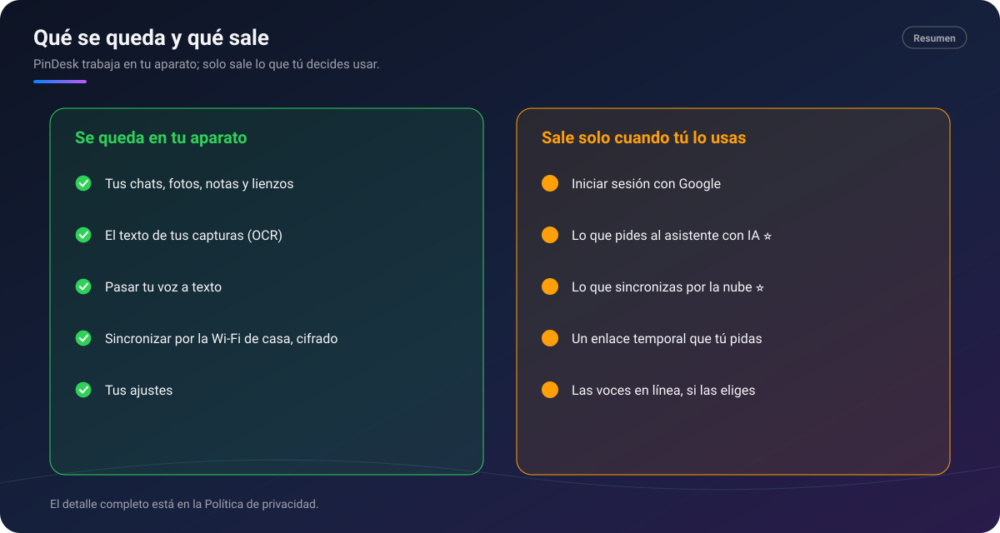

# 🔒 Privacidad

[🏠 Inicio](Inicio.md) · **Para todos los planes**

PinDesk está hecha para trabajar **en tu aparato**. Lo que haces se guarda en tu equipo y solo sale
cuando tú usas algo que lo necesita.

*Resumen: lo que se queda en tu aparato y lo que sale solo cuando lo usas.*

## Qué se queda en tu aparato

- **Tus chats, fotos, notas, lienzos, tareas y lecciones.**
- **El texto de tus capturas** (OCR): se lee en tu aparato.
- **Pasar tu voz a texto**: notas de voz, dictado y grabaciones se transcriben en tu aparato.
- **La sincronización por Wi‑Fi**: va **cifrada**, directamente entre tus aparatos, sin pasar por
  internet.
- **Tus ajustes y tus claves** se guardan protegidos en tu equipo.

## Qué sale, y solo cuando lo usas

- **Iniciar sesión con Google**: para saber quién eres y qué plan tienes.
- ⭐ **El asistente con IA y Jev**: les llega lo que les pides y lo que adjuntas para esa petición.
- ⭐ **La nube**: lo que sincronizas por la nube se guarda allí para llegar a tus otros aparatos y a
  las personas de tus chats compartidos.
- **Google Drive y Google Calendar**, solo si los conectas. Calendar es de **solo lectura**.
- **Un enlace temporal** que tú pidas para compartir algo (cualquiera con el enlace lo abre mientras
  dure; PinDesk te avisa antes).
- **Las voces en línea**, si eliges leer en voz alta con ellas.

## Lo que hacemos y lo que no

- **Sin anuncios.**
- **No vendemos tus datos.**
- **Nunca vemos ni guardamos los datos de tu tarjeta**: los pagos los procesan proveedores
  especializados.
- Si una respuesta de la IA es inadecuada, puedes usar **Reportar respuesta…** en el menú del
  mensaje.
- En **Ajustes → General → Privacidad y datos** tienes la política, qué sale de tu aparato y cómo
  borrar tus datos.

## Fortalezas

- **Lo básico funciona sin internet**: captura, pines, chats, lienzo, lector, tareas y voz a texto.
- **Tu voz no sale de tu aparato** para pasarse a texto.
- **Sincronizar en casa no pasa por ningún servidor**.
- **Tú decides** cada cosa que sale: la IA, la nube y las conexiones con Google son opcionales.

## Preguntas frecuentes

**¿Dónde están mis datos en Windows?** En tu carpeta de usuario. Lo explica
[Instalar en Windows](../docs/instalar.md#desinstalar).

**¿Cómo borro todo?** Lo explica la [Política de privacidad](../docs/privacidad.md#8-conservación-y-borrado).

El texto completo y legal está en la [Política de privacidad](../docs/privacidad.md)
([English](../en/privacy.md)) y en los [Términos de uso](../docs/terminos.md).

---

[← Cuenta y planes](Cuenta-y-planes.md) · [Inicio](Inicio.md)
