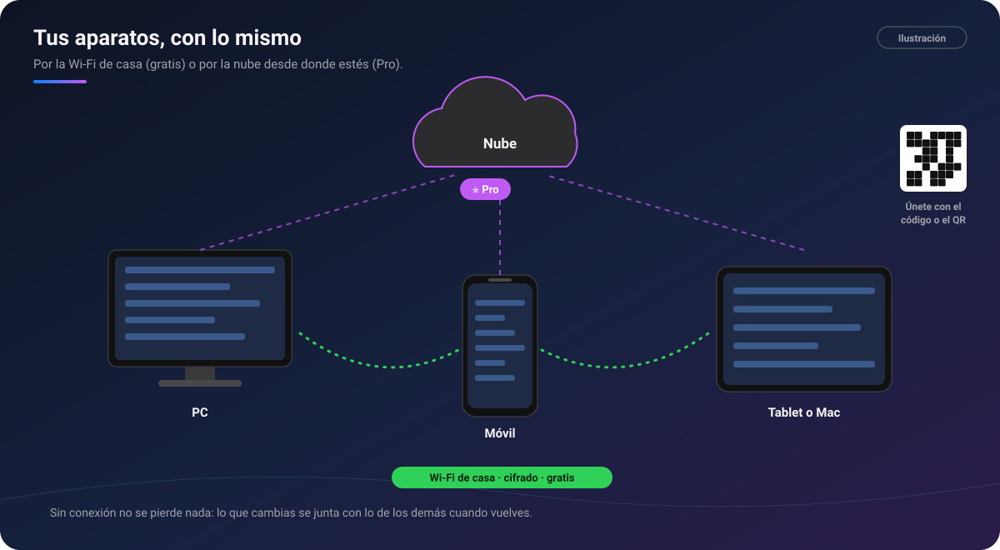

# 🔄 Sincronización

[🏠 Inicio](Inicio.md) · **Plan: 🟢 Gratis** (por Wi‑Fi) · **⭐ Pro** (por la nube)

| | Windows | Android | macOS | iPad | iPhone |
|---|:-:|:-:|:-:|:-:|:-:|
| Por Wi‑Fi, con código o QR | ✅ | ✅ | ✅ | ✅ (con la app abierta) | ⏳ |
| Por la nube ⭐ | ✅ | ✅ | ✅ | ✅ | ⏳ |

Tus aparatos pueden tener **lo mismo** en todos: chats, fotos, tareas, lecciones, lienzos y lo que
anotes en PDF, Word o planos.

*Ilustración: PC, móvil y tablet por la Wi‑Fi de casa, y la nube por encima con Pro.*

## Qué hace

### Por Wi‑Fi (🟢 gratis)

- Los aparatos de tu grupo se **encuentran solos** en la misma red y juntan los cambios de los dos
  lados: si escribes en el móvil y en el PC, se quedan las dos cosas, y nada se duplica.
- Todo viaja **cifrado** directamente entre tus aparatos, sin pasar por internet.
- **En segundo plano**, siempre que el aparato lo permite.
- **Enviar archivos sueltos** a un aparato del grupo: entran en el chat que tenga abierto.
- **Enviar una sola vez** a alguien con un código de seis cifras y un QR.

### Por la nube

**⭐ Pro**

- Tus aparatos se mantienen al día **aunque no estéis en la misma Wi‑Fi**.
- Los **chats compartidos** pueden ir por la nube, para que cada persona los reciba desde donde
  esté. Al crear uno eliges **Red local** o **Nube**.
- Se sube **solo lo que cambia**: si dibujas una raya en un plano, viaja esa raya, no el plano
  entero.
- Una **nubecita** en el chat dice cómo va: azul subiendo, verde al día, gris sin red.

### Sin conexión

- En los documentos de un chat de la nube, el botón **En línea / Sin conexión** te deja trabajar sin
  red. Al salir, PinDesk te pregunta si quieres quedarte con lo anotado sin conexión o descartarlo.
- Por Wi‑Fi, lo que cambias sin red se junta con lo de los demás la próxima vez que os veáis.

## Cómo se usa, paso a paso

1. En un aparato, abre **Sincronizar** y crea tu grupo: sale un **código** y un **QR**.
2. En el otro, **Únete con el código** o **lee el QR con la cámara** (vale cualquier cámara: el
   enlace abre PinDesk y empareja).
3. Listo. El botón de sincronizar **gira** mientras trabaja y se marca en **rojo** si la última vez
   falló.
4. ⭐ Para la nube, activa Pro con tu cuenta y elige **Nube** en los chats que quieras.

## Fortalezas

- **Gratis y sin servidores** en casa: tus cosas van de tu móvil a tu PC sin pasar por nadie.
- **Junta, no pisa**: los lienzos figura por figura, las tablas celda por celda, las notas párrafo a
  párrafo. Lo borrado no resucita.
- **Copias de seguridad antes de recibir**, y antes de borrar algo se pregunta.
- **Emparejar sin escribir direcciones**: el código basta, o el QR.
- **La nube sube lo mínimo**: rápido incluso con planos y PDF grandes.
- **Viaja todo lo anotado**: tinta, marcadores, marcos, marcas de texto, comentarios y urgencias.

## Consejos

- En Windows, la red debe estar como **red privada** y PinDesk con permiso en el firewall.
- Las redes de invitados suelen aislar a los aparatos: usa la Wi‑Fi principal.

## Preguntas frecuentes

**Mis aparatos no se encuentran.** Comprueba que están en la misma Wi‑Fi y, en Windows, el permiso de
red. Lo explica [Instalar en Windows](../docs/instalar.md#mis-aparatos-no-se-encuentran-para-sincronizar-por-wi-fi).

**¿Si Pro vence, se para todo?** No. La nube se pausa, pero **la Wi‑Fi sigue funcionando**, y al
renovar la nube se pone al día sola.

**En el iPad no se sincroniza en segundo plano.** iPadOS corta la red de las apps en segundo plano:
se sincroniza con la app abierta y al volver a abrirla.

---

[← Jev](Jev.md) · [Inicio](Inicio.md) · Siguiente: [PinDesk Plantillas →](PinDesk-Plantillas.md)
