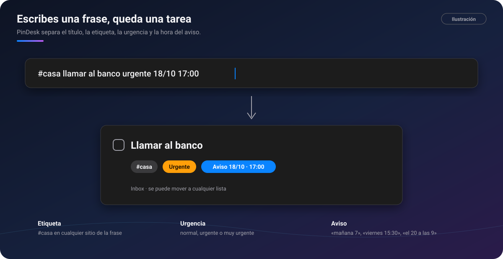
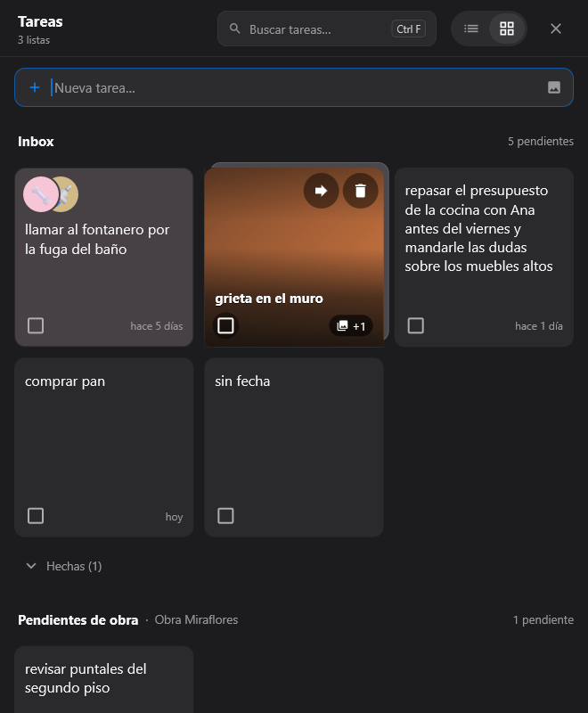

# ✅ Tareas

[🏠 Inicio](Inicio.md) · **Plan: 🟢 Gratis** (urgencia propuesta por Jev: ⭐ Pro)

| Windows | Android | macOS | iPad | iPhone |
|:-:|:-:|:-:|:-:|:-:|
| ✅ | ✅ | ✅ | ✅ | ⏳ |

**Tareas** reúne en una sola ventana las listas de **todos tus proyectos**, y entiende lo que
escribes: la etiqueta, la urgencia y la hora del aviso salen solas de la frase.

*Ilustración: «#casa llamar al banco urgente 18/10 17:00» queda con su título, etiqueta, urgencia y
aviso.*

## Qué hace

- **Tres vistas**: **tarjetas** (`Ctrl T`), **Kanban** (`Ctrl K`) y el **horario** de la semana
  (`Ctrl H`).
- **Inbox**: lo que apuntas rápido entra aquí, y **Mover a…** lo lleva a su lista.
- **Se entiende lo que escribes**:
  - **Etiqueta**: `#casa`, en cualquier parte de la frase.
  - **Urgencia**: normal, **urgente** o **muy urgente**. Las palabras que la marcan («urgente»,
    «importante», «!», «!!»…) se cambian en **Ajustes → Tareas**.
  - **Aviso**: «18/10 17:00», «18 oct 5pm», «el 20 a las 9», «mañana 7», «viernes 15:30»… o con el
    reloj de la caja de apuntar.
- **Fotos en las tareas**: pega una imagen con `Ctrl V`; en las tarjetas la foto es el fondo.
- **Pin de una tarea**: una tarea con hora se queda flotando, con un botón «¿Por qué no ahora?» para
  apuntar el motivo.
- **Lo tachado se queda quieto**: mientras miras la lista, nada salta de sitio.
- **Exportar una lista** a PDF, imagen, página web, Word, Markdown o texto.
- ⭐ **Jev propone la urgencia** de cada tarea leyendo lo que dice, sin que escribas «urgente». Ver
  [Jev](Jev.md).

*Captura de PinDesk para Windows: la vista de tarjetas.*

## Cómo se usa, paso a paso

1. Abre **Funciones → Tareas** (o el atajo de la bandeja, o `p t …` en
   [Flow Launcher](Flow-Launcher-y-atajos.md)).
2. Escribe la tarea en una sola frase, por ejemplo «comprar sellador #obra mañana 9». Mientras
   escribes ves cómo quedará: «Urgente · #obra · ⏰ …».
3. Pulsa **Intro**. Entra en el Inbox o en la lista que elegiste con el libro de la caja.
4. **Arrastra** una tarjeta a otra columna del Kanban para cambiarla de lista.
5. Táchala al terminarla. Si tenía aviso, sonará a su hora en tus aparatos.

## Fortalezas

- **Apuntar cuesta una frase**: sin formularios, sin menús de fecha.
- **Entiende cómo hablas**: fechas en lenguaje normal, sin año (es este año) y, si el día ya pasó,
  el siguiente.
- **Todas tus listas juntas**: las de cada chat, las de cada [asignatura](Asignaturas-y-horario.md)
  y el Inbox, en tarjetas o en columnas.
- **Fotos que explican la tarea**, no solo texto.
- **El pin de la tarea** te la pone delante a su hora, y el «¿Por qué no ahora?» te ayuda a ser
  honesto con lo que pospones.
- **Viaja a tus aparatos** con su urgencia y su aviso.

## Consejos

- Usa `!` y `!!` como atajo de urgente y muy urgente.
- Pon la fecha en el título de una lista («Para el lunes») y sus tareas la tienen en cuenta.
- En Android, el **widget de tareas** te las enseña en la pantalla de inicio.

## Preguntas frecuentes

**¿Puedo cambiar las palabras que marcan la urgencia?** Sí, en **Ajustes → Tareas**.

**¿Jev decide por mí?** No: propone una urgencia, y tú la cambias cuando quieras.

---

[← Lienzo](Lienzo.md) · [Inicio](Inicio.md) · Siguiente: [Asignaturas y horario →](Asignaturas-y-horario.md)
