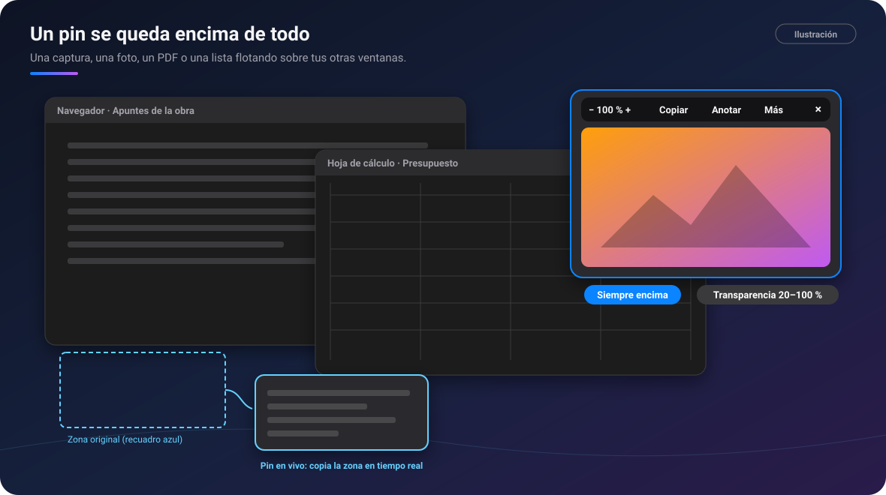
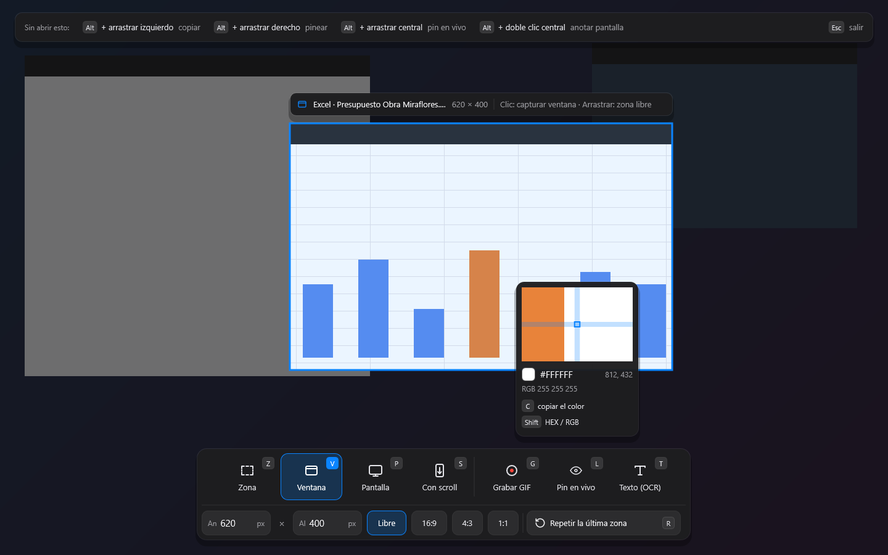

# PinDesk para Windows

[🏠 Inicio](Inicio.md) · Plataformas: **Windows** · [Android](Android.md) · [macOS](macOS.md) ·
[iPad](iPad.md) · [iPhone](iPhone.md)

**Estado: ✅ disponible.** Windows es la versión de referencia de PinDesk: aquí nace cada función y
desde aquí llega a los demás aparatos.

*Ilustración: un pin se queda siempre encima, aunque cambies de ventana.*

## Requisitos

- **Windows 10 versión 21H2 o posterior, o Windows 11**, de 64 bits.
- Una **cuenta de Google** para iniciar sesión (con eso ya tienes el plan gratuito).
- Internet para iniciar sesión, para lo que es de Pro en la nube y para bajar los modelos de voz
  opcionales. Todo lo demás funciona **sin conexión**.
- No hace falta un equipo potente: PinDesk va fluida en ordenadores modestos, con 4 GB de memoria.

## Instalar, en tres pasos

1. **Descarga** el ZIP: [PinDesk-Windows-x64.zip](https://github.com/1xmanMAX/PINDESK-/releases/latest/download/PinDesk-Windows-x64.zip).
2. **Extráelo**: clic derecho → **Extraer todo…** → **Extraer**.
3. Abre **`Instalar.cmd`** desde la carpeta extraída. PinDesk se instala solo para tu usuario (no
   pide permisos de administrador), crea los accesos **PinDesk** y **PinDesk Plantillas** en el
   menú Inicio y se abre.

Si Windows dice «Windows protegió su PC», pulsa **Más información → Ejecutar de todas formas**. La
primera vez, deja que PinDesk use la red (**Permitir**), para que tus otros aparatos lo encuentren.
Todos los detalles, actualizar y desinstalar: [Instalar en Windows](../docs/instalar.md).

## Lo que solo tiene (o tiene mejor) Windows

| | Qué es | Por qué mola |
|:-:|---|---|
| 📌 | **Pines siempre encima** de cualquier programa | Una foto, un PDF o una lista se quedan a la vista mientras trabajas en otra cosa. Con `Ctrl T` dejan pasar el clic y no estorban. |
| 🔴 | **Pin en vivo** | Una ventanita copia una zona de la pantalla en tiempo real, y puedes hacer clic en esa zona desde el propio pin. |
| ⌨️ | **Un atajo general**: `Ctrl Alt X` | Capturas desde cualquier sitio, y las letras de cada modo salen en pantalla: no hay que memorizar nada. |
| 🖱️ | **Gestos con Alt** | `Alt` + arrastrar con el botón izquierdo copia una zona, con el derecho la pinea y con el central saca un pin en vivo. |
| 🗂️ | **La bandeja** | Un clic en el icono junto al reloj abre un centro de control: capturar, favoritos, ocultar los pines, silenciar los atajos y las últimas capturas. |
| 🚀 | **Flow Launcher** | Escribe `p t comprar sellador` y la tarea queda apuntada sin abrir PinDesk. Ver [Flow Launcher y atajos](Flow-Launcher-y-atajos.md). |
| ⎵ | **Vista rápida** | En el Explorador, elige un archivo y pulsa **Espacio**: se abre en PinDesk al instante. |
| 📂 | **App predeterminada** | Fotos, vídeos, audios y documentos se abren en una ventanita flotante en unos 200 ms. |
| 📊 | **Office sin Office** | Word, Excel y PowerPoint se ven al momento, aunque no tengas Office. |
| 🗓️ | **PinDesk Plantillas** | La app de plantillas viene incluida. Ver [PinDesk Plantillas](PinDesk-Plantillas.md). |
| 🧳 | **Versión portátil** | Llévala en un USB: con un archivo `pindesk.toml` vacío al lado, guarda todo en esa carpeta. |
| ↗️ | **Arrastrar a otras apps** | `Ctrl` + arrastrar un pin lo suelta en WhatsApp, en el correo o en una carpeta. |

*Captura de PinDesk para Windows: al capturar, la barra de abajo enseña cada modo con su letra.*

## Atajos y gestos

Solo hay **un atajo general** (capturar) y los gestos con Alt. El resto son letras que valen
**dentro de la ventana abierta**, y cada botón enseña la suya.

| Dónde | Teclas |
|---|---|
| En todo Windows | `Ctrl Alt X` capturar · `Alt` + arrastrar (izquierdo copia, derecho pinea, central pin en vivo) · `Alt` + doble clic central: anotar la pantalla · `Ctrl 2` ocultar o mostrar los pines |
| Al capturar | `Z` `V` `P` `S` `G` `L` `T` modos · `R` repetir la zona · `C` copiar el color · `1`–`5` herramientas · `Enter` copiar · `Ctrl P` pinear · `Ctrl M` al chat · `Ctrl T` texto · `Ctrl S` guardar |
| En un pin | `A` anotar · `Ctrl C` copiar · `Ctrl 0` tamaño original · `Ctrl T` dejar pasar el clic · `Mayús` + rueda transparencia |
| Lector | `F11` pantalla completa · `Esc` vuelve a pin · `Ctrl F` buscar · `Ctrl M` marcador · `A` anotar · `I` marcos |
| Tareas | `Ctrl T` tarjetas · `Ctrl K` Kanban · `Ctrl H` horario |

La lista completa está en [Flow Launcher y atajos](Flow-Launcher-y-atajos.md#atajos-de-teclado).

## Límites y cosas que conviene saber

- Algunas fotos y vídeos (HEIC, AVIF, JPEG XL, WebM) necesitan una extensión gratuita de Microsoft
  Store. PinDesk te dice cuál falta.
- Los Word y PowerPoint antiguos (`.doc`, `.ppt`) se ven con la vista previa de Office. Para
  anotarlos, PinDesk los convierte una vez **si tienes Office instalado**.
- Los modelos de Revit se abren desde **Revit 2023**; los de 2022 o anteriores, todavía no.
- La instalación del plugin de Flow Launcher desde el ZIP llega **próximamente**.
- Para sincronizar por Wi‑Fi, tu red debe estar como **red privada** y PinDesk debe tener permiso
  en el firewall. Lo explica [Instalar en Windows](../docs/instalar.md#mis-aparatos-no-se-encuentran-para-sincronizar-por-wi-fi).

## Preguntas frecuentes

**¿Funciona en Windows de 32 bits o en Windows 7?** No: hace falta Windows 10 (21H2) o 11 de 64 bits.

**¿Se borran mis datos al actualizar?** No. `Instalar.cmd` cambia el programa y deja tus chats,
tareas, capturas y ajustes como estaban.

**¿Tenía PixPin Max, el nombre de antes?** `Instalar.cmd` la sustituye y tus datos pasan a PinDesk
la primera vez que se abre.

---

[← Inicio](Inicio.md) · Siguiente: [Android →](Android.md)
