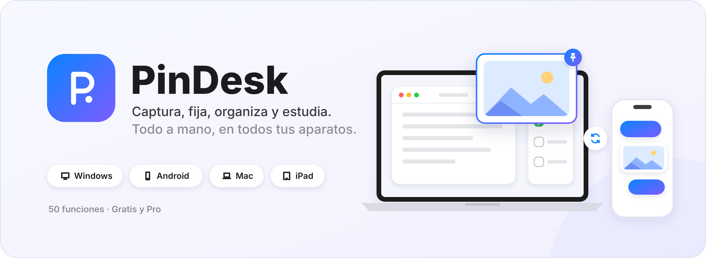

### [🏠 Inicio](Inicio.md)

**Las funciones**

- [**I** · Capturar y fijar](Parte-1-Capturar-y-fijar.md) 1–9
- [**II** · Organizar](Parte-2-Organizar.md) 10–18
- [**III** · Crear](Parte-3-Crear.md) 19–27
- [**IV** · Leer, escuchar y estudiar](Parte-4-Leer-escuchar-y-estudiar.md) 28–34
- [**V** · Inteligencia artificial](Parte-5-Inteligencia-artificial.md) 35–40
- [**VI** · Conectar](Parte-6-Conectar.md) 41–47
- [**VII** · Tu cuenta](Parte-7-Tu-cuenta.md) 48–50

**Los aparatos**

- [Lo que tienen en común](Plataformas.md#lo-que-tienen-en-común-las-4)
- [🪟 Windows](Plataformas.md#windows)
- [🤖 Android](Plataformas.md#android)
- [💻 Mac](Plataformas.md#mac)
- [📱 iPad e iPhone](Plataformas.md#ipad)

---

🇬🇧 [English summary](en/Home.md)
