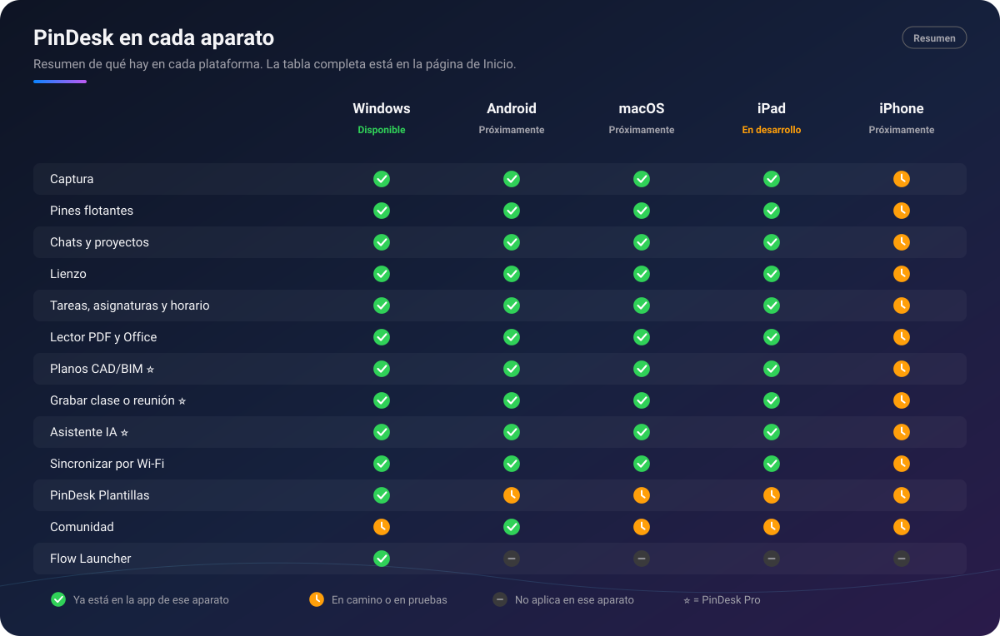

# PinDesk wiki (English summary)

[← Back to the repository](../../README.md) · [Wiki en español](../Inicio.md)

The full wiki is in Spanish. This page sums it up in English.

## What is PinDesk?

**PinDesk** keeps everything you see, write down and study within reach:

- **Capture** the screen and keep anything **floating on top** of your windows: a photo, a video, a
  PDF or a to‑do list.
- **Save everything in chats**, one per project, like a messaging app: notes, photos, voice notes,
  documents and canvases, each with its date.
- **Draw, measure and annotate** on top of anything: screenshots, PDFs, Word files, CAD drawings or a
  blank canvas.
- **Organise your day**: tasks that understand what you type, a class timetable that "calls" you
  before each class, a timeline of your day and lessons learned with spaced review.
- **Keep your devices in sync** over your home Wi‑Fi for free, and through the cloud with Pro.

*Summary chart (labels in Spanish): ✅ already in that device's app, ⏳ on its way, — not applicable.*

## Platforms

| Platform | Status | Page (Spanish) |
|---|---|---|
| 🪟 Windows 10 (21H2+) and 11 | ✅ Available | [Windows](../Windows.md) |
| 🤖 Android 10+ | ⏳ Coming soon | [Android](../Android.md) |
| 💻 macOS 15+ | ⏳ Coming soon | [macOS](../macOS.md) |
| 📱 iPadOS 18+ | ⏳ In development | [iPad](../iPad.md) |
| 📱 iPhone | ⏳ Coming soon (same app as the iPad) | [iPhone](../iPhone.md) |

What is special on each one:

- **Windows**: pins that stay on top of every program, a live pin that mirrors part of the screen, a
  single global shortcut (`Ctrl Alt X`), Alt gestures, the tray control centre, Flow Launcher, Quick
  View with Space in File Explorer, Office files without Office, and PinDesk Templates included.
- **Android**: a floating bubble, pins over other apps, camera to chat, share sheet and "Open with",
  a floating microphone, the "secret call" reminder, up to three canvases side by side and touch
  gestures. The Community gallery and the assistant that creates files arrive here first.
- **macOS**: menu bar app, system‑wide shortcuts (`⌃⌥X`), Live Text, Quick Look, Siri and Shortcuts.
- **iPad**: Apple Pencil, several windows, Share extension, Siri and Shortcuts. iPadOS does not allow
  capturing other apps or floating over them.
- **iPhone**: being prepared on the same app as the iPad, with one‑hand screens.

## Free and Pro

- **🟢 Free** includes almost everything, with no expiry date, including **Wi‑Fi sync** and
  **PinDesk Templates without AI**.
- **⭐ Pro** adds **cloud sync**, **AI** (the Assistant, Jev task urgency, transcription summaries and
  Templates with AI) and **pro tools** (CAD/BIM drawings, advanced comments with a mini chat,
  class and meeting recording, and interactive HTML export).
- Every new Google account gets **30 days of Pro** to try it.
- Pro comes as **monthly**, **yearly** or **lifetime**, for **up to 3 devices**. **Prices: coming
  soon.**
- Some features open gradually; "available soon" in the app means they arrive in a future update.

## Feature pages (Spanish)

[Capture](../Captura.md) · [Floating pins](../Pines-flotantes.md) ·
[Chats and projects](../Chats-y-proyectos.md) · [Canvas](../Lienzo.md) · [Tasks](../Tareas.md) ·
[Subjects and timetable](../Asignaturas-y-horario.md) · [Lessons and study](../Lecciones-y-estudio.md) ·
[PDF, Office and EPUB reader](../Lector-de-documentos.md) · [CAD and BIM](../Planos-CAD-BIM.md) ⭐ ·
[Advanced comments](../Comentarios-avanzados.md) ⭐ ·
[Recording classes and meetings](../Grabar-clases-y-reuniones.md) ⭐ ·
[AI assistant](../Asistente-IA.md) ⭐ · [Jev](../Jev.md) ⭐ · [Sync](../Sincronizacion.md) ·
[PinDesk Templates](../PinDesk-Plantillas.md) · [Community](../Comunidad.md) ·
[Export and share](../Exportar-y-compartir.md) · [Music and karaoke](../Musica-y-karaoke.md) ·
[Flow Launcher and shortcuts](../Flow-Launcher-y-atajos.md) · [Languages (14)](../Idiomas.md) ·
[Account and plans](../Cuenta-y-planes.md) · [Privacy](../Privacidad.md)

## More in English

- [README in English](../../en/README.md)
- [Privacy policy](../../en/privacy.md) · [Terms of use](../../en/terms.md)

Questions or ideas? Open an [issue](https://github.com/1xmanMAX/PINDESK-/issues/new/choose), or write
to **max.antony.8.5.1@gmail.com** for private matters.
