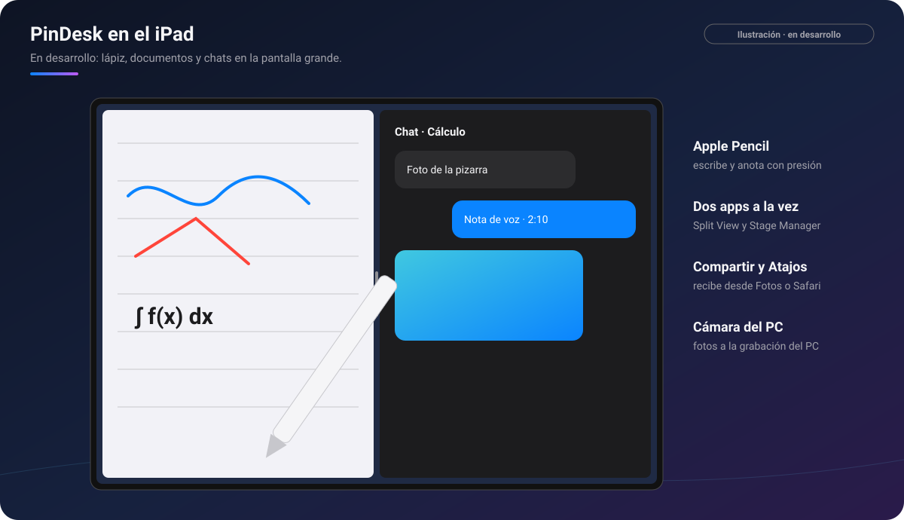

# PinDesk para iPad

[🏠 Inicio](Inicio.md) · Plataformas: [Windows](Windows.md) · [Android](Android.md) ·
[macOS](macOS.md) · **iPad** · [iPhone](iPhone.md)

**Estado: ⏳ en desarrollo.** La app del iPad ya tiene la mayoría de las funciones y se está probando.
Todavía no hay descarga pública: se anunciará en este repositorio.

*Ilustración: un apunte a mano con el Apple Pencil y el chat de la asignatura al lado.*

## Requisitos

- **iPadOS 18 o posterior.**
- Una **cuenta de Google** para iniciar sesión.
- Funciona con el dedo; con un **Apple Pencil** se aprovecha mucho más.

## Lo que tiene de especial el iPad

| | Qué es | Por qué mola |
|:-:|---|---|
| ✏️ | **Apple Pencil** | Escribe y anota con presión en el lienzo, los PDF, los Word y los planos. Si quieres, también con el dedo. |
| 🪟 | **Varias ventanas** | Abre un visor en otra ventana con Split View o Stage Manager, y arrastra cosas del chat a otra app. |
| 📤 | **Compartir** | Recibe desde Fotos, Safari, la captura del sistema o cualquier app. |
| 🗣️ | **Siri y Atajos** | «Grabar nota de voz», «Capturar», «Apuntar en el timeline», «Mandar al lienzo»… |
| 📽️ | **Presentar** | Un PowerPoint a pantalla completa, con transiciones y vista del orador en una pantalla externa. |
| 🎥 | **El iPad como cámara del PC** | Mientras el PC graba una clase, tus fotos entran en su minuto. |
| 📐 | **Planos y 3D con los dedos** | Mide, marca, anota y corta modelos con la caja de sección. ⭐ |
| 🌙 | **Claro, oscuro y cosmos** | El mismo aspecto que en el resto de aparatos, con el tema estrellado del móvil. |

## Gestos

| Gesto | Qué hace |
|---|---|
| Apple Pencil | Dibuja y escribe. |
| Un dedo (con Pencil) | Mueve la hoja; activa «Dibujar con el dedo» para pintar con él. |
| Dos dedos | Mover y acercar. |
| Mantener y arrastrar en el texto | Elegir un trozo para [marcarlo](Lector-de-documentos.md#marcar-el-texto). |
| Teclado | Con un teclado conectado valen atajos como `⌘F` buscar o `⌘Z` deshacer. |

## Límites (cosas que iPadOS no deja)

- **No se pueden capturar otras apps**: haz la captura del sistema y mándala a PinDesk con
  **Compartir**. Dentro de PinDesk sí se recorta, se anota y se saca el texto.
- **Los pines flotan dentro de PinDesk**, no encima de otras apps, y no hay «dejar pasar el clic»
  ni pin en vivo.
- **Sincroniza mientras la app está abierta** (y al volver a abrirla): iPadOS corta la red de las
  apps en segundo plano.
- Sin [Flow Launcher](Flow-Launcher-y-atajos.md) ni atajos globales; en su lugar, Atajos y Siri.
- Los Word y PowerPoint antiguos (`.doc`, `.ppt`) no se abren en el visor propio.
- [Comentarios avanzados](Comentarios-avanzados.md), [PinDesk Plantillas](PinDesk-Plantillas.md) y
  la [cuenta con planes](Cuenta-y-planes.md) llegan más adelante.

## Preguntas frecuentes

**¿Cuándo sale?** Aún no hay fecha. Se anunciará en este repositorio.

**¿Se sincroniza con mi PC?** Sí, por la Wi‑Fi de casa, con el mismo código o QR que tus otros
aparatos.

---

[← macOS](macOS.md) · [Inicio](Inicio.md) · Siguiente: [iPhone →](iPhone.md)
