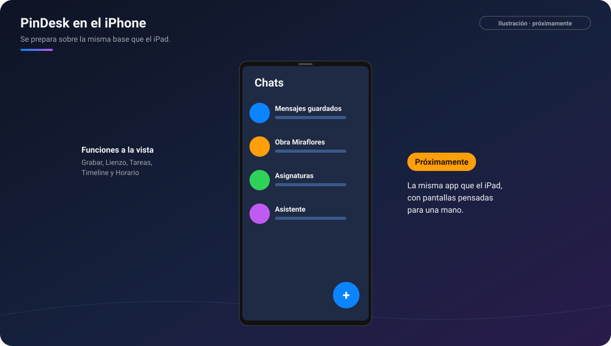

# PinDesk para iPhone

[🏠 Inicio](Inicio.md) · Plataformas: [Windows](Windows.md) · [Android](Android.md) ·
[macOS](macOS.md) · [iPad](iPad.md) · **iPhone**

**Estado: ⏳ próximamente.** PinDesk para iPhone se prepara **sobre la misma app que el iPad**: una
sola app para los dos, con pantallas adaptadas a una mano. Todavía falta probarla a fondo en un
iPhone de verdad, así que en la tabla de [Inicio](Inicio.md) sus funciones salen como «en camino».

*Ilustración: la lista de chats en el iPhone.*

## Qué se está preparando

Lo mismo que el [iPad](iPad.md), con su forma de usarlo en una pantalla pequeña:

- **Una pantalla principal como la de Android**: la lista de chats y, con el interruptor
  **Chat · Funciones**, los mosaicos de Grabar reunión, Nuevo lienzo, Tareas, Timeline y Horario.
  Cada cosa se abre encima, y «‹» vuelve atrás.
- **Visores sencillos**: una sola barra arriba con el nombre del archivo y lo esencial, y el resto
  en «⋯».
- **El dedo dibuja siempre** en el lienzo y dos dedos mueven la hoja.
- **Tareas en tarjetas y en Kanban**, también de lado, y el horario en uno o tres días.
- **Marcar el texto** mientras lees, con la barrita abajo, en dos filas.
- **Sincronizar** por la Wi‑Fi de casa con tus otros aparatos, con el código o el QR.
- **Claro y oscuro** según el teléfono.

## Requisitos previstos

- Un iPhone con la versión de iOS que pida la app del iPad (iOS 18 o posterior).
- Una cuenta de Google para iniciar sesión.

## Límites previstos

Los de iOS, iguales que en el iPad: no se capturan otras apps (se manda la captura del sistema con
**Compartir**), los pines flotan dentro de PinDesk y la sincronización va con la app abierta.

## Preguntas frecuentes

**¿Será otra app distinta de la del iPad?** No, la misma app sirve para los dos.

**¿Cuándo sale?** Aún no hay fecha. Se anunciará en este repositorio.

---

[← iPad](iPad.md) · [Inicio](Inicio.md) · Siguiente: [Captura →](Captura.md)
