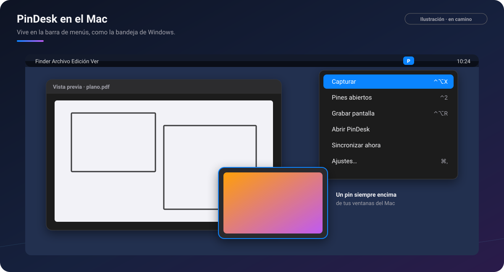

# PinDesk para Mac

[🏠 Inicio](Inicio.md) · Plataformas: [Windows](Windows.md) · [Android](Android.md) · **macOS** ·
[iPad](iPad.md) · [iPhone](iPhone.md)

**Estado: ⏳ próximamente.** La app del Mac es nativa, ya se usa a diario en pruebas y se va
poniendo al día con Windows. Falta pulirla y firmarla con Apple antes de publicarla aquí.

*Ilustración: el menú de PinDesk en la barra de menús y un pin flotando sobre otra ventana.*

## Requisitos

- **macOS 15 o posterior**, en Mac con **Apple Silicon o Intel**.
- Una **cuenta de Google** para iniciar sesión.

## Instalar (cuando se publique)

1. Descarga el instalador `.dmg` desde este repositorio, ábrelo y arrastra **PinDesk** a
   **Aplicaciones**.
2. La primera vez, macOS puede pedir que lo confirmes en **Ajustes del Sistema → Privacidad y
   seguridad → Abrir igualmente**, hasta que la app vaya firmada.
3. Al capturar por primera vez, da el permiso de **Grabación de pantalla** y vuelve a abrir PinDesk.
   Para los gestos con Opción y manejar un pin en vivo a distancia, también **Accesibilidad**.

## Lo que tiene de especial el Mac

| | Qué es | Por qué mola |
|:-:|---|---|
| 🍏 | **La barra de menús** | PinDesk vive arriba a la derecha, como la bandeja de Windows: capturar, pines, sincronizar y ajustes a un clic. |
| ⌨️ | **Atajos en todo el Mac** | `⌃⌥X` captura desde cualquier app; los atajos se cambian en Ajustes → Atajos. |
| 📌 | **Pines encima de tus ventanas** | Imagen, PDF, vídeo, notas y mini-apps; también **pin en vivo** de una zona de la pantalla. |
| 🔤 | **Texto en vivo** | El texto de las capturas y de los pines se elige y se copia, con el reconocimiento del Mac. |
| 👀 | **Vista previa rápida** | Los archivos de PinDesk se ven con la barra espaciadora del Finder. |
| 🗣️ | **Siri y Atajos** | Acciones de PinDesk para tus atajos: capturar, apuntar, mandar al lienzo… |
| 📤 | **Compartir** | Manda a PinDesk desde Safari, Fotos o el Finder. |
| ✍️ | **Trackpad y tabletas** | Pellizcar, mover con dos dedos y la presión de una tableta gráfica en el lienzo. |
| 🖥️ | **Grabar la pantalla** | `⌃⌥R` graba una zona, con el sonido del Mac si quieres. |

## Atajos

| Dónde | Teclas |
|---|---|
| En todo el Mac | `⌃⌥X` capturar · `⌃2` mostrar u ocultar los pines · `⌃⌥R` grabar la pantalla · gestos con `⌥` (apagados de fábrica) |
| Al capturar | `Z` `V` `P` `S` `G` `L` `T` modos · `R` repetir la zona · `C` copiar el color · `1`–`5` herramientas |
| En la app | `⌘,` ajustes · `⌘F` buscar · `⌘Z` / `⇧⌘Z` deshacer y rehacer · `⎋` sale de la pantalla completa o cierra |

## Límites y lo que falta pulir

- La app aún **no está firmada** con Apple: macOS pide confirmación la primera vez.
- Los **Word y PowerPoint antiguos** (`.doc`, `.ppt`) todavía no se anotan en el visor propio.
- [Comentarios avanzados](Comentarios-avanzados.md) y [PinDesk Plantillas](PinDesk-Plantillas.md)
  llegan más adelante.
- [Flow Launcher](Flow-Launcher-y-atajos.md) es de Windows; en el Mac tienes la barra de menús,
  los atajos y Siri.
- La [cuenta y los planes](Cuenta-y-planes.md) se están preparando para el Mac.

## Preguntas frecuentes

**¿Se sincroniza con Windows y Android?** Sí, por la misma Wi‑Fi y con el mismo código: lo que
haces en un aparato aparece en los demás. Ver [Sincronización](Sincronizacion.md).

**¿Funciona en un Mac con Intel?** Sí, con macOS 15 o posterior.

---

[← Android](Android.md) · [Inicio](Inicio.md) · Siguiente: [iPad →](iPad.md)
